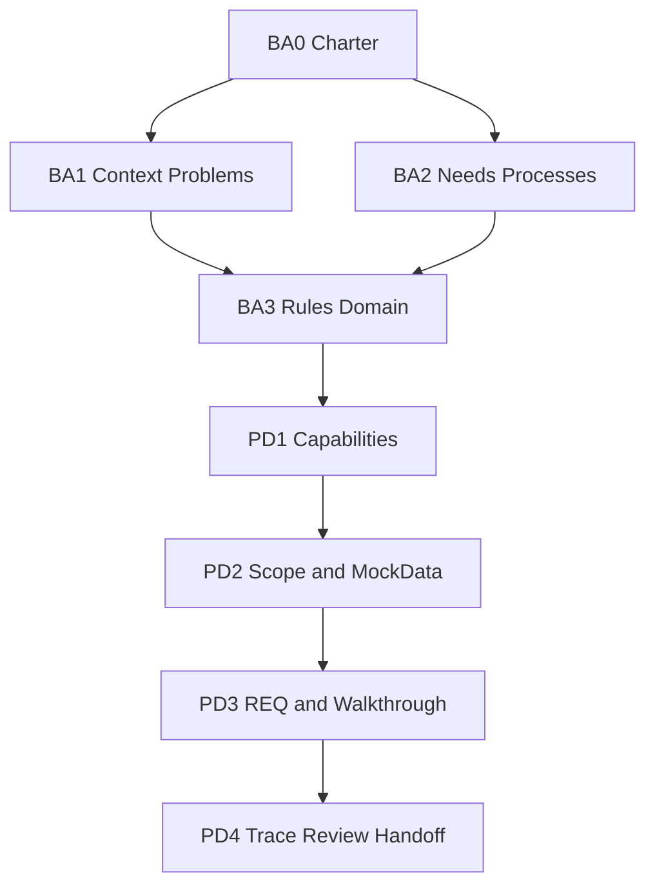

# Business Analysis & Product Definition — L2 Plan

## 1. Текущее состояние и входы

**Готово:** Docs Engineering; Discovery L2 **completed** (`9820c84`); PO: HIP-001/006/008; `npm run test:docs` зелёный; `openspec/**` пуст (seed only).

**SoT входы (не переписывать без причины):**

| Область | Пути |
|---------|------|
| Discovery | [`docs/01-discovery/`](docs/01-discovery/) — summary, context, domain, stakeholders, processes, information-concepts, scenarios, boundaries, MoSCoW candidates, registers, HIP |
| Handoff | [`docs/07-delivery/handoffs/2026-10-30-discovery.md`](docs/07-delivery/handoffs/2026-10-30-discovery.md) |
| Product/tech | [`vision-and-scope.md`](docs/03-product/vision-and-scope.md), [`demo-v1-architecture.md`](docs/03-product/demo-v1-architecture.md), [`persistence-transition.md`](docs/03-product/persistence-transition.md), ADR-0001…0003 |
| Пустые слоты | [`docs/02-business-analysis/`](docs/02-business-analysis/README.md), [`docs/04-requirements/`](docs/04-requirements/README.md) — seed only |
| Шаблоны | `requirement-domain`, `nfr`, `epic-feature`, `use-case`, `demo-scenario`, `phase-plan`, `handoff` |

**Не дублировать:** ADR стека, demo-v1-architecture, Discovery briefs как «вторая копия»; BA **ссылается** и **углубляет** только контур SCN-001→SCN-007.

**Обязательные ограничения PO (сохранены):** primary UX = директор; PM = operational; H-002 leading / H-003 supporting (hypothesis); narrative **SCN-001→SCN-007**; SCN-006 вне обязательного Demo v1; стек Next/Nest/REST/OpenAPI/mock NestJS/без PG/без нового ORM·auth ADR.

---

## 2. Цель, границы, исключения

**Цель:** проверяемая бизнес- и продуктовая модель Demo v1 + draft REQ/AC, достаточные для отдельной фазы Requirements Specification & OpenSpec.

**В scope:** BA-артефакты в `docs/02-business-analysis/`; product scope/capabilities/demo walkthrough + mock data integrity в `docs/03-product/`; draft `REQ-*` + AC в `docs/04-requirements/`; phase plan + handoff в `docs/07-delivery/`; точечные ссылки в vision; HIP-дополнение; `type` enum при необходимости.

**Вне scope:** код `apps/**`; PostgreSQL/ORM/auth ADR; любые правки `openspec/specs|changes`; полные PROC-001…011 «по инвентарю» / все SCN-*; GMP/CSV compliance theater; ERP/Primavera/QMS; enterprise-`fact` без эксперта; auto-`approved`; UX/UI layout specs (отдельная UX-фаза).

---

## 3. Декомпозиция BA0–PD4

| Этап | Фокус | Уточнение |
|------|--------|-----------|
| **BA0** | Charter | Phase plan + BA README map + ba-registers + HIP-вопросы для BA |
| **BA1** | Context & problems | **Один** документ: синтез P-001/P-002/H-002/H-003 **только** под narrative; без клона product-context |
| **BA2** | Needs & processes | Personas Demo v1 + **обоснованный** набор process specs (см. §3.1); не авто-копия Discovery PROC |
| **BA3** | Rules & domain | BR по канону §3.2 + Demo v1 domain model (поверх information-concepts) |
| **PD1** | Capabilities | C-01…C-05 как capability model; C-06/C-07 вне обязательного scope |
| **PD2** | Functional scope + mock data | Freeze in/out/Won’t; **целостный** mock narrative dataset (см. §3.3); UX priority director |
| **PD3** | REQ + walkthrough | Behavior REQ + AC; AREA из capabilities/domain; business-outcome walkthrough (§3.4–3.5) |
| **PD4** | Trace + handoff | Матрица, summary, handoff → OpenSpec phase; `test:docs` |

**Убрано как отдельные файлы:** objectives, полный BPMN-каталог, отдельный «business context» без проблем, отдельный NFR-том сверх 3–5 Demo NFR, UX wireframes.

### 3.1 BA2 — обоснованность процессов (обязательно)

Discovery PROC-* — **кандидаты**, не автоматический Must для BA.

Для **каждого** кандидата (включая PROC-001, 004, 007, 010, 011 и любые другие) в process-specs:

1. Зафиксировать вклад в причинно-следственную цепочку **SCN-001 → SCN-007** (оборудование → отклонение → веха/прогноз → решение директора) **или** явно исключить.
2. Если вклада нет / слабое ребро — **не** писать process spec; отметить `out of Demo v1 narrative` + ссылка на OQ при необходимости.
3. Включённые specs описывают **демонстрационную модель** процесса (шаги, роли демо, входы/выходы, решения в контуре продукта), **не** регламент / SOP реального предприятия (`hypothesis` / `assumption`).

**Рабочая гипотеза включения (проверяется в BA2, не предопределяет итог):** equipment/supply и impact на production-start date почти наверняка войдут; schedule/milestones/risk-issue/reporting — только если доказана связь в цепочке; readiness-by-area (SCN-006), docs/TOP, budget, contractor-first-class — вне обязательного набора, пока PO не расширит scope.

### 3.2 BA3 — канон Business Rule

Каждый BR в `business-rules-demo-v1.md`:

| Поле | Обязательно |
|------|-------------|
| **ID** | `BR-NNN` (уникальный) |
| **Описание** | Что задаёт правило |
| **Источник / обоснование** | Discovery SCN/PROC/concept, PO decision, или явное demo-допущение |
| **Certainty** | `fact` только для цитаты внешнего источника или PO decision; иначе `assumption` / `hypothesis` / `open_question` |
| **Условия применения** | Когда срабатывает |
| **Ожидаемый результат** | Наблюдаемое следствие в данных/статусах |
| **Проверяемый пример** | Конкретный кейс из mock narrative (до/после) |

Запреты:

- Не выдавать демо-допущения за отраслевые стандарты / GMP.
- Не изобретать «точные» формулы прогноза даты запуска без обоснования; при необходимости — **явное** `assumption`/`hypothesis` с простым детерминированным demo-правилом (например сдвиг даты = сдвиг critical delivery), помеченным как demo assumption.
- Не смешивать project controls rules с site PQS/GMP change (OQ-014).

### 3.3 PD2 — целостность mock narrative data

Отдельная секция (в functional-scope **или** файл `docs/03-product/demo-v1-mock-narrative-data.md`):

- Один согласованный набор состояний для primary story.
- Обязательная цепочка согласованности: **Equipment/Delivery → Risk/Issue → Milestone RAG → Forecast production start → агрегированный director view**.
- Проверка не только «поля заполнены», а **причинно-следственная** согласованность (одно и то же отклонение даёт согласованные статусы во всех представлениях).
- Gate **BA-Mock-Integrity** (см. §8).

### 3.4 PD3 — REQ = поведение, не UI

- Формулировки: наблюдаемое поведение системы, данные, решения, результаты.
- **Запрещено** в REQ/AC: конкретные виджеты, расположение карточек, цвета, структура страниц, «кнопка слева».
- UX/UI — последующая фаза (`docs/05-ux-ui/`); walkthrough может называть **роли и информационные потребности**, не layout.
- AC проверяют: состояние данных, статусы, связи, доступность действий, ожидаемый бизнес-результат.

### 3.5 PD3 — REQ AREA

- `PROJ`, `MILE`, `EQPT`, `RISK`, `IMPCT`, `NFR` — **предварительные** ярлыки плана.
- Финальный набор AREA выводится в PD3 из согласованных capabilities (PD1) и domain model (BA3).
- Допускается обоснованное добавление / объединение AREA; фиксируется в `04-requirements/README.md`.

### 3.6 Acceptance walkthrough — бизнес-результат

Walkthrough (`demo-v1-acceptance-walkthrough.md`) обязан проверить сквозной исход, а не «последовательность экранов»:

1. Исходное согласованное состояние проекта.
2. Возникновение задержки critical / long-lead equipment (SCN-001).
3. Изменение статуса / риска / issue и прогноза.
4. Влияние на ключевую контрольную точку / дату production start (SCN-007).
5. Управленческая интерпретация для директора (что видно, какое решение поддерживается).

Критерий успеха walkthrough: наблюдаемый **бизнес-результат** цепочки; FE-layout не входит в AC walkthrough.

---

## 4. Артефакты (создать / обновить)

### Создать

| Документ | Путь | Назначение | Источник | Owner |
|----------|------|------------|----------|-------|
| Phase plan | [`docs/07-delivery/ba-pd-phase-plan.md`](docs/07-delivery/ba-pd-phase-plan.md) | DoD, gates, волны | этот план | BA lead |
| BA registers | `docs/02-business-analysis/ba-registers.md` | BA OQ/HYP/assumptions; исключённые PROC | Discovery registers + BA gaps | BA |
| Business context & problems | `docs/02-business-analysis/business-context-and-problems.md` | Проблемы/цели демо под SCN-001→007 | DOC-DISC-012/010/021 | BA |
| Stakeholder needs (Demo v1) | `docs/02-business-analysis/stakeholder-needs-demo-v1.md` | Needs director/PM (+ leads equipment) | DOC-DISC-015, HIP-001 | BA |
| Process specs (narrative) | `docs/02-business-analysis/process-specs-demo-v1.md` | Только PROC с обоснованным вкладом в SCN-001→007; demo-модель | DOC-DISC-016/018 + §3.1 | BA |
| Business rules | `docs/02-business-analysis/business-rules-demo-v1.md` | BR по канону §3.2 | scenarios + domain | BA |
| Domain model Demo v1 | `docs/02-business-analysis/domain-model-demo-v1.md` | Сущности/атрибуты/связи/состояния для mock; Mermaid conceptual **не ER** | DOC-DISC-017 | BA |
| Capabilities | `docs/03-product/demo-v1-capabilities.md` | C-01…C-05 + mapping к SCN/PROC/BR | DOC-DISC-020 | PD |
| Functional scope | `docs/03-product/demo-v1-functional-scope.md` | Freeze Must/Won’t; ссылка на mock integrity | capabilities + boundaries | PD |
| Mock narrative data | `docs/03-product/demo-v1-mock-narrative-data.md` | Согласованный dataset + causal integrity matrix | SCN-001/007, domain, BR | PD |
| Demo acceptance walkthrough | `docs/03-product/demo-v1-acceptance-walkthrough.md` | Business-outcome проверка §3.6 | SCN-001/007 + mock data | PD |
| REQ pack | `docs/04-requirements/REQ-<AREA>-*.md` | Behavior shall + AC; AREA из PD1/BA3 | PD2 + templates | PD |
| Traceability | `docs/02-business-analysis/traceability-matrix.md` | Discovery→Problem→Process→Rule→Capability→REQ→AC→walkthrough | все выше | PD4 |
| BA/PD summary | `docs/02-business-analysis/ba-pd-summary.md` | Синтез + готовность к OpenSpec | PD4 | lead |
| Handoff | `docs/07-delivery/handoffs/YYYY-MM-DD-ba-pd.md` | → Requirements Specification & OpenSpec | PD4 | lead |

### Обновить (ссылки, не клоны)

- [`docs/02-business-analysis/README.md`](docs/02-business-analysis/README.md), [`docs/04-requirements/README.md`](docs/04-requirements/README.md) — карты + финальные AREA
- [`docs/01-discovery/human-input-pack.md`](docs/01-discovery/human-input-pack.md) — новые HIP только при необходимости (не авто-закрывать HIP-002/005/009)
- [`docs/03-product/vision-and-scope.md`](docs/03-product/vision-and-scope.md) — ссылки после PD2/PD4
- [`docs/standards/documentation-standard.md`](docs/standards/documentation-standard.md) — при необходимости `type: business`
- handoffs README

### Не создавать в этой фазе

OpenSpec changes/specs; apps; новые ADR ORM/auth; REQ на Won’t (C-08…C-12) как Must; дубли Discovery glossary/overview; UI wireframes / page specs.

**ID:** BA docs `DOC-BA-NNN`; product `DOC-PROD-*`; REQ `REQ-<AREA>-NNN`; BR `BR-NNN`. Certainty-блоки обязательны.

---

## 5. Волны, задачи, параллелизм

| Волна | Параллель | Пишет | AC этапа |
|-------|-----------|-------|----------|
| **BA0** | 1 | phase plan, BA README, ba-registers skeleton, type enum если нужен | G0; ссылка на DoD; нет fake domain facts |
| **BA1 \|\| BA2** | 2 | BA1: context-problems; BA2: needs + process-specs **с обоснованием вклада** | Narrative-scoped; каждый включённый PROC обоснован; исключённые PROC явны; gaps = open_question |
| **BA3** | 1–2 (rules \|\| domain) | business-rules (канон §3.2), domain-model | Каждый BR с примером; нет «стандартных» формул без certainty; сущности ⊆ Must capabilities |
| **Checkpoint** | lead | сверка BA1–3 vs Discovery | Нет противоречий; нет необоснованных PROC; HIP gaps явны |
| **PD1** | 1 | demo-v1-capabilities | C-01…C-05 + трассировка к SCN/PROC/BR |
| **PD2** | 1 | functional-scope + mock-narrative-data | Freeze Must; Won’t; SCN-006 не Must; **BA-Mock-Integrity**; **PO review gate** |
| **PD3** | до 2 | REQ (behavior) \|\| walkthrough | AREA из capabilities/domain; AC без UI-layout; walkthrough = бизнес-результат §3.6 |
| **PD4** | 1 | matrix, summary, vision links, handoff, `test:docs` | DoD фазы; OpenSpec unchanged |

**Пик: 2 агента.** Не параллелить vision / ba-registers / summary / handoff / mock-data.

После Approve: сохранить в [`.cursor/plans/business-analysis-product-definition.md`](.cursor/plans/business-analysis-product-definition.md).

---

## 6. Участие людей

| Решение | Кто | Блокирует |
|---------|-----|----------|
| Messaging GMP/CSV (HIP-003), горизонт (HIP-004), framing platform vs MVP (HIP-007) | **Product Owner** | Не блокирует старт BA0–BA3 при `assumption`; желательно до PD2 freeze |
| Freeze Demo v1 functional scope + принятие mock narrative (PD2) | **Product Owner** | PD3/PD4 `done` без freeze → `paused` |
| Review summary / go-ahead OpenSpec phase | **Product Owner** | Старт OpenSpec-фазы |
| Применимость процессов к предприятию | **Expert/customer** | Только enterprise-`fact`; BA на hypothesis |

Без эксперта: process/rules/domain для демо остаются `hypothesis`/`assumption`.

---

## 7. Traceability

Минимальная цепочка для каждого Must-capability:

`P-001/P-002` → **обоснованный** `PROC-*` → `BR-*` → `C-0N` → `REQ-*` → AC → шаг walkthrough → элемент mock data

Слабые рёбра не форсировать. Исключённые PROC трассируются как `out` в ba-registers / process-specs intro.

---

## 8. Quality Gates

| Gate | Проверка |
|------|----------|
| G0 | Frontmatter, ID, links |
| BA-Narrative | Scope только SCN-001→007; SCN-006 не Must |
| BA-Process-Justify | Каждый process spec имеет явный вклад в цепочку; иначе исключён |
| BA-No-Fake-GMP | Нет утверждённых GMP/CSV FR; BR не маскируются под отраслевой стандарт |
| BA-BR-Testable | Каждый BR: ID, описание, источник, certainty, условия, результат, пример |
| BA-Certainty | Enterprise applicability ≠ `fact` без expert |
| BA-No-Dup | Нет клона Discovery; ссылки |
| BA-Demo-Constraints | demo-v1-architecture / persistence-transition |
| BA-Mock-Integrity | Causal consistency equipment→risk/issue→milestone→forecast→director view |
| BA-Behavior-REQ | REQ/AC без UI-layout; наблюдаемое поведение |
| BA-Testable-REQ | Shall + проверяемые AC |
| BA-No-OpenSpec | Нет изменений `openspec/**` |
| BA-Docs-Tests | `npm run test:docs` |
| BA-Handoff | Handoff + критерии готовности к OpenSpec (без execute) |

---

## 9. Definition of Done фазы

1. BA context/problems, needs, **обоснованные** process-specs, rules (канон BR), domain-model Demo v1 согласованы с Discovery.
2. Capabilities C-01…C-05 описаны; functional scope заморожен PO **или** фаза `paused`.
3. Mock narrative data проходит BA-Mock-Integrity.
4. Draft behavior REQ + AC покрывают primary narrative; AREA согласованы с capabilities/domain.
5. Walkthrough проверяет сквозной **бизнес-результат** SCN-001→SCN-007.
6. Traceability matrix без искусственных рёбер.
7. Vision обновлён ссылками; summary + handoff → **Requirements Specification & OpenSpec**.
8. HIP остаток явен; `openspec/**` не менялся; `npm run test:docs` зелёный.
9. Кандидатные 2–5 OpenSpec capability names в summary/handoff (гипотезы имён, не changes).

**Не требуется:** expert 100%; ER/PG; apps; living OpenSpec; UX layouts.

---

## 10. Риски

| Риск | Контроль |
|------|----------|
| Scope creep «вся стройка / CQV» | PD2 Won’t; BA-Process-Justify; C-06+ не Must |
| Авто-включение всех Discovery PROC | §3.1 + gate BA-Process-Justify |
| Непроверяемые / «отраслевые» BR | §3.2 + BA-BR-Testable / BA-No-Fake-GMP |
| REQ про UI вместо поведения | §3.4 + BA-Behavior-REQ |
| Рассинхрон mock-представлений | §3.3 + BA-Mock-Integrity |
| Walkthrough = тур по экранам | §3.6 |
| Преждевременный OpenSpec | BA-No-OpenSpec |
| Нет freeze PO | PD4 = paused |

---

## 11. Handoff → Requirements Specification & OpenSpec

Вход: ba-pd-summary, functional-scope, mock-narrative-data, capabilities, REQ pack, walkthrough, traceability, business-rules, domain-model.

Задача следующей фазы: OpenSpec **changes** (propose→review→apply) для 2–5 capabilities, согласованных с C-01…C-05 / REQ.

Запрет: менять Discovery narrative; расширять scope на SCN-006 без нового PO decision; apps до apply+review минимума (или явного исключения PO); UI-дизайн в OpenSpec как замена UX-фазы.

---

## 12. Порядок после Approve

1. Сохранить план в `.cursor/plans/business-analysis-product-definition.md`.
2. Execute BA0 → … → PD4 по волнам.
3. Не начинать OpenSpec/apps до handoff PD4 и human review.
