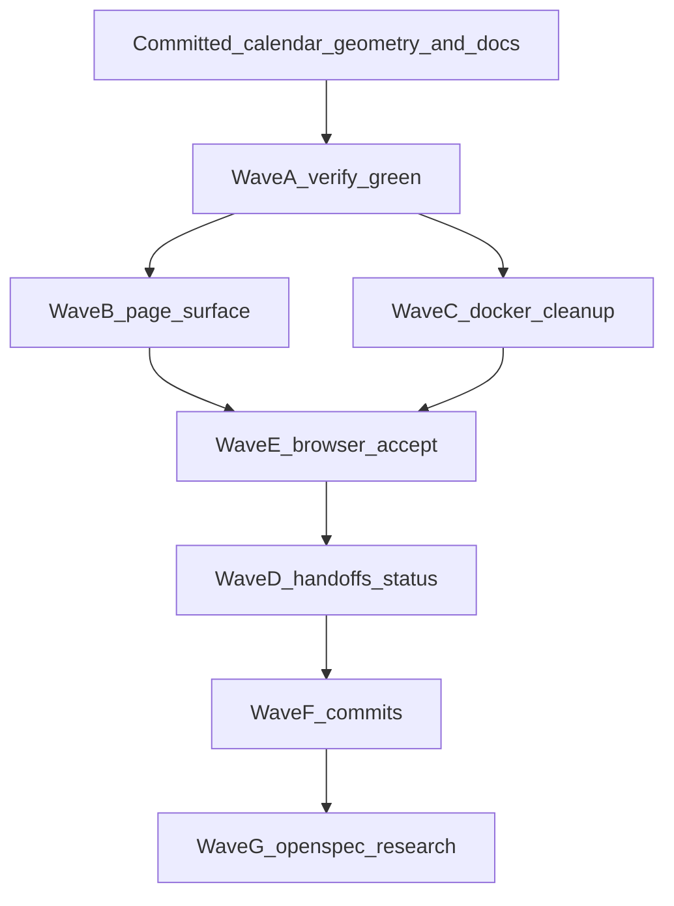

# Demo recovery 2026-11-07

Файл плана в репозитории: этот документ (`./demo-recovery-2026-11-07.md`).

Исполнение: Cursor CLI после принятия плана Codex (`--model auto`). Codex review ≠ human approval для OpenSpec archive. Не делегировать исполнение обратно Codex.

## Контекст снимка

| Факт | Значение |
|------|----------|
| HEAD | `419fa12` (`docs(schedule): match the presenter script to the split screen`) |
| Branch | `main`, ahead of `origin/main` by 9 |
| Docker | штатный `pharma-demo` на `http://localhost:3080`; сосед `docs-portal-dev` на `:8088` — **сохранять**, новых Compose-стеков не создавать |
| Living OpenSpec | `openspec/specs/schedule-workspace/` **отсутствует**; 5 calendar change остаются `propose` |

Источники (ссылаться, не дублировать):

- [AGENTS.md](../../AGENTS.md), [docs/07-delivery/pharma-demo-call-work-plan.md](../../docs/07-delivery/pharma-demo-call-work-plan.md) v0.7.8
- Планы: [calendar-unified-geometry.md](./calendar-unified-geometry.md), [rehearsal-and-open-items.md](./rehearsal-and-open-items.md), [director-demo-polish.md](./director-demo-polish.md), [portfolio-and-calendar.md](./portfolio-and-calendar.md)
- Отчёты: [calendar-unified-geometry](../../docs/07-delivery/reports/2026-11-06-calendar-unified-geometry.md), [calendar-stabilization-walk](../../docs/07-delivery/reports/2026-11-06-calendar-stabilization-walk.md), [schedule-openspec-order](../../docs/07-delivery/reports/2026-11-06-schedule-openspec-order.md)
- Untracked handoffs: `2026-11-06-page-surface-row-geometry.md`, `2026-11-06-schedule-one-calendar.md`, `2026-11-07-docker-dev-cleanup.md`

## Уже сделано — не повторять

Коммиты:

1. **`7765e32`** — единая геометрия 32/40, ИСР, иконки режимов, scroll-anchor, OpenSpec change `schedule-unified-geometry`, UX §1.6/§1.11, отчёт геометрии.
2. **`c811882`** — typecheck: `Scrollable` в `bind-schedule-pane-scroll.ts`, ES2017-safe regex в `document-scroll-lock.test.ts`.
3. **`8c7a1ce`** — порядок apply/archive записан в [schedule-openspec-order](../../docs/07-delivery/reports/2026-11-06-schedule-openspec-order.md) + правки дельт; **archive в основном репо не выполнялся**.
4. **`801b626`** — после выбора полосы Y строк совпадают; tooltip неизвестного прогресса без ложного «0%».
5. **`419fa12`** — walkthrough / director-rehearsal / live-presentation под «Разделение»; [stabilization-walk](../../docs/07-delivery/reports/2026-11-06-calendar-stabilization-walk.md).

Ранее в ветке: F07 закрыт (`985d744`), название портфеля (`0e6ef53`), single-origin `:3080` (`a288d5a`).

Продуктовый статус call-plan — **фактический**, без новых галочек в этой recovery:

- Закрыто ранее: A*, B*, C01–C04, C08–C14, D*, E01/E03/E05, F*, G07–G12, H01–H05.
- **E02** открыт до репетиции другим участником и записи в walkthrough.
- **C06** открыт (месячные `vis-minor` оставлены; скрытие ухудшает чтение).
- **C07** открыт (сверка с макетами ОСУП по базе/факту/цвету отклонения на одной строке). Продуктовый режим сравнения с **фактом** (переключатель, колонки, полосы где есть данные) **уже реализован** в демо; C07 — не «факт вне реализации», а открытая сверка оформления с ОСУП. Не расширять макеты ОСУП и цвет отклонения в этой recovery.
- **C05** и платформенный **E04** выведены из активной доводки; чекбоксы пустые.

Запрет scope recovery: не закрывать E02 без человеческой репетиции; не доводить ОСУП/цвет отклонения; не открывать мобильную доводку.

## Остатки working tree (три независимых трека)

### Трек P — Page Surface + tokens

Файлы:

- [apps/web/src/components/shell/page-surface.tsx](../../apps/web/src/components/shell/page-surface.tsx) — plate `bg-[var(--surface-raised)]`
- [apps/web/src/components/shell/page-surface.test.tsx](../../apps/web/src/components/shell/page-surface.test.tsx) — новый тест (untracked)
- [docs/05-ux-ui/demo-v1-design-tokens.md](../../docs/05-ux-ui/demo-v1-design-tokens.md)
- [docs/05-ux-ui/demo-v1-ui-foundations.md](../../docs/05-ux-ui/demo-v1-ui-foundations.md) — роль surface vs surface-raised; `rail-w` через inner shadow

Diff согласован handoff [page-surface-row-geometry](../../docs/07-delivery/handoffs/2026-11-06-page-surface-row-geometry.md). Часть handoff про `schedule-board` / геометрию строк **уже в `7765e32`** — при коммите кратко отметить в handoff, что геометрия ушла туда; в dirty остаётся plate/tokens.

Критерий: тест page-surface зелёный; на `http://localhost:3080` пластина как карточки (`--surface-raised`), не бледный `--surface`.

### Трек D — Docker / ops cleanup

Файлы:

- [package.json](../../package.json) — `dev`/`dev:down`/`dev:logs` с `-p pharma-demo`
- [docker-compose.dev.yml](../../docker-compose.dev.yml) — `name: pharma-demo` + комментарий override
- [docs/10-operations/local-dev-and-demo.md](../../docs/10-operations/local-dev-and-demo.md)
- [docs/07-delivery/handoffs/2026-11-07-docker-dev-cleanup.md](../../docs/07-delivery/handoffs/2026-11-07-docker-dev-cleanup.md)

Критерий: повторный `npm run dev` не плодит вторую группу; `docs-portal-dev` не трогать; `compose … -p pharma-demo … config --quiet` OK; HTTP `http://localhost:3080/`, `/backend/health`, `/docs/`.

### Трек H — Calendar handoffs (docs-only, код уже committed)

- [docs/07-delivery/handoffs/2026-11-06-schedule-one-calendar.md](../../docs/07-delivery/handoffs/2026-11-06-schedule-one-calendar.md) — follow-up геометрии закрыт `7765e32`+`801b626`
- Handoff page-surface — вместе с треком P или отдельным docs-коммитом handoffs после синхронизации текста

## Волны исполнения (после approve Codex)

### Волна 0 — статус на диске (до feature-кода)

1. Этот файл уже материализован.
2. В [calendar-unified-geometry.md](./calendar-unified-geometry.md) — todos → completed со ссылками на `7765e32` / `801b626` / `c811882` / `419fa12`.
3. Абзац статуса в [pharma-demo-call-work-plan.md](../../docs/07-delivery/pharma-demo-call-work-plan.md): дата 2026-11-07, геометрия/стабилизация закрыты отчётами, dirty → раздельные коммиты; **E02 / C06 / C07 без новых галочек**, с фактическими формулировками выше.

**Не** создавать и не расширять [`.cursor/plans/README.md`](./README.md) без явной необходимости. Не поднимать `status: approved`, не повышать certainty до fact без человека.

### Волна 1 — проверка зелени

На HEAD + dirty tree:

- `apps/web`: `tsc --noEmit`
- vitest: `page-surface.test.tsx` + `src/components/schedule` и `src/lib/schedule`
- полный монорепо suite не обязателен

Красное — чинить только регрессию от dirty/page-surface; геометрию календаря не переоткрывать.

### Волна 2a / 2b — параллельные треки

| Волна | Трек | Действие | Не пересекается с |
|-------|------|----------|-------------------|
| 2a | P | Подтвердить plate+tokens+тест; при необходимости правка handoff surface | D, schedule code |
| 2b | D | Подтвердить scripts/compose/ops; не `down -v`, не новые `-p` | P, schedule code |

Код `schedule-*` / gantt в recovery **не менять**, кроме hotfix красного typecheck/теста от уже закоммиченного — отдельным `fix(schedule|web): …`.

### Волна 3 — браузерная приёмка обычного окна

Стек: существующий `http://localhost:3080` (не 3091/show). Окно ~1440×900. Снимок C.

1. Дашборд → «Календарный план»: «Разделение» по умолчанию, ИСР, иконка предупреждения, строки совпадают после прокрутки и после клика по полосе.
2. Page Surface: пластина raised на дашборде и schedule.
3. Короткий C→D→F по [director-rehearsal](../../docs/07-delivery/director-rehearsal.md) **без** закрытия E02.
4. Light/dark — ключевой кадр schedule split.

Артефакт: краткий статус в call-plan или дополнение stabilization-walk; галочку E02 не ставить.

### Волна 4 — раздельные коммиты

После зелени + браузерной приёмки. Три staged set:

1. **shell/ux** — page-surface + test + design-tokens + ui-foundations (+ handoff surface при синхронизированном тексте).
2. **ops** — package.json + docker-compose.dev.yml + local-dev-and-demo.md + handoff docker-dev-cleanup.
3. **handoffs/status** — schedule-one-calendar (+ статусные правки call-plan / geometry-плана из волны 0, если не ушли в 1–2).

Не коммитить секреты, `.cursor/cli.json`, чужой dirty. Push только по отдельной просьбе.

### Волна 5 — OpenSpec: только исследование порядка

Корректный порядок (доказан на копии в [schedule-openspec-order](../../docs/07-delivery/reports/2026-11-06-schedule-openspec-order.md)):

1. `demo-v1-schedule-work-bars-links`
2. `schedule-hierarchy-baseline-forecast`
3. `schedule-work-actual`
4. `schedule-c-cross-project-subsample`
5. `schedule-unified-geometry`

**Проверка 2026-11-07 (основной репозиторий, без archive):**

| Change | `openspec validate --strict --type change` |
|--------|--------------------------------------------|
| `demo-v1-schedule-work-bars-links` | valid |
| `schedule-hierarchy-baseline-forecast` | valid; INFO: archive отказал бы — living `schedule-workspace` нет, есть MODIFIED |
| `schedule-work-actual` | valid |
| `schedule-c-cross-project-subsample` | valid |
| `schedule-unified-geometry` | valid; тот же INFO про отсутствие living + MODIFIED |

Living `openspec/specs/schedule-workspace/` — **MISSING**. Все пять proposal остаются `propose`. Codex review плана **не** является human approval на archive. **Archive / apply не запускались и не будут** в этой recovery без явного решения человека.

## Критерии готовности recovery

- Dirty tree очищен перечисленными коммитами (или явно отложен с записью в handoff).
- `tsc` web зелёный; page-surface + schedule vitest зелёные.
- Браузер `http://localhost:3080` обычное окно: split geometry + raised plate + C→D→F без сюрпризов инструкции.
- Единый статус: этот файл + абзац call-work-plan + todos geometry-плана = done; README планов не трогать без нужды.
- OpenSpec: порядок исследован/зафиксирован; living не опубликован без человека.
- E02 / C06 / C07 остаются с фактическим открытым статусом; соседний docs-dev жив; новых стеков нет.

## Вне scope

- Закрытие E02 без отзыва второго участника.
- Расширение ОСУП / цвета отклонения по C07.
- Мобильная/узкая доводка ([calendar-responsiveness](./calendar-responsiveness.md) не открывать).
- Повтор лабораторий C08/C06, правки `reference platform`, новые Compose names, `down -v` / prune.
- Переписывание закоммиченной геометрии «для красоты».
- Автоматический `openspec archive` без решения человека.
- Создание/раздувание `.cursor/plans/README.md` без необходимости.
