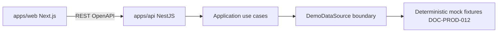

# Implementation Plan Demo v1 (APPROVED)

**Статус документа:** **APPROVED** (human, после R1–R4). Plan остаётся SoT последовательности I1–I8; todos синхронизируются по мере итераций.

| Слой | Статус |
|------|--------|
| UI Design pack | APPROVED (`approved UI Design decision`) |
| Этот Implementation Plan | **APPROVED** (human) |
| Implementation I1 | **APPROVED + committed** (`dbea074`) |
| Implementation I2 | **APPROVED + committed** (`f104503`; includes corrective R1–R2) |
| Implementation I3 | **APPROVED + committed** (`ea4205b`; includes RU / corrective passes) |
| Implementation I4 | **APPROVED + committed** (`22d56b2`; includes corrective R1) |
| Implementation I5+ | **NOT STARTED** — только после явной human-команды |

**Проверенные источники (primary, не только handoff):** [AGENTS.md](AGENTS.md), [DOC-PROD-003](docs/03-product/demo-v1-architecture.md), [DOC-PROD-002](docs/03-product/target-technology-stack.md), [ADR-0002](docs/06-architecture/decisions/0002-target-technology-stack-direction.md), [ADR-0003](docs/06-architecture/decisions/0003-local-dev-urls-and-proxy.md), [DOC-PROD-012](docs/03-product/demo-v1-mock-narrative-data.md), living specs в `openspec/specs/`, REQ-PROJ/MILE/EQPT/RISK/IMPCT/NFR, UI Design DOC-UX-014…020 + [handoff](docs/07-delivery/handoffs/2026-11-01-ui-design.md), [testing-strategy](docs/08-quality/testing-strategy.md), существующие [docker-compose.yml](docker-compose.yml) / [Caddyfile](Caddyfile).

---

## A. Структура репозитория / приложения

**Зафиксировано docs + Compose placeholders (без нового monorepo framework):**

| Путь | Роль |
|------|------|
| [`apps/api`](apps/api) | NestJS + TypeScript; OpenAPI/Swagger; application layer над минимальной Demo data-access boundary (intent REQ-NFR-002) |
| [`apps/web`](apps/web) | Next.js App Router + TS + Tailwind + intent shadcn/ui; данные **только** через HTTP API client (REQ-NFR-001) |
| Корневой [`docker-compose.yml`](docker-compose.yml) | Уже есть `ppc-net`, docs, Caddy; `web`/`api` под `profiles: ["app"]` как placeholders → позже заменить на реальные builds |
| [`Caddyfile`](Caddyfile) | `localhost` → web:3000; `api.localhost` → api:3000; `docs.localhost` → docs |

**Не вводить:** Turbo/Nx/pnpm-workspace без отдельного ADR; профиль PostgreSQL/`db`; FE-local narrative fixtures; shared Domain package в обход API; ORM.

**Контракты:** **Каталога OpenAPI/HTTP paths в репозитории пока нет** (подтверждено). Nest OpenAPI, публикуемый в I1–I5, становится contract SoT. FE — тонкий typed API client (hand-written или generated из OpenAPI). Третий пакет `packages/domain` для Demo v1 не нужен.

**Fixtures / data-access (Demo v1):**

- Канонические значения A/B/C зеркалят [DOC-PROD-012](docs/03-product/demo-v1-mock-narrative-data.md) как deterministic in-memory/mock TypeScript data.
- Nest **application / use-case layer НЕ ДОЛЖЕН** импортировать fixture constants напрямую.
- Между use cases и fixtures — **минимальная data-access boundary**, форма которой определяется реальными use cases Demo v1 (концептуальные имена: `DemoDataSource`, `ProjectDataSource` или use-case-oriented repository/data-source ports — точное имя выбирается при реализации).
- Adapter Demo v1 = deterministic in-memory/mock data source — **не** слой database persistence.
- **Не** называть и **не** проектировать это как `PersistencePort`, когда в Demo v1 нет semantics persistence/DB.
- **Не** проектировать границу вокруг будущих таблиц ORM/PostgreSQL.
- Intent REQ-NFR-002 / OpenSpec architecture-constraints сохраняется как **заменяемый data-access adapter** (сейчас mock; позже DB adapter без смены FE/HTTP contracts) — без преждевременных DB-shaped ports.

**Проверка ADR:** раскладка `apps/web` + `apps/api` согласуется с ADR-0002/0003 и комментариями Compose — **отдельный ADR для старта не нужен**. **ORM ADR для Demo v1 не нужен**. Новый ADR — только при будущем выборе ORM, auth, GraphQL или monorepo tooling (open_question в DOC-PROD-002).

### Механизм Snapshot — `approved implementation decision` (R1)

> **`approved implementation decision`:** контекст Snapshot Demo v1 — **request-scoped** и представляется как **`snapshot=A|B|C`**. Snapshots остаются **discrete fixtures**, не time series. Утверждено **human approval этого Implementation Plan**. Отдельный ADR **не** требуется (не меняет утверждённые architecture boundaries FE↔HTTP, mock в Nest, без PostgreSQL). Это **не** prior requirement/ADR/HTTP contract из предыдущих волн.

Зафиксировать в OpenAPI при посадке I2.

**CORS / Next data fetching:** браузер ходит на `http://api.localhost`; опциональный SSR может использовать internal Compose DNS `http://api:3000`. Решается через env-based API base URL в I1/I2 — implementation detail, не blocker ADR.

---

## B–G. Сквозной дизайн (до итераций)

### Граница API (минимум read-oriented Demo v1)

**Snapshot (`approved implementation decision`):** request-scoped query `snapshot=A|B|C` (discrete; default A). Невалидный snapshot → 400. Все narrative-ответы относятся **целиком** к одному snapshot.

| Use case / capability | Направление (не замороженный path catalog) | Примечания |
|-----------------------|---------------------------------------------|------------|
| Project overview / Dashboard aggregate | Typed project overview, напр. `GET /v1/projects/{id}?snapshot=` | Поля PRJ, PS Δ, refs; сводка Decision (REQ-PROJ-001, REQ-IMPCT-001) |
| Equipment list / detail | Typed equipment, напр. `GET /v1/equipment`, `GET /v1/equipment/{id}` | OnTrack/Delayed; delivery dates/Δ (REQ-EQPT-001) |
| Реестр Issues & Risks V1 | Combined или paired list endpoints | Только Type + shared columns (assumption BA-OQ-006) |
| Milestones list / detail | Typed milestone resources | RAG + milestone dates/Δ (REQ-MILE-001) |
| Schedule control points | Schedule list resource | Строки = только Milestone + Equipment delivery (D11) |
| **Entity detail capability** | Capability загрузки **Overview + Links + Impact** для конкретной сущности в snapshot | Links = только DOC-BA-015; Impact = derived. **Точная HTTP-декомпозиция** фиксируется в OpenAPI в ходе I1–I5. **Typed** detail endpoints допустимы. **`GET /v1/{entityType}/{id}` НЕ является выбранным контрактом** этого плана. |
| Decision (Must read-only) | Встроено в overview/detail Impact; опциональный typed decision GET | Snapshot C = DEC-001 PrioritizeRecovery; **без** Must write/POST |

**Derived Impact:** считается в Nest application services из mock data + BR-004/BR-006 (Δ=+21; C не «лечит» forecasts/RAG). Не изобретать Links EQ—MS / Issue—Decision.

**Ошибки (DOC-UX-019):** сбой загрузки Snapshot → на клиенте сохраняется предыдущий snapshot; API отдаёт явную ошибку без partial payload. Отсутствующая сущность в активном snapshot → **404**; FE сохраняет маршрут + EmptyState + CTA в реестр.

### Архитектура mock-данных

- **Истина:** значения DOC-PROD-012 кодируются один раз за Demo data-access boundary (карты A/B/C по ключу snapshot).
- **Выбор:** параметр запроса `snapshot` выбирает карту; без интерполяции time series.
- **Lookup:** по entity id внутри snapshot; C копирует forecasts B; ISS-001 → Mitigating; есть DEC-001.
- **Links:** только прямые рёбра из Domain allowlist.
- **Детерминизм:** один и тот же snapshot → один и тот же JSON; без RNG.

### Frontend-архитектура (UI Design → модули)

- App Shell: Sidebar (5 пунктов) + TopBar (breadcrumbs, SnapshotSelector, ThemeToggle) + PageSurface (DOC-UX-002/017).
- Routing: `/`, `/schedule`, `/equipment`, `/issues-risks`, `/milestones`, маршруты Entity Detail по OpenAPI/FE mapping.
- Глобальное клиентское состояние: текущий snapshot + theme (ephemeral session defaults; cross-session persistence остаётся `open_question`).
- Локальная страница: фильтры **не** восстанавливаются при breadcrumb return (`assumption`).
- Примитивы: shadcn + TanStack Table + Recharts; StatusIndicator четыре модели; DecisionPanel **read-only**.
- Schedule: Table primary; I6 готовит Split infrastructure; **Gantt/timeline renderer только в I7 после D12**.
- A11y: focus-visible; Skip→TopBar→Sidebar→main; статус не только цветом; browser contrast re-measure на impl (DOC-UX-015/020).

### Gantt (D12)

- **Не блокирует** Schedule Table, Split infrastructure/readiness, Dashboard, registers, detail.
- **Блокирует только** реальный read-only Gantt/timeline **renderer** (I7).
- Перед I7: короткий spike + human-выбор среди кандидатов из docs (SVAR OS №1 / custom / gantt-task-react) — [DOC-UX-005](docs/05-ux-ui/demo-v1-schedule-workspace.md). План библиотеку **не** выбирает.
- **Не** строить ad-hoc Gantt/timeline в I6 ради обхода D12.

### Пирамида тестов (практичная)

| Слой | Инструмент (направление) ([DOC-QA-001](docs/08-quality/testing-strategy.md)) | Фокус |
|------|-----------------------------------------------------------------------------|-------|
| Unit BE | Jest | BR-004 Δ; BR-006 без heal; builders Links≠Impact; целостность fixtures через data-access boundary |
| Unit FE | Vitest | Snapshot switch reducer (atomic/error); marker mapping; helpers подписей Δ |
| API/contract | Против OpenAPI | Форма ответов Snapshot; 404 отсутствующей сущности |
| Architecture | dependency-cruiser ([DOC-QA-003](docs/08-quality/architecture-tests.md)) | FE ↛ Nest mock modules; data-access только через API client |
| Component | Vitest + Testing Library | DecisionPanel read-only; EmptyState; StatusIndicator |
| E2E | Playwright | Narrative A→B→C; честность Dashboard на C; Schedule table; missing-entity на detail |
| Visual | Manual / редкие screenshots | Markers — не полный Chromatic, пока не решено иначе |

**Существующий docs gate (сохранить):** `npm run test:docs`; `openspec validate --specs --strict`.

**Proposed app gates (явно proposed, пока нет CI):** тесты+coverage `api`; тесты+coverage `web`; architecture cruise; Playwright smoke; `git diff --check`. Coverage **target** 80% отдельно для FE и BE ([DOC-QA-002](docs/08-quality/coverage-policy.md)) — enforcement FUTURE до появления CI.

---

## Реестр решений для Implementation

### Уже утверждено / settled (предыдущие волны)

- Стек: Next.js App Router + NestJS + REST/OpenAPI; mock-данные только в Nest; без PG в Demo v1 (ADR-0002, DOC-PROD-003, OpenSpec architecture-constraints).
- URL/proxy: localhost / api.localhost / docs.localhost + Caddy + `ppc-net` (ADR-0003).
- Product Must narrative SCN-001→007; Snapshots A/B/C как discrete fixtures; честность BR-006; Links = DOC-BA-015; Schedule = только MS+EQ; D1–D11; VD-A; UI Design pack DOC-UX-014…020.
- Must DecisionPanel read-only + DEC-001 на C.

### Введено этим планом и утверждено вместе с plan APPROVE

- Request-scoped snapshot context `snapshot=A|B|C` — **`approved implementation decision`** (не prior ADR/REQ).

### Безопасные assumptions для реализации

- Issues & Risks **V1 single table + Type** (BA-OQ-006 остаётся open).
- Filter non-restore при breadcrumb return.
- Ephemeral theme/snapshot на сессию (cross-session не специфицирован).
- Shell DOM order: логический focus order DOC-UX-019; выбранный DOM order задокументировать в коде.

### Open questions, которые **не** блокируют coding

- BA-OQ-006 (использовать V1 assumption); AcceptDateSlip / Closed / Amber; interactive M-DEC **вне** Must; HIP-*; mock volume `hypothesis`; cross-session persistence.

### Блокирует только **позднюю** стадию

| Пункт | Блокирует |
|-------|-----------|
| Human-выбор Gantt library (D12) | **только I7** (Gantt/timeline renderer) |
| Опционально: CI fail-on-threshold coverage | Финальный claim «CI green» — не локальная Demo readiness |

### Blockers / gates (актуально)

1. ~~Финальный human APPROVE этого Implementation Plan~~ — **выполнено.**
2. ~~Явная human-команда на старт Implementation I1~~ — **выполнено.**
3. ~~I1 scaffold~~ — **APPROVED + committed** (`dbea074`).
4. ~~I2~~ — **APPROVED + committed** (`f104503`; incl. corrective R1–R2).
5. ~~I3 Dashboard~~ — **APPROVED + committed** (`ea4205b`).
6. ~~I4 registers~~ — **APPROVED + committed** (`22d56b2`; incl. corrective R1).
7. **I5+** — не начинать без явной human-команды на соответствующую итерацию.
8. D12 / Gantt library — блокирует **только I7**.

---

## H. Предлагаемые итерации (8)

Каждая итерация: один вертикальный outcome; STOP для human review; commit только по просьбе. Progress todos — в YAML frontmatter этого плана (поддерживать в sync).

### I1 — Scaffold + mock data boundary + скелет OpenAPI

- **Статус итерации:** **COMPLETED / APPROVED / committed** (`dbea074`).
- **Цель:** Runnable пустые Nest + Next; минимальная Demo data-access boundary + модуль fixtures A/B/C; health; stub FE API client; правило архитектуры FE↛api internals; первая поверхность OpenAPI (сейчас в репо нет).
- **Scope:** создать `apps/api`, `apps/web`; root scripts для обоих; OpenAPI/Swagger; fixtures по ключам DOC-PROD-012 (допустимы только health + один project stub); `NEXT_PUBLIC_API_BASE_URL` (или аналог) на `api.localhost`.
- **Вне scope:** polish экранов; Gantt; полная замена Compose profile (до I8); PostgreSQL; ORM; Turbo/Nx; именование/`PersistencePort` / DB-shaped ports.
- **Deps:** plan APPROVED + **явная команда старта** impl.
- **SoT:** DOC-PROD-003/012, REQ-NFR-001/002, ADR-0002, AGENTS.md, OpenSpec `demo-v1-architecture-constraints`.
- **AC:** `curl` API health; FE-страница грузится через client call; нет FE fixture import; use cases не импортируют fixture constants напрямую; docs gates PASS.
- **Tests:** Nest fixture integrity smoke через data-access boundary; FE architecture guard (script).
- **STOP:** Review границ scaffold — **пройден.**

### I2 — Snapshot infrastructure + App Shell

- **Статус итерации:** **COMPLETED / APPROVED / committed** (`f104503`; includes corrective R1–R2: monotonic seq + SnapshotSelector keyboard).
- **Цель:** Применить `approved implementation decision` (`snapshot=A|B|C`) на API; FE Shell (Sidebar 5 + TopBar Snapshot/Theme/breadcrumbs); atomic switch / ошибка сохраняет предыдущий; theme Light/Dark из DOC-UX-015.
- **Вне scope:** полные виджеты Dashboard; богатые реестры.
- **Deps:** I1.
- **SoT:** DOC-UX-002/015/019; OpenSpec project-status-overview snapshot scenarios; snapshot decision этого плана (R1).
- **AC:** Переключение A/B/C обновляет client context; неудачный switch оставляет прежние данные; виден keyboard focus ring.
- **STOP:** Review shell + поведения snapshot — **пройден (APPROVED).**

### I3 — Вертикальный срез Dashboard

- **Статус итерации:** **COMPLETED / APPROVED / committed** (`ea4205b`; RU UI + corrective passes + project rename).
- **Цель:** Overview API + композиция Dashboard: narrative, полоса Δ (Delivery vs PS с подписями), Impact, DecisionPanel read-only (A empty / B needed / C DEC-001), опциональный discrete chart A/B/C (не time series).
- **Deps:** I2.
- **SoT:** DOC-UX-004/017/018; REQ-IMPCT-001/002; BR-006; DOC-PROD-012.
- **AC:** B показывает честность +21d; C — Issue Mitigating, Risk/MS Red, forecasts без изменений; нет UI «recovery progress»; **нет** Must Decision write.
- **Tests:** BE BR-006; E2E smoke A/B/C header+panel.
- **STOP:** Director narrative review — **пройден (APPROVED).**

### I4 — Реестры (Equipment, Issues & Risks V1, Milestones)

- **Статус итерации:** **COMPLETED / APPROVED / committed** (`22d56b2`; includes corrective R1).
- **Цель:** List APIs + три экрана реестров; модели StatusIndicator; shared columns Issues&Risks only (без Owner).
- **Deps:** I2 (по умолчанию после I3).
- **SoT:** DOC-UX-016/017; REQ-EQPT/RISK/MILE; assumption BA-OQ-006 (OQ остаётся open).
- **AC:** Фильтры локальные non-restore; row → detail route; markers по DOC-UX-018.
- **STOP:** Review реестров — **пройден** (BA-OQ-006 остаётся OPEN).

### I5 — Entity Detail + Links vs Impact

- **Цель:** Поставить **Entity detail capability** (Overview / Links / Impact) через OpenAPI paths, выбранные в этой итерации (typed resources допустимы); EmptyState при отсутствии сущности + CTA в реестр; без ложных Domain edges.
- **Deps:** I4.
- **SoT:** DOC-UX-006/017/019; DOC-BA-015; BR-004/006.
- **AC:** Snapshot switch на detail сохраняет URL; 404 → EmptyState; Impact только derived; generic path `{entityType}` не предполагается, пока явно не добавлен в OpenAPI с human review.
- **STOP:** Review Detail + causal honesty.

### I6 — Schedule Table + Split infrastructure/readiness

- **Цель:** Полноценный Schedule **Table** как primary path; infrastructure режимов/layout Schedule; control-point data model (Milestone + Equipment delivery); type-qualified семантика Delivery vs Milestone dates; boundary/interface для будущего timeline/Gantt pane; interaction contract для optional shared focused/hovered row cue (**selection off by default**).
- **Deps:** I4/I5.
- **SoT:** DOC-UX-005/017/018/019; D10/D11.
- **Вне scope / не в I6:** Gantt/timeline **renderer**; ad-hoc fake Gantt visualization; заявка, что Split — готовая визуальная Gantt-панель.
- **AC:** Table позволяет завершить задачи с клавиатуры; нет Activity/deps/drag; режим Gantt unavailable/disabled/явно deferred — **не** выглядит как рабочая visualization; нет placeholder «как будто Gantt готов».
- **STOP:** Schedule Table usable; Split readiness к review; D12 всё ещё open.

### I7 — Spike D12 + read-only Gantt/timeline renderer

- **Цель:** Human-approved выбор библиотеки после spike; реализовать реальный read-only Gantt/timeline renderer для control points MS+EQ; baseline ghost + forecast; связать с границей I6 и focused/hovered cue.
- **Deps:** I6 + **human-решение D12**.
- **Вне scope:** PRO features, CPM, dependency arrows.
- **AC:** Gantt не единственный путь; семантика по DOC-UX-018.
- **STOP:** Если D12 не решён — skip/defer I7; Demo всё ещё shippable с Schedule Table (+ Split infrastructure без renderer).

### I8 — Compose profile app + Demo readiness gates

- **Цель:** Заменить Compose placeholders `web`/`api` реальными builds; проверить маршруты Caddy; Playwright narrative path; зелёные architecture tests; зафиксировать оставшиеся open questions.
- **Deps:** минимум I3–I6 (I7 опционален).
- **AC:** `docker compose --profile app up` отдаёт FE+API через localhost/api.localhost; E2E A→B→C; docs+OpenSpec gates PASS; Implementation по-прежнему без PG/auth.
- **STOP:** Review Demo v1 readiness (не auto production).

---

## Риски / ловушки

- Дублирование DOC-PROD-012 во FE → нарушение REQ-NFR-001.
- Snapshot C как «починили» / green wash → ломает BR-006.
- Narrative chain EQ→ISS→RISK→MS как Links → ложный Domain.
- Неоднозначный Δ без подписей Delivery vs Milestone.
- Включение selection/pagination «по умолчанию» против UI Design.
- Блокировка всего Schedule из‑за D12 (блокируется только renderer).
- Interactive Decision write в Must.
- Проектирование DB/`PersistencePort` «на потом» внутри Demo v1.
- Заморозка generic URL `{entityType}` без необходимости.
- Fake Gantt UI в I6 «для красоты».
- Предположение, что CI coverage enforcement уже есть (FUTURE).
- Правка OpenSpec/Domain/mock docs во время coding без human-команды.

---

## Текущий статус Implementation (sync)

1. **Последовательность:** I1 → I2 → I3 → I4 → I5 → I6 → I7 (D12-gated) → I8.
2. **Settled architecture:** Next/Nest/REST/OpenAPI; `DemoDataSource` + mock fixtures; без PG; Caddy URLs; `apps/web`+`apps/api`; FE только через API; `snapshot=A|B|C` request-scoped.
3. **Сделано:** I1 (`dbea074`); I2 (`f104503`); I3 (`ea4205b`); I4 (`22d56b2`) — все APPROVED+committed.
4. **В работе / review:** нет; следующая итерация — **I5** (не начата).
5. **Нерешённое → блок когда:** D12 → **только I7**; theme/snapshot cross-session persistence = `open_question`; BA-OQ-006 open.
6. **Gates:** `test:docs` + OpenSpec strict + `test:apps` / e2e / architecture guards по мере итераций.
7. **Agent habit:** после каждой итерации обновлять YAML todos + этот блок статуса в плане.

**Consistency (R1–R4, сохраняется):** snapshot не выдаётся за прежний ADR; нет обязательного `PersistencePort`; нет выбранного generic-контракта `{entityType}`; I6 ≠ Gantt visualization; I7 = единственная итерация, заблокированная D12; Must DecisionPanel read-only / без Must POST; BA-OQ-006 open + V1 assumption; без PG/ORM/auth/monorepo tooling.

**Следующий шаг человека:** явная команда на старт **I5**; I5 не начинать без неё.
