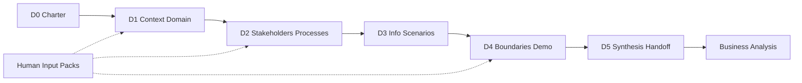

# Discovery Phase — L2 Plan (Pharma Project Control)

## 1. Готовность репозитория

**Готов к Discovery.** Docs Engineering System закрыт (W1–W3); SoT и процессы на месте.

| Есть | Нет / seed only |
|------|-----------------|
| Стандарты, certainty, G0, templates (`discovery-brief`, `phase-plan`, `handoff`, `demo-scenario`) | Substantive briefs в [`docs/01-discovery/`](docs/01-discovery/) (только README) |
| Product seed: [`vision-and-scope.md`](docs/03-product/vision-and-scope.md), Demo v1 / stack | Living OpenSpec capabilities (ожидаемо пусто) |
| ADR-0001…0003 (docs stack, app stack direction, URLs) | Stakeholder/process/scenario каталоги |
| Handoff W3 → «product discovery with customer» | BA / REQ содержимое |

**Не дублировать:** ADR-0001…0003, [`demo-v1-architecture.md`](docs/03-product/demo-v1-architecture.md), [`target-technology-stack.md`](docs/03-product/target-technology-stack.md), docs-portal research. Discovery отвечает на *что демонстрировать и зачем*, не *какой стек*.

**Режим по умолчанию:** desk research + **Human Input Pack (HIP)**. Отсутствие отраслевого эксперта **не** блокирует подготовку демонстрационных гипотез; блокирует только перевод применимости к предприятию / реальных процессов в `fact`.

### Методология certainty (обязательная)

| Уровень | Когда допустим |
|---------|----------------|
| `fact` (содержимое источника) | Утверждение **верно цитирует** внешний отраслевой источник (что источник говорит). Не означает «так у нашего заказчика». |
| `assumption` / `hypothesis` (применимость) | Перенос отраслевого сведения на конкретное предприятие, оргструктуру, процессы заказчика или продукт — пока нет подтверждения экспертом/заказчиком. |
| `open_question` | Нет достаточных данных; фиксируется в registers + HIP. |

**Evidence** (секция в `registers.md`): для каждой записи — название, организация, дата/версия, URL, дата обращения, подтверждаемое утверждение. Ссылка Evidence ID из certainty-блока.

### Human validation (разделение ролей)

| Решение | Кто | Если недоступен |
|---------|-----|-----------------|
| Приоритетный демонстрационный сценарий / narrative | **Владелец продукта** | D5 → `paused` или явный open_question; гипотезы сценариев всё равно готовятся |
| Подтверждение реальных отраслевых процессов предприятия | **Отраслевой эксперт или заказчик** | Оставлять `hypothesis`/`assumption`; **не** выдавать за `fact` применимости |

---

## 2. Цель фазы и границы

**Цель:** от идеи → проверяемая модель контекста, ролей, процессов, сущностей, проблем и управленческих сценариев + обоснованные кандидаты Demo v1 + handoff в BA / Product Definition.

**В scope:** документы Discovery, обновление product vision/boundaries, реестры, HIP, **критерии готовности** к будущей фазе OpenSpec (без записи в OpenSpec).

**Вне scope:** код Next/Nest, PostgreSQL, новые ADR по ORM/auth, **любые** правки `openspec/specs/` и `openspec/changes/` в ходе Discovery, выдуманные FR/GMP, утверждение `status: approved` AI.

---

## 3. Информационная архитектура артефактов

Все новые substantive файлы: frontmatter по [`documentation-standard.md`](docs/standards/documentation-standard.md); `type: discovery` (при первом файле — одна строка в enum стандарта); certainty-блоки в теле; ID `DOC-DISC-NNN`.

### Создать (итеративно, не пачкой пустых)

| Документ | Путь | Источник шаблона |
|----------|------|------------------|
| Phase plan Discovery | [`docs/07-delivery/discovery-phase-plan.md`](docs/07-delivery/discovery-phase-plan.md) | `phase-plan` |
| Product context brief | `docs/01-discovery/product-context.md` | `discovery-brief` |
| Domain overview | `docs/01-discovery/domain-overview.md` | `discovery-brief` |
| Stakeholder register + analysis | `docs/01-discovery/stakeholders.md` | `discovery-brief` (две секции) |
| Process inventory | `docs/01-discovery/process-inventory.md` | `discovery-brief` |
| Domain glossary | `docs/01-discovery/domain-glossary.md` | новый; **не** смешивать с [`terminology.md`](docs/standards/terminology.md) (инженерный глоссарий) |
| Information concepts | `docs/01-discovery/information-concepts.md` | conceptual model; **отдельный** файл (не секция domain-overview) |
| **Unified registers** | `docs/01-discovery/registers.md` | секции: Problems, Hypotheses, Open Questions, Evidence (поля Evidence — см. §1) |
| Management scenarios | `docs/01-discovery/management-scenarios.md` | структура из `demo-scenario` + certainty |
| Product boundaries (preliminary) | `docs/01-discovery/product-boundaries.md` | `discovery-brief` |
| Demo v1 scope candidates | `docs/01-discovery/demo-v1-scope-candidates.md` | ссылка на tech constraints, без переписывания архитектуры |
| Discovery summary | `docs/01-discovery/discovery-summary.md` | синтез |
| HIP (вопросы человеку) | `docs/01-discovery/human-input-pack.md` | список вопросов + статус ответа |
| Index update | [`docs/01-discovery/README.md`](docs/01-discovery/README.md) | карта файлов |
| Handoff | `docs/07-delivery/handoffs/YYYY-MM-DD-discovery.md` | `handoff` |

### Актуализировать (не клонировать)

| Документ | Что менять |
|----------|------------|
| [`vision-and-scope.md`](docs/03-product/vision-and-scope.md) | После D4/D5: уточнённый контекст/границы со ссылками на Discovery; certainty сохранять честно |
| [`documentation-standard.md`](docs/standards/documentation-standard.md) | Добавить `discovery` в перечень `type` (минимальный правка) |
| `docs/07-delivery/handoffs/README.md` | Строка W3 + Discovery handoff |

### Не создавать на Discovery

- `REQ-*`, любые файлы/изменения в `openspec/specs/` и `openspec/changes/`, BA process models «как утверждённые», ER как финальная модель, новые ADR стека.

---

## 4. Этапы и итерации

### D0 — Charter и каркас (1 итерация, 1 агент)

**Цель:** зафиксировать L2 phase plan в репо и каркас раздела.

**Вопросы:** какие артефакты SoT; что out of scope; какой HIP нужен сразу.

**Вход:** этот план; W3 handoff; AGENTS.md; vision seed.

**Действия AI:** создать `discovery-phase-plan.md`; обновить `01-discovery/README`; создать пустой-структурированный `registers.md` + `human-input-pack.md` (вопросы без ответов); строка `type: discovery` в стандарте.

**Выход:** phase plan, README map, registers skeleton, HIP v0.

**AC / Gate:** G0; phase plan ссылается на DoD §7; нет выдуманных domain facts.

**Человек:** владелец продукта — приоритет аудитории демо (директор vs project controls) в HIP; эксперт не обязателен на D0.

---

### D1 — Product context + Domain desk research (параллель 2 агента)

**Цель:** контекст ценности + отраслевой lifecycle с корректной certainty (source-fact vs applicability).

| Агент | Пишет только | Содержание |
|-------|--------------|------------|
| **D1-Context** | `product-context.md`, правки HIP | Проблема, ценность для директора / PM / функциональных руководителей; отличие target vs Demo v1 (**ссылка** на demo-v1-architecture) |
| **D1-Domain** | `domain-overview.md`, `domain-glossary.md` (черновик терминов) | Типовой LC pharma construction; стадии; design–build–equipment–CQV; контрольные точки; документация/готовность |

**Исследовательские вопросы (примеры):** какие стадии обычно выделяют; какие decision points критичны для даты запуска; какие артефакты «готовности».

**Источники:** публичные отраслевые материалы (ISPE/PIC/S/WHO, project controls). Цитата/парафраз источника → `fact` **относительно источника** + полный Evidence. Утверждение «применимо к нашему предприятию/продукту» → `assumption`/`hypothesis` до эксперта/заказчика.

**AC / Gate:** Evidence ID или `open_question`; DG-Evidence; G0; нет пересечения файлов.

**Человек:** не обязателен для старта D1; HIP пополняется вопросами применимости (expert/customer).

**Checkpoint:** оркестратор сверяет Context↔Domain; линк-check.

---

### D2 — Stakeholders + Processes (параллель 2 агента, после D1)

| Агент | Пишет | Содержание |
|-------|-------|------------|
| **D2-Stakeholders** | `stakeholders.md` | Роли из ТЗ как **кандидаты** (не org chart заказчика); цели, решения, информация, боли, отчётность — hypothesis + HIP |
| **D2-Processes** | `process-inventory.md` | Инвентарь: schedule, budget, change, risk, issue, contractor, equipment/supply, docs, readiness, milestones, reporting — без детальных BPMN |

**Связи роль↔процесс↔проблема:** только **обоснованные**. Не требовать искусственной связи каждой роли и каждого процесса с проблемой. При нехватке данных — `hypothesis` или `open_question`.

**AC:** инвентари заполнены; зарегистрированы только обоснованные связи и явные пробелы; G0.

**Человек (эксперт/заказчик):** подтверждение реальных процессов/ролей; без доступа черновик остаётся hypothesis.

---

### D3 — Information concepts + Management scenarios (2 агента, разные файлы)

| Агент | Пишет | Содержание |
|-------|-------|------------|
| **D3-Info** | **`docs/01-discovery/information-concepts.md` только** | Концепты: Project, Phase, Activity, Milestone, Contractor, Owner, Equipment, Delivery, Budget, ActualCost, Risk, Issue, Change, Document, ReadinessStatus — текст/Mermaid conceptual, не ER. **`domain-overview.md` не изменять** для этой модели |
| **D3-Scenarios** | `management-scenarios.md` | Каталог 6–10 сценариев; полная структура; по умолчанию `hypothesis` (демо-гипотезы допустимы без эксперта) |

**AC:** `information-concepts.md` существует отдельно; ≥6 сценариев; трассировка к проблеме/роли только где обоснована, иначе open_question; G0.

---

### D4 — Boundaries + Demo v1 candidates (1 агент)

**Пишет:** `product-boundaries.md`, `demo-v1-scope-candidates.md`; обновляет HIP.

**Методика отбора Demo v1 (rubric в документе):**

1. Демо-ценность для директора / PM (вес высокий).
2. End-to-end связность данных (один сквозной narrative).
3. Реалистичность без выдуманного GMP-compliance theater.
4. Визуальная убедительность (статусы, timeline, impact).
5. Сложность реализации vs Demo v1 constraints (FE+API+mock, без PG/auth).
6. Риск scope creep.

Выход: **предварительная приоритизация кандидатов** Must / Should / Could / Won’t.

> MoSCoW здесь — **не** утверждённые функциональные требования и **не** обязательства по реализации. Это гипотетический ранг кандидатов для демо до решения владельца продукта и последующего Requirements/OpenSpec.

**AC:** матрица сценарий×кандидат; ссылка на tech constraints; Won’t явно out; формулировки не звучат как committed FR.

**Человек:** **владелец продукта** выбирает приоритетный demo narrative (gate перед D5 `done`; иначе `paused`).

---

### D5 — Synthesis, vision update, handoff (1 агент / оркестратор)

**Действия:**

1. `discovery-summary.md` — известно / гипотезы / открытое; source-fact vs applicability.
2. Актуализировать `vision-and-scope.md` ссылками (без повышения certainty без человека).
3. Обновить `registers.md`.
4. Handoff → BA / Product Definition; явно: **первые OpenSpec changes — следующая фаза** после human review Discovery.
5. Критерии готовности к OpenSpec-фазе — без любых записей в `openspec/`.

**AC фазы:** критерии §8; `npm run test:docs` зелёный; handoff заполнен; `openspec/**` не менялся.

---

## 5. OpenSpec: вне Discovery; следующая фаза

**На всём протяжении Discovery (D0–D5):** запрещено создавать и изменять `openspec/specs/` и `openspec/changes/` (включая draft).

Формирование первых OpenSpec changes — **отдельная задача следующей фазы** после human review артефактов Discovery.

**Критерии готовности к той фазе** (не execute внутри Discovery):

| Критерий | Порог |
|----------|-------|
| Discovery Summary + human review ключевых границ | обязательно |
| Demo narrative выбран владельцем продукта | обязательно (или formal pause) |
| Кандидатные имена 2–5 capabilities в summary/handoff как гипотезы | желательно |
| Затем: changes → review → apply → living specs | только следующая фаза |

---

## 6. Human Input Pack (обязательный механизм)

Файл [`docs/01-discovery/human-input-pack.md`](docs/01-discovery/human-input-pack.md) — таблица:

`ID | Вопрос | Адресат (product owner / expert / customer) | Зачем | Блокирует | Статус | Ответ/ссылка | Certainty после ответа`

**Минимальный HIP v0 (D0):**

1. Primary audience демо: директор / PM / оба? → **product owner**
2. Доступ к отраслевому эксперту в горизонте фазы? → планирование validation
3. GMP/CSV в демо как контекст или избегать? → **product owner** (+ expert при необходимости)
4. Горизонт демо: один завод / один проект / multi-project? → **product owner**
5. Какие процессы/роли критичны у заказчика? → **expert/customer** (не блокирует черновики D1–D3)

---

## 7. Acceptance Criteria и Quality Gates

**На каждую итерацию:** G0; внутренние ссылки; один писатель на path-prefix; README map; **запрет правок OpenSpec**.

**Дополнительно:**

| Gate | Проверка |
|------|----------|
| DG-Evidence | Source-`fact`: Evidence с названием, организацией, датой/версией, URL, датой обращения, утверждением |
| DG-Applicability | Применимость к предприятию не `fact` без expert/customer |
| DG-No-Fake-GMP | Нет утверждённых GMP/FR заказчика без источника |
| DG-Trace | Обоснованные связи; пробелы = open_question (не искусственные рёбра) |
| DG-No-OpenSpec | Нет изменений `openspec/**` в Discovery |
| DG-Docs-Tests | `npm run test:docs` после substantive pack |
| DG-Handoff | Handoff при смене роли/сессии и в D5 |

---

## 8. Критерии завершения Discovery

Фаза **done**, когда:

1. Product context и preliminary boundaries документированы.
2. Domain overview + glossary есть; source-fact ≠ применимость к заказчику.
3. `information-concepts.md` существует отдельно от domain-overview.
4. Stakeholders и process inventory как кандидатные модели; связи только обоснованные.
5. Registers согласованы.
6. ≥6 management scenarios (демо-гипотезы допустимы).
7. Demo v1 MoSCoW — предварительная приоритизация (**не** FR); narrative выбран владельцем продукта **или** фаза `paused`.
8. `vision-and-scope.md` актуализирован ссылками.
9. Discovery summary + handoff (OpenSpec = следующая фаза).
10. HIP показывает остаток; `openspec/**` не изменялся.

**Не требуется:** 100% ответов эксперта; финальная ER; утверждённые REQ; OpenSpec changes.

---

## 9. Параллелизм агентов

| Волна | Параллель | Анти-конфликт |
|-------|-----------|---------------|
| D0, D4, D5 | 1 агент | — |
| D1 | Context \|\| Domain | разные файлы |
| D2 | Stakeholders \|\| Processes | разные файлы |
| D3 | Info \|\| Scenarios | `information-concepts.md` vs `management-scenarios.md` |
| Checkpoints | оркестратор | между волнами |

Пик: **2 агента**. Не параллелить правки `vision-and-scope.md` / `registers.md` / `discovery-summary.md`.

Планы Cursor: существенный согласованный план сохранить в [`.cursor/plans/`](.cursor/plans/) (этот план после Approve).

---

## 10. Риски

| Риск | Митигация |
|------|-----------|
| AI выдаёт отрасль за применимость к заказчику | DG-Applicability; source-fact ≠ enterprise-fact |
| Scope creep «полная GxP система» | D4 Won’t + Demo constraints; MoSCoW ≠ FR |
| Нет эксперта | Демо-гипотезы готовятся; процессы предприятия не `fact` |
| Нет решения product owner по narrative | D5 = `paused`, не `done` |
| Дубль vision vs discovery | SoT границ: `product-boundaries` + vision links |
| Преждевременный OpenSpec | DG-No-OpenSpec; changes только в следующей фазе |

---

## 11. Порядок исполнения после Approve

1. Сохранить план в `.cursor/plans/discovery-phase.md`.
2. Execute D0 → … → D5 по волнам выше.
3. Не начинать BA/REQ/код/OpenSpec changes до handoff D5 и решения владельца продукта по demo narrative (или formal pause).
