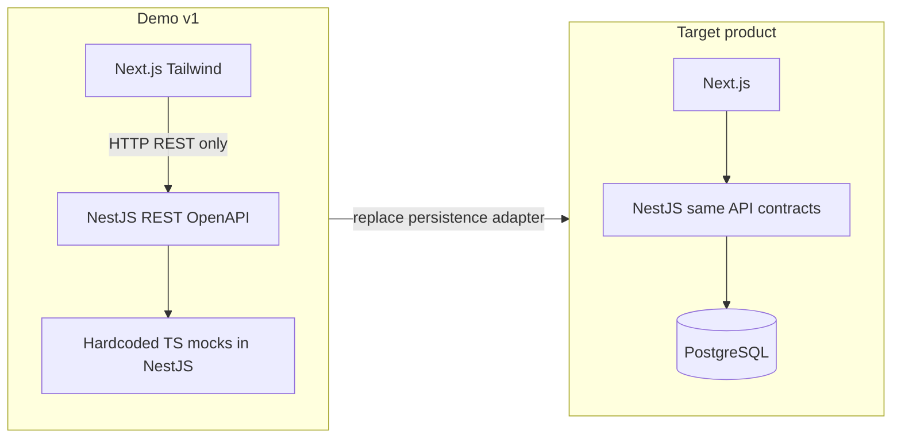
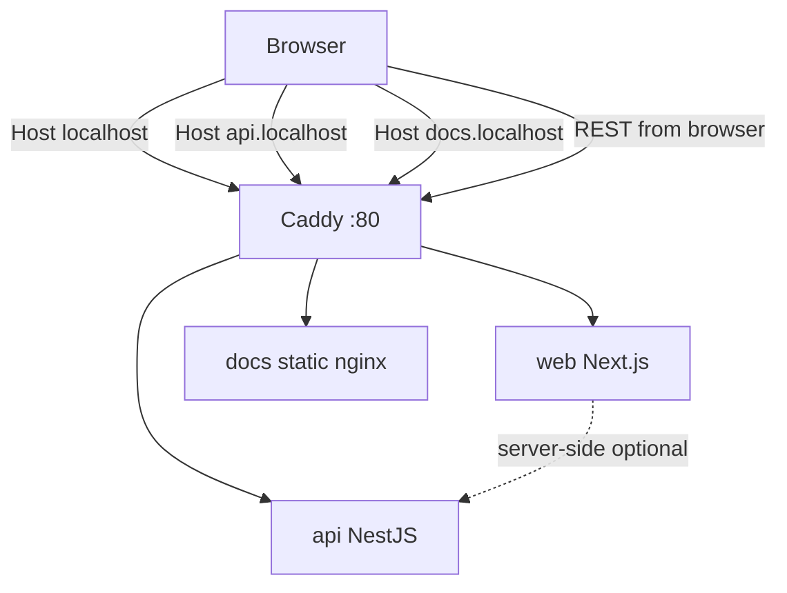
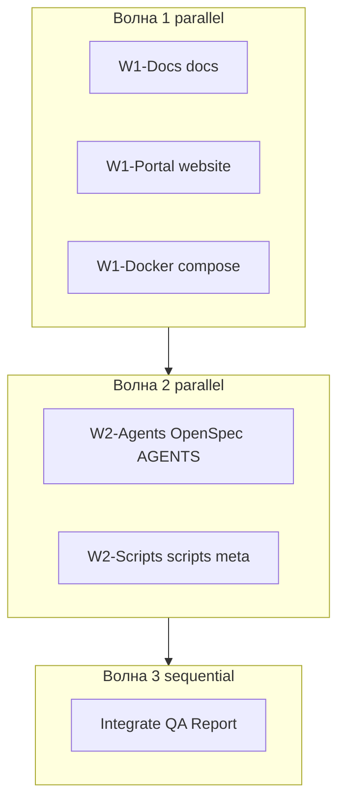

# Инженерная система документации Pharma Project Control

## Зафиксированные решения

| Решение | Выбор | Обоснование |
|---|---|---|
| SDD | **OpenSpec** (MIT) | Living specs + delta-changes; Cursor; без БД |
| OpenSpec telemetry | Global CLI / env | `openspec config set telemetry.enabled false` / `OPENSPEC_TELEMETRY=0`; не в project YAML |
| Портал | **Docusaurus 3.x** (MIT) | Multi-instance без копирования MD; Mermaid; light/dark |
| Публикация OpenSpec | Только `openspec/specs/` | `changes/` не публикуются |
| Поиск | `@easyops-cn/docusaurus-search-local`, `language: ['ru','en']` | Offline; без Ask AI / Algolia |
| Локальный runtime | **Docker Compose + Caddy reverse proxy** | Host-routing; единый up/down |
| URL | `http://localhost` → app; `http://api.localhost` → API; `http://docs.localhost` → docs | `.localhost` → loopback по RFC 6761; Compose сам Host не маршрутизирует |
| Docs container | Отдельный сервис (static nginx) за Caddy | Самостоятельный портал |
| Demo v1 | **Next.js + NestJS**; mock **только в NestJS**; без PostgreSQL | FE только через REST; замена mock→DB без ломки контрактов |
| Целевой продукт | + PostgreSQL, тот же FE/BE/API стиль | Отдельный этап после Demo v1 |
| Язык docs | Только русский | EN-термины в оригинале; i18n зарезервирован |
| AI процесс | Documentation First | Docs в Git = SoT до и после кода |
| Дефекты | Test First (red→green) | Нет «тихого» фикса без падающего теста |
| Coverage | ≥80% statements/branches/functions/lines **отдельно** FE и BE | CI gate; явные exclude |
| Handoff | Markdown-артефакты в Git | Не только chat history |
| Не выбирать сейчас | ORM, monorepo apps layout, auth | Отдельные ADR |
| Scope этапа | **Инфраструктура docs + стандарты + Compose (proxy+docs)** | Код Next/Nest **не** реализуется сейчас |
| Не ставить | Spec Kit, BMAD, Zensical, Material, StrictDoc на старте | Дублирование / незрелость |

---

## Противоречия с прошлыми редакциями и их разрешение

| Было | Стало | Решение |
|---|---|---|
| Demo v1 = frontend-only + mock на клиенте | Demo v1 = FE + NestJS; mock на backend | Заменить `demo-v1-constraints.md`; устареть формулировки frontend-only |
| FE typed data-access к mock-модулям | FE data-access = **HTTP API client** к NestJS | Mock не импортируется во frontend |
| Compose только для docs на `:8080` | Compose: Caddy `:80` + Host-routing; docs на `docs.localhost` | Порт 8080 убрать как основной UX; оставить внутренние порты контейнеров |
| «Нет backend в v1» | Backend есть; **PostgreSQL нет** | Развести Demo v1 / Target / Transition |
| Coverage/app tests в этом этапе | Стандарты и шаблоны **сейчас**; enforcement на коде — когда появится app | Quality gates docs обязательны сейчас; app gates — в стандарте и будущем CI |
| api URL не был задан пользователем | Нужен публичный API host для браузера/Swagger | Зафиксировать `api.localhost` как решение плана; оформить ADR-0003 |

Остальные решения (OpenSpec, Docusaurus multi-instance, RU-only, status≠certainty, telemetry global, no secrets, offline **runtime** docs) **сохраняются**.

---

## 1. Архитектура Demo v1 vs целевой продукт vs переход



### Demo v1 (текущая целевая реализация приложения — следующий этап разработки)

- Frontend: Next.js App Router + TypeScript + Tailwind.
- Backend: NestJS + TypeScript.
- API: REST; контракты — OpenAPI/Swagger (генерируются/ведутся на NestJS).
- Mock data: **только** в NestJS (hardcoded TS objects/arrays), отдаются endpoints.
- Frontend **запрещено** импортировать mock-модули backend или локальные fixture как замену API.
- Frontend получает данные **только** через API-клиент (typed data-access layer над HTTP).
- PostgreSQL **не** используется.
- Backend: слой портов/адаптеров (или эквивалент repository interface): API/use-cases не зависят от того, mock это или БД.

### Целевой продукт

- Тот же FE/BE/API стиль + PostgreSQL.
- Self-hosted Docker Compose.
- ORM / auth / точная структура packages — **отдельные ADR** (ещё не выбирать).

### Переход mock → PostgreSQL

1. Стабилизировать OpenAPI-контракты на Demo v1.
2. Ввести persistence adapter (PostgreSQL) за тем же интерфейсом, что mock repository.
3. Переключить DI/config без изменения контроллеров и без изменения frontend.
4. Миграции/схема БД — отдельный этап + ADR по ORM.

Где фиксируется в docs:

| Файл | Роль |
|---|---|
| `docs/03-product/demo-v1-architecture.md` | Текущая Demo v1 (FE+BE+mock API) |
| `docs/03-product/target-technology-stack.md` | Целевой стек (+ PostgreSQL) |
| `docs/03-product/persistence-transition.md` | Этапы mock→PostgreSQL |
| `docs/06-architecture/arc42.md` | Constraints / solution strategy со ссылками |
| `docs/06-architecture/decisions/0002-*.md` | Направление стека |
| `docs/06-architecture/decisions/0003-local-dev-urls-and-proxy.md` | localhost / api.localhost / docs.localhost + Caddy |

---

## 2. Docker Compose и маршрутизация

### DNS `.localhost`

- По [RFC 6761](https://www.rfc-editor.org/rfc/rfc6761.html) имена в зоне `.localhost` должны резолвиться в loopback.
- Chromium и Firefox реализуют это для `*.localhost`.
- **Docker Compose не делает Host-based routing** — нужен reverse proxy.
- Риск: редкие окружения/старые клиенты без RFC 6761 — fallback `/etc/hosts` описать в README (не как основной путь).

### Выбранная схема: Caddy как edge proxy

Сервисы:

| Сервис | Роль | Host / доступ |
|---|---|---|
| `proxy` (Caddy) | Слушает `:80`, маршрутизация по `Host` | — |
| `docs` | Статика Docusaurus (nginx) | `docs.localhost` → `docs:80` |
| `web` (Next.js) | Frontend | `localhost` → `web:3000` |
| `api` (NestJS) | Backend + Swagger | `api.localhost` → `api:3000` |
| `db` (PostgreSQL) | Позже | Только Docker network; не в Demo v1 |



Внутренняя Docker network: `ppc-net`. Сервисы обращаются по именам `web` / `api` / `docs`.

### Scope текущего этапа реализации docs-системы

- Реализовать и проверить: `proxy` + `docs` → `http://docs.localhost`.
- В `docker-compose.yml` заложить сервисы `web`/`api` (и закомментированный/profile `db`) как **скелет** с теми же сетями и labels/Caddyfile routes; контейнеры app **не обязаны** собираться, пока нет кода приложения.
- Compose profiles: например `docs` (default) и `app` (когда появится код).
- Единые команды (после появления app — полный стек):

```bash
docker compose up --build -d
docker compose down
```

Без обязательного `npm start` вне Docker для runtime. Dev hot-reload **может** остаться опциональным для авторов docs (`docs:dev`) — это инструмент разработки портала, не продакшен-runtime.

### Caddyfile (смысл)

```caddyfile
localhost {
  reverse_proxy web:3000
}
api.localhost {
  reverse_proxy api:3000
}
docs.localhost {
  reverse_proxy docs:80
}
```

Offline: **runtime** собранного `docs` — без CDN/API. Build docs/app — может требовать registry/npm (не заявлять air-gap build без проверки).

Auth на Caddy/docs — по-прежнему нет; ACL на infra позже. Секреты в публикуемых docs запрещены.

---

## 3. Структура репозитория (обновление)

```text
/
├── README.md
├── AGENTS.md
├── CONTRIBUTING.md
├── package.json                    # оркестрация scripts / future workspaces
├── docker-compose.yml              # proxy, docs, web, api; db profile later
├── Caddyfile
├── .env.example                    # без секретов; OPENSPEC_TELEMETRY=0 hint
├── .cursor/rules/
├── openspec/{config.yaml,specs/,changes/}
├── docs/
│   ├── standards/
│   ├── _templates/
│   │   ├── handoff.md
│   │   ├── bugfix-test-first.md
│   │   └── ...
│   ├── 00-portal/                  # + access-and-security, research, final-report
│   ├── 03-product/
│   │   ├── vision-and-scope.md
│   │   ├── target-technology-stack.md
│   │   ├── demo-v1-architecture.md
│   │   └── persistence-transition.md
│   ├── 06-architecture/
│   │   ├── arc42.md
│   │   └── decisions/
│   ├── 07-delivery/
│   │   ├── handoffs/               # артефакты handoff в Git
│   │   │   └── README.md
│   │   └── quality-gates.md
│   ├── 08-quality/
│   │   ├── testing-strategy.md
│   │   ├── coverage-policy.md
│   │   └── architecture-tests.md
│   └── 11-ai-engineering/
│       ├── engineering-constitution.md
│       ├── documentation-first.md
│       └── test-first-bugfix.md
├── scripts/                        # docs checks (сейчас)
├── website/                        # Docusaurus only
└── apps/                           # НЕ создаём код на этом этапе;
    ├── web/                        #   директории-заглушки опциональны
    └── api/                        #   или появляются на этапе Demo v1
```

На этапе Docs Engineering System каталоги `apps/*` можно не создавать физически — только описать в ADR/compose как будущие build contexts. Предпочтение плана: **не создавать пустые apps**, чтобы не провоцировать ложную готовность; в compose — comments + profiles.

---

## 4. Правила AI: Documentation First, Test First, Architecture

Закрепить в `AGENTS.md`, `.cursor/rules/*.mdc`, `docs/11-ai-engineering/engineering-constitution.md`.

### Documentation First (обязательный порядок)

1. Изучить требования, specs, архитектуру, связанные ADR.
2. Определить, какие документы/specs нужно изменить.
3. **Сначала** актуализировать документацию / OpenSpec change.
4. Согласовать с существующими ADR (или предложить новый ADR).
5. Только затем реализация.
6. Проверить соответствие docs.
7. Обновить docs при согласованных отклонениях.

Код не становится единственным хранилищем архитектурных решений.

### Test First для дефектов

1. Ожидаемое поведение.
2. Автотест, воспроизводящий баг.
3. Убедиться, что тест **падает** из-за дефекта.
4. Fix.
5. Тест зелёный.
6. Связанный/регрессионный набор.
7. Docs, если изменилось ожидаемое поведение.

Запрет: «починить код и заявить успех» без failing-then-passing теста.

### Cursor Rules (минимальный набор)

- `alwaysApply` → AGENTS + Documentation First + запрет выдумывать FR/GMP + Demo v1 boundaries.
- `docs/**` → status ≠ certainty; no secrets.
- `openspec/**` → propose → human review → apply → archive.
- `website/**` → no duplication of docs/specs.
- Когда появятся `apps/**`: boundaries FE↛mock; coverage; test-first bugfix; OpenAPI.

---

## 5. Стратегия тестирования и инструменты

Документ: `docs/08-quality/testing-strategy.md` (стандарт сейчас; внедрение на коде — с Demo v1).

| Слой | Инструмент (направление) | Назначение |
|---|---|---|
| Unit FE | **Vitest** | Компоненты, hooks, client mappers |
| Unit BE | **Jest** (стандарт NestJS) | Services, domain, mock repos |
| Integration BE | Jest + Supertest | HTTP endpoints + mock adapters |
| Contract | OpenAPI validation (напр. response against generated schema / schemathesis или Nest OpenAPI e2e assert) | API ↔ спецификация |
| E2E | **Playwright** | Сценарии через `localhost` / `api.localhost` в Compose |
| Architecture | **dependency-cruiser** и/или **eslint-plugin-boundaries** | FE не тянет `apps/api`; слои Nest; запрет mock import во FE |
| Docs QA | markdownlint, link check, frontmatter/IDs, portal-excludes | Уже на этом этапе |
| Compose smoke | `curl -H Host:...` / Playwright health | proxy routing, docs.localhost |

Архитектурные автопроверки (примеры, обязательны к описанию в `architecture-tests.md`):

- frontend не импортирует mock data из backend;
- frontend data-access только через API client;
- ответы API соответствуют OpenAPI;
- use-case/business не зависят от конкретного storage adapter;
- запрещённые dependency edges падают в CI;
- website не содержит копий `docs/` / `openspec/specs`;
- `openspec/changes` не в build портала;
- Compose: docs/app/api reachable by Host (smoke).

Конкретные пакеты contract-тестов зафиксировать ADR при старте Demo v1 (не блокирует docs-этап).

---

## 6. Coverage ≥ 80% (FE и BE раздельно)

`docs/08-quality/coverage-policy.md`:

- Пороги: statements / branches / functions / lines = **80%** каждый.
- Отчёты **раздельные** для `apps/web` и `apps/api`; общий aggregate **не** маскирует провал одной стороны.
- CI job падает при нарушении порога.
- Тесты пишутся **вместе** с функциональностью, не в конце фазы.

Явные исключения (примерный allowlist, уточняется ADR):

- generated OpenAPI clients/types;
- `*.config.*`, bootstrap wiring минимальный;
- Docusaurus `website/` (не продукт);
- чисто типовые файлы без runtime (`*.d.ts`);
- storybook/dev-only tooling при наличии.

Запрещено расширять exclude ради зелёного процента без записи в coverage-policy + review.

На **текущем** этапе docs: политику зафиксировать; CI coverage app — когда появятся apps.

---

## 7. Handoff между AI-агентами

- Шаблон: `docs/_templates/handoff.md`
- Экземпляры: `docs/07-delivery/handoffs/YYYY-MM-DD-<slug>.md`
- Для работы в рамках OpenSpec change — дополнительно (или вместо копии) `openspec/changes/<id>/handoff.md`, ссылка из delivery/handoffs.
- Мелкие задачи: короткий handoff **или** секция в PR по тому же шаблону (без отдельного файла) — порог: >1 сессии агента / смена роли (plan→implement→review→test) → файл обязателен.

### Структура шаблона (компактно)

```markdown
# Handoff: <краткий заголовок>
- id: HO-YYYYMMDD-NN
- date, from_agent_role, to_agent_role
- status: in_progress | blocked | ready_for_review | done

## Задача и контекст
## Ссылки: REQ / OpenSpec change / ADR / DOC
## Сделано
## Изменённые файлы и документы
## Тесты и проверки (команды + результат)
## Не завершено / риски / ограничения
## Следующие шаги (конкретные)
## Documentation First checklist (docs updated? yes/no)
```

Роли передачи: planning → implementation → review → testing → (archive).

---

## 8. Портал Docusaurus (без изменения SoT)

- Instances: `../docs`, `../openspec/specs` only.
- Mermaid, RU search, no Ask AI.
- Build → static files в сервисе `docs`.
- Публикация: **только** через Caddy `docs.localhost` (не основной UX на `:8080`).

---

## 9. Автоматические quality gates

### Сейчас (Docs Engineering System)

| Gate | Команда / проверка |
|---|---|
| Lint MD | `npm run lint:docs` |
| Links | `npm run lint:links` |
| Frontmatter / IDs / certainty | scripts |
| No changes/ in portal build | `check-portal-excludes` |
| Docusaurus build | `npm run docs:build` |
| Compose docs URL | `curl -sS -H "Host: docs.localhost" http://127.0.0.1/` → 200 |
| RU search smoke | ручной/скриптовый чеклист |
| Runtime docs offline | нет обязательных внешних запросов у собранного docs |

### Когда появится Demo v1 app

| Gate | Проверка |
|---|---|
| Unit+integration FE/BE | vitest / jest |
| Architecture boundaries | dependency-cruiser |
| Contract OpenAPI | CI |
| E2E smoke | Playwright через localhost hosts |
| Coverage 80% per app | fail CI |
| Compose full stack | `docker compose --profile app up` healthchecks |

---

## Порядок выполнения текущего этапа (A→E)

**A** — Research/ADR: docs stack; Demo v1 vs target vs transition; Caddy + URLs; access.  
**B** — Foundation: стандарты, шаблоны (handoff, test-first), OpenSpec, AGENTS, rules, quality docs.  
**C** — Portal + Compose `proxy`+`docs`; Caddyfile; skeleton comments/profiles для web/api.  
**D** — QA по таблице gates «сейчас».  
**E** — Final report + README up/down + ADR backlog.

Реализация Next.js/NestJS, PostgreSQL, coverage CI app — **следующие этапы**, не A–E.

---

## Распараллеливание между агентами (work-breakdown плана)

Это **разбиение будущего исполнения**, не запуск. Пока план только согласуется — агентов не стартовать.

Цель при будущем execute: сократить wall-clock, сохранив SoT и без гонок по файлам. Пиковая параллельность: **3 агента** (Волна 1), затем **2**, затем **1** оркестратор.



### Маппинг этапов A–E → пакеты агентов

| Этап | Кто выполняет |
|---|---|
| A Research/ADR (контент) | W1-Docs |
| B Foundation docs/templates/quality/AI texts | W1-Docs |
| B OpenSpec + AGENTS + Cursor rules | W2-Agents (после W1) |
| C Docusaurus | W1-Portal |
| C Docker/Caddy | W1-Docker |
| D QA + E report | W3 |

### Волна 1 — 3 агента параллельно (нет пересечения путей)

| Агент | Scope | Пишет только в |
|---|---|---|
| **W1-Docs** | A+B контент: дерево `docs/`, стандарт, шаблоны, seed product/architecture/ADR/quality/ai-engineering, handoffs | `docs/**` |
| **W1-Portal** | C сайт: scaffold Docusaurus, Mermaid, RU search, sidebars, multi-instance | `website/**` |
| **W1-Docker** | C runtime: `Dockerfile`, `docker-compose.yml` (profiles), `Caddyfile`, `nginx` для docs | корневые Docker/Caddy файлы |

Контракт интерфейсов Волны 1 (без переговоров во время работы):
- Docs paths: `../docs`, `../openspec/specs` относительно `website/`
- Compose service name: `docs`; Host: `docs.localhost`
- `openspec init`, `AGENTS.md`, `.cursor/` — **вне** Волны 1
- Root `package.json` scripts — **Волна 2** (W2-Scripts), Portal не создаёт конкурирующий root package

### Волна 2 — 2 агента после завершения Волны 1

| Агент | Scope | Пишет только в |
|---|---|---|
| **W2-Agents** | `openspec init --tools cursor`; project `config.yaml` без telemetry; `AGENTS.md`; `.cursor/rules`; CONTRIBUTING (CLI telemetry); черновик README | `openspec/**`, `AGENTS.md`, `.cursor/**`, `CONTRIBUTING.md`, `README.md` |
| **W2-Scripts** | `scripts/*`, root `package.json` (`docs:*`, `lint:docs`, `test:docs`), `.gitignore`, `.editorconfig`, `.env.example` | `scripts/**`, корневые meta |

### Волна 3 — один оркестратор (после Волны 2)

1. Сшивка: Docusaurus видит seed docs; navbar/sidebars.
2. `docker compose up --build` → проверка `http://docs.localhost`.
3. Этап D: links, excludes, search RU, offline runtime docs.
4. Этап E: `final-report.md`, финальный README.

### Правила анти-конфликта (для будущего execute)

- Один писатель на path-prefix внутри волны.
- Не параллелить два `openspec init` или два scaffold Docusaurus.
- Между волнами — интеграционный checkpoint оркестратора.
- Handoff каждого пакета: `docs/07-delivery/handoffs/YYYY-MM-DD-wN-<agent>.md`.

---

## Критерии готовности этапа Docs Engineering System

1. `docker compose up --build -d` поднимает proxy+docs; `http://docs.localhost` → портал (HTTP 200).
2. Markdown SoT только в `docs/` и `openspec/specs/`; без дублей в `website/`.
3. `openspec/changes` не в build; check green.
4. Search RU + Mermaid на runtime docs без внешних SaaS.
5. `npm run test:docs` (lint+links+build checks) = 0.
6. Документы Demo v1 / target / transition / ADR URL+proxy существуют и согласованы (нет frontend-only).
7. AGENTS + rules содержат Documentation First, Test First bugfix, запрет approve hypothesis.
8. Handoff template + `handoffs/README` на месте.
9. Testing strategy + coverage policy + architecture-tests описаны; app enforcement помечен как future gate.
10. Telemetry OpenSpec описана через CLI/env; не в project YAML.
11. `final-report.md` в портале.
12. Compose/Caddyfile содержат явную схему маршрутов для future `localhost` / `api.localhost` (даже если web/api ещё не собираются).

---

## Риски и решения, требующие отдельных ADR

**Риски**
- Неполная поддержка `*.localhost` в экзотических клиентах → `/etc/hosts` fallback.
- Caddy vs Traefik: выбран Caddy ради простоты Caddyfile; смена — ADR.
- MDX/`format: 'detect'` и RU search quality — проверка на этапе D.
- Скелет compose с несуществующими `web`/`api` может ломать `compose up`, если сервисы объявлены без profile — **обязательно** profiles/`profiles: [app]`.
- Contract-testing tool ещё не выбран.
- 80% branches на UI может быть жёстким — не снижать молча; только через изменение policy + ADR.

**ADR backlog (не сейчас выбирать детали реализации app)**
- ADR-0001: docs stack (Docusaurus/OpenSpec/search).
- ADR-0002: направление целевого стека.
- ADR-0003: local URLs + Caddy Host-routing (+ api.localhost).
- ADR-xxxx: ORM / persistence library.
- ADR-xxxx: monorepo/package layout (`apps/`, pnpm workspaces и т.д.).
- ADR-xxxx: authn/authz.
- ADR-xxxx: contract testing toolchain.
- ADR-xxxx: e2e в CI против Compose.
- ADR-xxxx: стратегия миграций PostgreSQL.

**Открытые вопросы**
- Нужен ли отдельный `www.localhost` alias.
- CORS: при браузерных вызовах `api.localhost` с страниц `localhost` — настроить CORS на Nest (зафиксировать в Demo v1 design).
- Server Components Next → direct server fetch к `http://api:3000` vs только public `api.localhost`.
- Корпоративный ACL перед docs.
