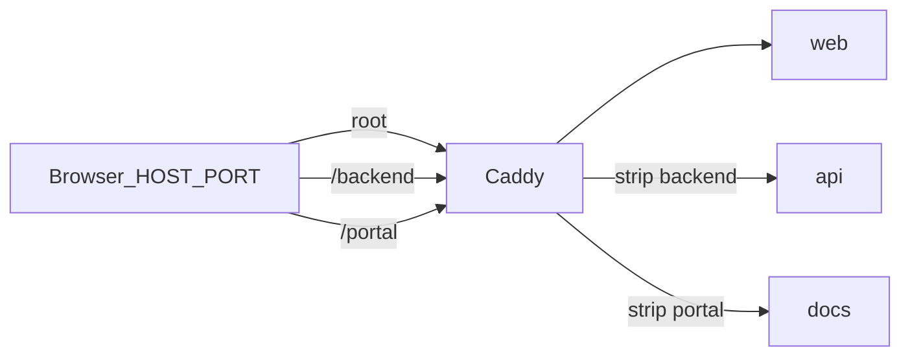

# Minimal server deployment (pharma-demo)

## Контекст (факт)

- Репозиторий: `/home/aleksei/pharma-demo`, ветка `main`, 54 локальных коммита, **remote отсутствует**.
- Working tree: ~173 modified + ~12 untracked (docs/apps/scripts/website). Это не мусор деплоя — **не отбрасывать**.
- `apps/web/.env.local` локально (только `NEXT_PUBLIC_API_BASE_URL`), в Git не входит. Быстрый scan tracked history на типичные secret-пути — пусто.
- Сейчас на `:80` крутится **dev Compose** (`pharma-demo-proxy/web/api/docs`). Не останавливать. Серверную схему проверять на **другом порту** и **другом compose project** (`pharma-demo-server`).
- Backend mock-only; PostgreSQL не нужен. Соседние репозитории не трогать.

## Реальные блокеры «как есть»

1. [Caddyfile](Caddyfile) маршрутизирует `localhost` / `api.localhost` / `docs.localhost` — на `http://SERVER:PORT` API/docs недоступны браузеру.
2. [apps/web/Dockerfile](apps/web/Dockerfile) и [docker-compose.yml](docker-compose.yml) зашивают `NEXT_PUBLIC_API_BASE_URL=http://api.localhost`. `NEXT_PUBLIC_*` вшивается в bundle; runtime env контейнера это **не** исправляет.
3. [apps/web/src/lib/api-client.ts](apps/web/src/lib/api-client.ts) fallback `http://localhost:3001` — на сервере браузер бьёт в машину посетителя.
4. [apps/api/src/main.ts](apps/api/src/main.ts) CORS allowlist в основном localhost; для cross-origin с IP нужен `WEB_ORIGIN`. При same-origin `/backend` CORS менее критичен, но env всё равно задаём.
5. [website/docusaurus.config.ts](website/docusaurus.config.ts): `url` под `docs.localhost`, `baseUrl: /` — не годятся для path `/portal/` на IP.
6. Docs image на Node 20 ([Dockerfile](Dockerfile)); apps на Node 24. Оставить docs на 20, пока build зелёный; не обновлять весь стек. При конкретном fail docs — точечно Node 22.

Production build предпочтителен и достижим (Next `output: 'standalone'` уже в [apps/web/next.config.ts](apps/web/next.config.ts); API multi-stage уже есть). Dev runtime как fallback не планируем без доказанного build-блокера.

## Выбранная схема

Один публичный origin, path-based proxy, без обязательных DNS-поддоменов. Имена Docker-сервисов — только внутри Compose-сети, никогда как browser URL.

```text
http://HOST:PORT/            -> web:3000
http://HOST:PORT/backend/*   -> api:3000   (Caddy strip /backend)
http://HOST:PORT/portal/*    -> docs:80    (Caddy strip /portal; Docusaurus baseUrl=/portal/)
```

| Внешний | Внутри | Назначение |
|---------|--------|------------|
| `/` | Next | UI |
| `/backend/health` | `/health` | API health |
| `/backend/v1/...` | `/v1/...` | REST + query |
| `/backend/api` | `/api` | Swagger (текущий `SwaggerModule.setup('api')`) |
| `/portal/` | docs static | портал |
| `/portal/docs/...`, assets | после strip | deep links |

Почему `/backend`, не `/api`: у Nest Swagger уже путь `api`.

Browser API base: build-arg `NEXT_PUBLIC_API_BASE_URL=/backend` (относительный URL → тот же origin; IP:port и будущий домен без пересборки ради hostname).

Локальный DX (ADR-0003): [docker-compose.dev.yml](docker-compose.dev.yml) + [Caddyfile.dev](Caddyfile.dev) сохраняются. Сервер — **новые** `docker-compose.server.yml` + `Caddyfile.server`, default `HOST_PORT=8080`.

Домен позже: только `WEB_ORIGIN` / `PUBLIC_ORIGIN` в `.env`, path-схема та же.



## Documentation First

1. ADR `docs/06-architecture/decisions/0005-server-single-origin-compose.md` (draft).
2. Ops `docs/10-operations/server-compose-demo.md` (clone, up, URLs, logs, update, rollback).
3. Pointers в [README.md](README.md) и [docs/10-operations/local-dev-and-demo.md](docs/10-operations/local-dev-and-demo.md): local ADR-0003 vs server ADR-0005.

## Test First

1. Unit `resolveApiBaseUrl`: `/backend` + `/health` → `/backend/health`; без `api.localhost` в server default.
2. API CORS: `WEB_ORIGIN=http://127.0.0.1:8080` допускается (плюс опциональный CSV `CORS_EXTRA_ORIGINS`).
3. OpenAPI paths без `setGlobalPrefix` — не ломать [openapi.contract.spec.ts](apps/api/src/openapi.contract.spec.ts).
4. Не отключать typecheck / `test:apps`.

## Файлы

**Новые:** `docker-compose.server.yml`, `Caddyfile.server`, ADR-0005, `docs/10-operations/server-compose-demo.md`, `apps/web/src/lib/resolve-api-base-url.ts` + test, опционально `scripts/smoke-server-compose.sh`, workspace-копия плана в `.cursor/plans/minimal-server-deployment.md`.

**Изменить:** [apps/web/Dockerfile](apps/web/Dockerfile) (ARG base URL), [api-client.ts](apps/web/src/lib/api-client.ts), [apps/api/src/main.ts](apps/api/src/main.ts) (CORS env), [Dockerfile](Dockerfile) docs (`DOCUSAURUS_BASE_URL`/`URL`; убедиться что `build:cross-ref` входит в image build), [docusaurus.config.ts](website/docusaurus.config.ts), [nginx/docs.conf](nginx/docs.conf) при необходимости, [.env.example](.env.example), [.dockerignore](.dockerignore) (`**/.next`, coverage, playwright-report), README/ops, [package.json](package.json) scripts `server:up|down|logs`.

**Не ломать:** `docker-compose.dev.yml`, `Caddyfile.dev`, смысл ADR-0003. Корневые `docker-compose.yml`/`Caddyfile` оставить как local production-like на `*.localhost` либо явно пометить local-only.

## Compose / env / ресурсы

```bash
cp .env.example .env
# HOST_PORT=8080
# WEB_ORIGIN=http://127.0.0.1:8080
docker compose -p pharma-demo-server -f docker-compose.server.yml up --build -d
```

- Build web: `NEXT_PUBLIC_API_BASE_URL=/backend`
- Build docs: `DOCUSAURUS_BASE_URL=/portal/`, `DOCUSAURUS_URL` из PUBLIC_ORIGIN
- Runtime api: `PORT=3000`, `WEB_ORIGIN`
- Только `npm ci` + lockfiles; `restart: unless-stopped`
- Health: api `/health`, web `/`, docs `/` (после strip)
- Docker 24+ / Compose v2; RAM примерно от 4 GiB на build (пик выше); диск примерно от 8 GiB свободно

## Проверки (порт 8080, :80 не трогать)

1. Up server compose на 8080 из изолированного чистого дерева (worktree/rsync без node_modules/.next).
2. UI открывается; DevTools: запросы только на тот же origin `/backend/...`; нет `api.localhost`.
3. Dashboard и entity navigation работают.
4. `/backend/health`, `/backend/api` (Swagger).
5. `/portal/`, asset, deep link docs.
6. Restart контейнеров — сервисы живы; dev на `:80` жив.
7. `npm run test:apps` + новые unit зелёные.

## GitLab (после approve реализации; не сейчас)

Сейчас: **не commit / не push**.

После реализации и URL от пользователя:

1. `git ls-remote` URL; credentials через helper/askpass — не в URL/файлах/логах.
2. `git remote add origin` при пустом remote.
3. Совместный ревью dirty/untracked: deploy-коммиты отдельно от уже существующей продуктовой работы; без `git clean` без явного ok.
4. Не коммитить `.env`, `.env.local`, node_modules, builds, tmp.
5. Scan секретов в истории перед push.
6. Сохранить 54 коммита; если remote с initial README — pull --rebase/merge, **без force**.
7. Осмысленные коммиты (docs ADR/ops, затем feat server compose, затем продуктовые dirty если их включают).
8. `git push -u origin main` после ok. Если GitLab отвергает password — нужен PAT/token (password auth for Git over HTTPS отключён), без раскрытия секретов.

Push ≠ deploy. Для выкладки на Linux позже нужны адрес сервера и способ доступа (SSH и т.п.).

## Запуск на сервере (целевой текст ops-дока)

```bash
git clone <gitlab-url> pharma-demo && cd pharma-demo
cp .env.example .env
# HOST_PORT и WEB_ORIGIN=http://SERVER_IP:PORT
docker compose -p pharma-demo-server -f docker-compose.server.yml up --build -d
```

Обновление: `git pull` + тот же `up --build -d`. Откат: checkout предыдущего commit + `up --build -d`.

## Недостающие данные (проектирование не блокируют)

- GitLab URL + Git token/credentials — для push.
- IP/SSH сервера — для фактического deploy.
- Желаемый HOST_PORT на сервере (в примере 8080).
- Домен — опционально позже через WEB_ORIGIN.

## Порядок после approve

1. ADR-0005 + ops + README.
2. Red tests (base URL, CORS).
3. Compose/Caddy/Dockerfiles/docusaurus/api-client/CORS.
4. Smoke :8080 + :80 жив.
5. Стоп для ревью commit/push состава и GitLab URL.

**Сейчас останавливаемся на ревью плана — без commit/push и без изменения running containers.**
