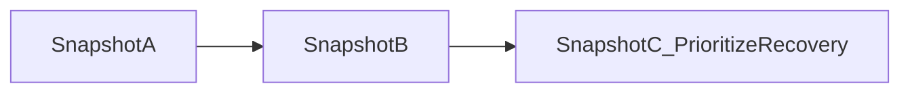

# Stage 1 — OpenSpec Demo v1 Must

## Исходное состояние

- Stage 0 audit: [docs/07-delivery/reports/2026-10-31-req-openspec-readiness-audit.md](docs/07-delivery/reports/2026-10-31-req-openspec-readiness-audit.md) — Must ready; AcceptDateSlip post-state / UI / messaging out.
- OpenSpec CLI **1.15.0**, schema **`spec-driven`** (`proposal` → `specs` → `design` → `tasks`).
- Living specs пусты (`openspec/specs/` только README).
- Уже существует пустой scaffold: [openspec/changes/define-demo-v1-project-control/](openspec/changes/define-demo-v1-project-control/) (только `.openspec.yaml`). **Переиспользуем это имя**, не создаём второй change.
- Commit / push / apps / ADR — **не** в scope Stage 1.

## Change и capabilities (зафиксировано)

Change ID: **`define-demo-v1-project-control`**

Delta specs (пути относительно change):

| Capability dir | C / REQ | Содержание Must |
|---|---|---|
| `project-status-overview` | C-01 / REQ-PROJ-001 | PRJ-01 поля; A/B/C dates; C без сдвига после PrioritizeRecovery; Phase **не** Must |
| `milestone-readiness` | C-02 / REQ-MILE-001 | MS-PS dates/rag; link RISK-001 на B/C; fixture+integrity BR-003; no runtime RAG engine |
| `equipment-delivery-status` | C-03 / REQ-EQPT-001 | EQ-HVAC-01; +21d; OnTrack/Delayed; delivery ≠ PS dates; воспроизводимость Snapshot A/B/C (механизм — later) |
| `risk-issue-impact` | C-04 / REQ-RISK-001 | Issue≠Risk; BR-001 capability vs NC-001 fixture раздельно; Mitigating только от PrioritizeRecovery; Closed transitions **не** специфицировать |
| `management-exception-report` | C-05 / REQ-IMPCT-001+002 | Aggregate + Decision; **основной workflow C-05 = PrioritizeRecovery**; AcceptDateSlip — известный тип / out boundary, без Must AC/state machine |
| `demo-v1-architecture-constraints` | NFR-001/002 | FE→HTTP only; persistence port; PG out; port ≠ auto-compatibility |

Имена совпадают с кандидатами DOC-PROD-010 (+ один NFR capability).

AcceptDateSlip **не** входит в основной demo flowchart как пользовательский сценарий.

## Жёсткие правила содержания specs

- Primary narrative: A → B → C (**PrioritizeRecovery**); значения/даты/связи **только** из [demo-v1-mock-narrative-data.md](docs/03-product/demo-v1-mock-narrative-data.md).
- **AcceptDateSlip:** допускается упомянуть как известный тип Decision и как **ограничение области** (BA-OQ-004/005 open). **Запрещено:** самостоятельный обязательный user scenario; полноценные функциональные AC; state machine Issue/Risk/MS; включение в основной C-05 workflow. Основной C-05 workflow — **только PrioritizeRecovery**.
- Нет: CPM, recovery execution, auto-reforecast, runtime RAG engine, Activity entity, C-06/C-07 Must, GMP/CSV claims.
- Requirements: атомарные SHALL + Scenario с THEN, трассировка к REQ/BR в тексте (related/source), без копипаста BA docs.

## EQ write-path / воспроизведение snapshots

**Нормативно (specs):** система / Demo v1 dataset **должны воспроизводить** утверждённые Snapshot A/B/C (включая EQ delivery states и BR-004 dates). Не предписывать конкретный механизм.

**В design.md:** явно зафиксировать **open / deferred implementation detail** — механизм переключения или обновления между A/B/C (snapshot switching, backend operation, иное) **не выбран** на этапе OpenSpec; не перечислять два обязательных варианта реализации; не выдавать выбор за принятое продуктовое решение.

**Product decision rule:** если при формализации выяснится, что без выбора механизма нельзя однозначно сформулировать пользовательски наблюдаемое поведение — **остановиться и задать конкретный вопрос пользователю**, не решать самостоятельно.

Aggregate DTO: в design можно назвать контракт (напр. `DirectorImpactAggregate`) по полям REQ-IMPCT-001; смысл не менять.

## Порядок артефактов OpenSpec

Следовать CLI (не изобретать workflow):

1. `openspec status --change define-demo-v1-project-control --json`
2. Для каждого artifact: `openspec instructions <id> --change ... --json` → писать по `template`/`instruction` в `resolvedOutputPath`
3. Порядок: **proposal** → **specs** (6 capability dirs) → **design** → **tasks**
4. `openspec validate` / status до зелёного состояния артефактов
5. **Не** запускать apply / archive / apps implementation

### proposal.md
Проблема/цель Demo v1; Must C-01…C-05; A→B→C PrioritizeRecovery; out of scope (AcceptDateSlip SM/AC, UI, C-06/07, CPM, recovery exec, PG, auth; EQ switch mechanism deferred); assumptions; success criteria (walkthrough business outcome).

### specs/*/spec.md
Нормативное поведение; scenarios покрывают Snapshot A/B/C где применимо; AcceptDateSlip — только boundary/out notes, без Must scenarios; Closed transitions out.

### design.md
Логические компоненты FE/BE/mock adapter; domain entities/links (ссылка на DOC-BA-015); REST ownership mock NestJS; persistence port; **EQ A/B/C reproducibility + deferred mechanism**; open questions list (включая BA-OQ и deferred impl); не выбирать ORM/auth/DB без ADR.

### tasks.md
**Только** задачи текущего этапа: создание/доработка OpenSpec artifacts, синхронизация docs/traceability, validation, `test:docs`, Stage 1 report.  
**Запрещено:** фиктивные implementation tasks; scaffold Next/Nest; API/UI/DB tasks; «implement capability X in code».

## Синхронизация docs (минимальная)

| Файл | Действие |
|---|---|
| [docs/02-business-analysis/traceability-matrix.md](docs/02-business-analysis/traceability-matrix.md) | Добавить колонку/секцию **OpenSpec** в существующем формате: Scope→C→PROC→BR→REQ→**OpenSpec capability**→AC/walkthrough |
| [docs/03-product/demo-v1-capabilities.md](docs/03-product/demo-v1-capabilities.md) | C-01 BR: синхронизировать с REQ-PROJ (BR-004/006 как правила forecast/no-reforecast, отображаемые на Project) **без** изменения текста BR |
| [docs/04-requirements/README.md](docs/04-requirements/README.md) | Убрать «OpenSpec только после human review»; указать freeze BA-OQ-001 + active change |
| [docs/07-delivery/handoffs/](docs/07-delivery/handoffs/) | Новый handoff `2026-10-31-req-openspec.md` + строка в README; BA/PD handoff не переписывать целиком |
| [docs/07-delivery/reports/](docs/07-delivery/reports/) | `2026-10-31-req-openspec-stage1.md` — состав change, REQ→OpenSpec map, validation, test:docs, assumptions, open Qs, no apps |
| Delivery README | Ссылка на Stage 1 report |

Не трогать: mock snapshots/dates, BR-001…007 текст, Domain cardinality (кроме ссылок), BA-OQ statuses, Discovery narrative.

Сохранить согласованный Cursor plan в [`.cursor/plans/`](.cursor/plans/) (ссылки на OpenSpec/docs, без дублирования ADR).

## Product decisions во время выполнения

- Не предполагать, что design assumptions закрывают все вопросы.
- При неоднозначности, **требующей продуктового решения** (меняет наблюдаемое поведение / AC / scope) — **стоп** и конкретный вопрос пользователю.
- Не маскировать такие решения под assumption без явной маркировки и без остановки, если они влияют на Must-поведение.

## Проверки завершения Stage 1

1. OpenSpec validate/status для change — PASS  
2. `npm run test:docs` — PASS  
3. Semantic checklist: snapshots A/B/C; Issue≠Risk; delivery≠PS; no CPM/recovery/auto-reforecast/RAG engine; AcceptDateSlip без Must AC/SM; OQs still open; EQ mechanism не зафиксирован как Must  
4. `apps/**` отсутствует; нет новых ADR  
5. Итог в чате: создано / изменено / проверки / **фактические** вопросы пользователю (если возникли) / готовность к human review OpenSpec (не к apps)

## Вне scope этой работы

Apply OpenSpec → living specs; Nest/Next scaffold; UI; PostgreSQL; закрытие BA-OQ/HIP; commit; выбор EQ switch mechanism.
