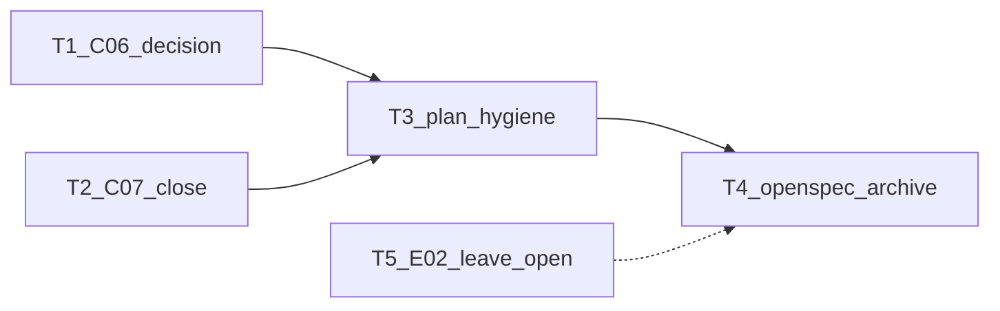

# Pharma demo closeout (остатки)

**Контекст:** HEAD `972e36a`, working tree clean, ahead 16. Cursor = исполнитель; Codex = координатор. Мандат пользователя этой сессии = решение по обратимым остаткам и завершению lifecycle; **не** подменять прошлый contract-review 2026-11-06 выдуманным apply-approval и **не** повышать уже `approved` doc/OpenSpec статусы. Scope: только открытые остатки call-plan; без новых features/мобильности/`reference platform`/C05/E04.

**Артефакт review:** Plan mode запрещает Write → полный план здесь (и в CreatePlan). После approve Codex/Agent: сохранить копию в `/tmp/pharma-closeout-plan.md`, затем исполнять. **Стоп после этого плана — один review Codex, без реализации.**

---

## Открытое сейчас (сверка)

| ID | Статус в [pharma-demo-call-work-plan.md](docs/07-delivery/pharma-demo-call-work-plan.md) | Действие closeout |
|---|---|---|
| **C06** | `[ ]` | Закрыть обоснованным **no-op** |
| **C07** | `[ ]` (текст чекбокса про ОСУП устарел относительно продукта) | Закрыть по **рабочему режиму**; ОСУП/цвет отклонения out |
| **E02** | `[ ]` | Оставить открытым; автопрогон ≠ человек |
| **C05, E04** | `[ ]` | Не трогать (вне scope) |

Пять calendar OpenSpec (все ещё active, living `schedule-workspace` **нет**):

1. `demo-v1-schedule-work-bars-links` — 24/26; open: Archive, G12 (G12 в продукте уже сделан)
2. `schedule-hierarchy-baseline-forecast` — 9/12; open: E02, C07, Apply/archive
3. `schedule-work-actual` — 13/13 complete; living не sync
4. `schedule-c-cross-project-subsample` — 7/7 complete; living не sync
5. `schedule-unified-geometry` — 11/11 complete; living не sync

Порядок archive уже доказан на копии: [2026-11-06-schedule-openspec-order.md](docs/07-delivery/reports/2026-11-06-schedule-openspec-order.md). Вне scope archive: `portfolio-program-project`, `demo-v1-r2-lifecycle-controls`.

---

## Независимые треки



T1–T3 параллельны по смыслу до общего commit docs; T4 строго после T1–T3 (и после отметки tasks); T5 не блокирует T1–T4 и **не** закрывает чекбокс.

### T1 — C06: закрытие без удаления линий

**Решение (принято в плане):** вертикали `.vis-grid.vis-minor` на варианте 2 = **месячные границы**; скрытие ухудшает чтение ([DOC-DEL-C06](docs/07-delivery/reports/2026-11-06-c06-vis-month-grid.md)). Согласованных «помех» кроме оси/месяца/asOf нет → **ничего не удалять**; CSS hide не вносить; текущий `color-mix` contrast оставить.

**Критерий done:**

- Чекбокс C06 `[x]` в call-plan
- Короткий addendum в том же C06-отчёте: решение closeout = keep month grid; элемент для удаления не назван
- Код `executive-timeline-vis.tsx` без hide-правила

**Файлы:** [pharma-demo-call-work-plan.md](docs/07-delivery/pharma-demo-call-work-plan.md), [2026-11-06-c06-vis-month-grid.md](docs/07-delivery/reports/2026-11-06-c06-vis-month-grid.md); код только verify.

### T2 — C07: конкретный критерий + минимальные правки

**Критерий закрытия C07 (конкретный, без ОСУП):** пункт «рабочий режим» из [schedule-work-actual/design.md](openspec/changes/schedule-work-actual/design.md) «Критерий закрытия» + UX [§1.8](docs/05-ux-ui/demo-v1-schedule-workspace.md) / §1.11, уже принятый прогоном [DOC-DEL-C07-ACCEPT](docs/07-delivery/reports/2026-11-06-c07-product-acceptance.md):

1. Режим по умолчанию «Базовый план / прогноз»: ≤2 полосы; база overlay (`--text-muted`, gap **2px**, bar **8px**, row **32px**) над прогнозом при обоих концах базы; у `8.2.1` только прогноз; у `WK-01` база над совпадающим прогнозом; подписей факта нет.
2. Режим «Базовый план / факт»: нижняя полоса = закрытый факт иначе прогноз; у `WK-01` база+закрытый факт; у `8.2.2` таблица `2027-03-01`/`—`, на диаграмме прогноз **без** tick начала; три семантики подписи (`Факт` / `Прогноз — факт не завершён` / `Прогноз — факта нет`) в **accessible name / title / `data-fact-caption` / table**, не paint на фигурах (§1.11); четыре колонки дат факта.
3. Валидация API: плохие даты / later-than-asOf отвергаются; `Completed` не создаёт факт.
4. Края SS/FS двигаются только у `WK-01` при смене режима; FF/SF нет; стрелки на нижней полосе.
5. **Семантика отклонения без ОСУП:** заливка нижней полосы = существующие status tokens (`--status-warn|info|danger|ok-*`); сдвиг дат = две полосы база/факт; **отдельный цвет «отклонение факта от базы» не вводить** и не утверждать, что макет прочитан.

**Не входит в C07:** макет ОСУП, новый deviation hue, tick открытого факта, reference platform.

**Минимальный код:** только если verify на `localhost:3080` / unit (`schedule-comparison`, `to-gantt-presentation`, board) покажет регресс относительно пунктов 1–4. Ожидание: **код менять не нужно** (fact mode уже в сборке; captions layer намеренно снят; a11y через `factCaption`). Не чинить «косметику» (`|| 26` fallback) в этом closeout, если критерии зелёные.

**Docs:**

- Call-plan: C07 `[x]`; переформулировать текст пункта и §8/«Готовность» с «ожидает ОСУП» → «рабочий режим закрыт по design; ОСУП/deviation-hue отложены вне демо»
- При необходимости одна строка в C07-accept отчёте: closeout checkbox поставлен по мандату closeout, без claim «макет прочитан»
- [demo-v1-acceptance-walkthrough.md](docs/03-product/demo-v1-acceptance-walkthrough.md) deferred: убрать «Полосы факта нет» / «C07 до макета ОСУП» как блокеры демо

**Файлы кода (verify):** `schedule-comparison.ts`, `to-gantt-presentation.ts`, `dhtmlx-gantt-adapter.tsx`/`.css`, `baseline-overlay.ts`, `schedule-comparison-toggle.tsx`, `schedule-board.tsx`, fixtures actuals.

### T3 — Hygiene общего плана (тот же tracker)

Только [pharma-demo-call-work-plan.md](docs/07-delivery/pharma-demo-call-work-plan.md) (+ точечные связанные status-строки walkthrough/UX при противоречии). **Не** создавать второй tracker.

Исправить устаревшее:

- H04 / §17: зазор **4px → 2px** (код `BASELINE_GAP_PX = 2`, UX §1.11)
- §15: «пустой список связей» / «нужны интервалы» — противоречит G07–G11 done
- §8 evening / §17 / G05: формулировки «факта нет / C07 открыт как нереализованный факт» → рабочий режим есть; открытым оставался только ОСУП-хвост, который T2 снимает с демо-критерия
- Status-блоки recovery/followup: синхронизировать галочки C06/C07 после T1/T2; E02/C05/E04 без ложных закрытий
- Не трогать `status: draft` frontmatter → не повышать

### T4 — OpenSpec lifecycle (последовательный archive)

**Готовность до archive:**

- После T2: в `schedule-hierarchy-baseline-forecast/tasks.md` отметить `[x] C07`; **оставить `[ ] E02`**
- В `demo-v1-schedule-work-bars-links/tasks.md`: отметить `[x] G12` (уже в продукте/плане); пункт Archive отметить при выполнении шага
- Не выдумывать, что review 2026-11-06 = apply; в handoff/отчёте явно: **apply/archive authorized by user closeout mandate (this session)**
- Proposal lifecycle: выполнить archive workflow (перенос в `openspec/changes/archive/YYYY-MM-DD-*`), не вручную «повышать» поле status до approved

**Порядок (обязательный):**

```bash
openspec validate <each> --strict --type change --no-interactive
openspec archive demo-v1-schedule-work-bars-links --yes
openspec archive schedule-hierarchy-baseline-forecast --yes   # E02 остаётся open → --yes
openspec archive schedule-work-actual --yes
openspec archive schedule-c-cross-project-subsample --yes
openspec archive schedule-unified-geometry --yes
openspec validate --specs --strict
```

После каждого archive — `validate --specs --strict`. Ожидание: появляется living `openspec/specs/schedule-workspace/`; architecture constraint RENAMED/MODIFIED из change #1. История: папки archive сохраняют proposal/tasks/design/deltas.

**Критерий done:** пять change в `archive/`; living spec валиден strict; portal/docs links не ломаются (не ссылать unpublished changes); короткий отчёт/строка в call-plan status + handoff.

### T5 — E02 (человек обязателен)

- Чекбокс E02 **остаётся `[ ]`**
- Допускается независимый автопрогон Cursor по [director-rehearsal.md](docs/07-delivery/director-rehearsal.md) с записью «technical run, not E02» — **не** заполнять секцию «Репетиция (E02)» walkthrough как закрытие
- Не считать автопрогон human approval

---

## Порядок исполнения после approve

1. Записать этот план в `/tmp/pharma-closeout-plan.md` и при необходимости `.cursor/plans/` (ссылка, не дубль ADR/OpenSpec).
2. T1+T2 verify + T3 docs правки (один docs-проход по call-plan).
3. Отметить OpenSpec tasks G12/C07; прогнать archive sequence T4; validate.
4. Опционально T5 technical rehearsal.
5. Handoff `docs/07-delivery/handoffs/2026-11-07-pharma-closeout.md`: что закрыто, E02 open, C05/E04 untouched, archive list, без fake approvals.

---

## Summary (≤2500 символов)

HEAD 972e36a clean. Остатки: C06, C07, E02; C05/E04 вне scope. T1: C06 закрыть keep `.vis-minor` как месячные границы (отчёт C06) — без hide. T2: C07 закрыть по design «рабочий режим» + §1.8/1.11/токены статуса; ОСУП и отдельный deviation-hue out; код только при регрессе (ожидание: no-op). T3: в том же call-plan убрать 4px→2px, «пустые links», устаревшее «факта нет». T4: после отметки G12/C07 tasks — archive пяти calendar changes по DOC-DEL-SCHED-ORDER с `--yes` (E02 open), validate living `schedule-workspace`; мандат сессии = apply authority, не подмена review 2026-11-06. T5: E02 open; автопрогон ≠ человек. Нет reference platform/новых фич. Стоп на review Codex до реализации; /tmp файл — после выхода из Plan.
