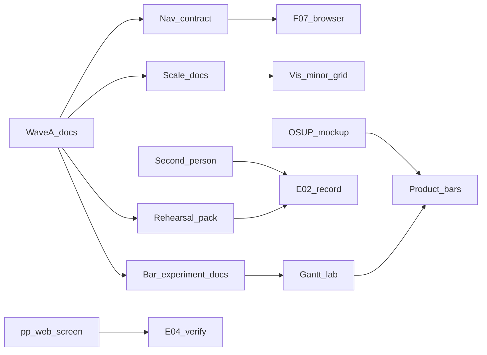

# Репетиция показа и открытые E02, E04, F07, C05–C08

Согласован 2026-11-06. Рабочая копия этого файла — источник этапа. E02 этим планом не закрывается.

Ближайший показ не меняется: портфель → программа → проект, C → D → F, одна прогнозная полоса на работу. Общий план работ отмечается только после подтверждённого результата. E02 в этом этапе не закрывается.

Технический прогон 2026-11-06 на `http://127.0.0.1:3080` уже прошёл маршрут без правок кода. Старт C без программы: «Вехи портфеля», «Требуется решение», запуск `06.10.2027`. Выбор «Строительство» даёт «Вехи программы» и `?program=PRG-CON`. «Перейти к программе» оставляет снимок C; ссылка «Отставание монтажа панелей чистых зон» появляется на D и ведёт к строке AN-08. Карточка: «Лебедева Ольга Викторовна», отдельная фраза про поставку, ссылка оборудования на `/equipment/EQ-CLN-01` (на экране имя «Панели чистых помещений», не литерал id). Крошки карточки: `PRJ-01 / Проекты / AN-08`. «Назад» возвращает на программу, затем на `/?program=PRG-CON`, снимок не откатывается. На F три отметки «Решение записано», ссылка Соколова `/people/PER-01`, запуск `06.10.2027` (+21). Сайдбар 240px; над ним нет продуктовой кнопки, только скрытая ссылка «Перейти к основному содержимому».

## Допущения

- Инструкция участника идёт по короткому маршруту выше. Фильтр состава `PRG-DIG` / `AN-15` остаётся необязательной проверкой ведущего, не шагом письма.
- Снимок живёт в `sessionStorage` (`ppc.demo.snapshot`). Пустое хранилище поднимает A, не C. Сброс — записать `C` и открыть `/` без `?program=`.
- Крошки демо и `reference platform` в этом этапе не переписываются. E04 — контракт в документации pharma-demo.
- C06, если план принят без другой линии: спрятать только мелкую вертикальную сетку vis-timeline (вариант 2). Вариант 1, маркер даты и месячные деления не трогать. Пункт остаётся открытым до сравнения кадров.
- C07–C08: лабораторная страница вне сайдбара и вне `/schedule`. Адаптер [dhtmlx-gantt-adapter.tsx](apps/web/src/components/schedule/dhtmlx-gantt-adapter.tsx) не меняется. `reference platform` не меняется.

## Волна A — документы до кода

Один писатель на файл. Идут параллельно.

- Репетиция (E02): новый [docs/07-delivery/director-rehearsal.md](docs/07-delivery/director-rehearsal.md) и ссылка из раздела «Репетиция (E02)» в [demo-v1-acceptance-walkthrough.md](docs/03-product/demo-v1-acceptance-walkthrough.md). Письмо участнику, чеклист ведущего, сброс (`ppc.demo.snapshot`, `ppc.demo.notificationPopup`, `ppc.demo.notificationRead`), шаблон отзыва: шаг, ожидание, факт, буква снимка, URL. Явно: клик по программе не открывает страницу; проблема панелей есть на D, не на C; два «Назад» только если не заходили в состав; дата запуска смотрится в «Запуск портфеля».
- Навигация (E04, F07): [demo-v1-shell-navigation.md](docs/05-ux-ui/demo-v1-shell-navigation.md). Зафиксировать текущие крошки демо (не ссылки; состав не отличается от программы; карточка теряет программу) и минимальный контракт платформы ниже. F07 не закрывать.
- Снимки (C05–C06): [demo-v1-dashboard.md](docs/05-ux-ui/demo-v1-dashboard.md). Уточнить гипотезу C05. Перечислить вертикали и критерий «до/после» для мелкой сетки vis. Авторские тексты фикстур не переписывать.
- Полосы (C07–C08): [demo-v1-schedule-workspace.md](docs/05-ux-ui/demo-v1-schedule-workspace.md) §1.5. Описать эксперимент и вопросы к макету. ADR-0004 и OpenSpec не менять, пока эксперимент не даст результат и человек не решит переносить его в продукт.

## Волна B — параллельно после своих документов

- E02: кода нет. Технический прогон уже записан в комплект. Закрытие только после прогона другим человеком и дописки раздела «Репетиция (E02)».
- F07: ещё раз открыть `http://127.0.0.1:3080` в текущем окне и на ширине 1100. Отличить продуктовую кнопку от skip-link и от dev-индикатора Next.js (`devIndicators.appIsrStatus: false` в [next.config.ts](apps/web/next.config.ts); `buildActivity` может быть справа снизу). Дописать условия в [2026-11-06-f07-g12-shell.md](docs/07-delivery/reports/2026-11-06-f07-g12-shell.md). Код сайдбара не менять, если кнопки нет.
- C06: в [executive-timeline-vis.tsx](apps/web/src/components/dashboard/executive-timeline-vis.tsx) скрыть `.vis-grid.vis-minor`. Кадры снимка C, вариант 2, обычная и узкая ширина, с программой и без, в `/tmp/pharma-demo-artifacts/c06/` (не в git). Сравнение: маркер даты и крупные месячные линии остаются различимы. Тест на класс сетки, если он уже покрывается рядом.
- C08: страница лаборатории, не входящая в `NAV_ITEMS`. Установлен `dhtmlx-gantt@10.0.3`, license MIT. Первое утверждение прототипа: `gantt.license === 'mit'` и `addTaskLayer` не функция экземпляра. Затем проверить `render: "split"` и `open_split_tasks` из установленных типов (`dhtmlxgantt.d.ts`: subtasks in one row). Если split не рисует две полосы, повторить приём overlay `posFromDate` + `getTaskPosition` только в лаборатории. Данные лаборатории: короткая работа в один день, длинная в несколько дней, интервал базы и интервал факта со сдвигом, одна стрелка FS, светлая и тёмная тема. Отсутствие факта — полоса факта не рисуется, строка и прогноз остаются. Отчёт: что подтвердил код типов и что подтвердил экран.

## Контракт возврата на платформе (E04)

Подтверждено чтением кода, экраны `reference platform` не открывались.

- Демо: [breadcrumbs.tsx](apps/web/src/components/shell/breadcrumbs.tsx) показывает `PRJ-01 / раздел / id`. Снимок в крошках нет. Карточка не знает, пришли из программы или из `/projects`; возврат в программу — ссылка имени программы и история браузера.
- `reference platform`: списки и карточки портфеля, программы и `/app/projects-legacy` имеют крошки своего раздела. [ProjectViewCard.tsx](reference platform/app/app/(features)/projects-legacy/[projectId]/_container/ProjectViewCard.tsx) даёт только «Проекты → проект». Портфель и программа есть ссылками в теле карточки, не в крошках.
- Предлагаемый минимум, гипотеза: прямой URL карточки стабилен; крошки строятся из данных карточки, не из referrer: портфель → программа → проект; клик по программе ведёт на карточку программы; приход из общего списка даёт тот же trail. Снимок и выбранная программа на платформе этим контрактом не обещаются: в коде `reference platform` сессии снимка демо нет. Проверка экрана — отдельная зависимость.

Перед любой правкой `reference platform`: его `AGENTS.md`, doc-first и visual-layer rules. Этот этап туда не входит.

## C05 — рекомендуемое правило, гипотеза

В `reference platform` нет контракта сравнения снимков дашборда. Ближайший найденный аналог — сравнение двух версий метаданных (`settings/data-model/version-history/compare`), это не период портфеля.

Рекомендация, не факт: база по умолчанию — предыдущий сохранённый снимок; UI всегда пишет «Сравнение с: …»; пустой период показывает пустую фразу и не подставляет последнее удачное сравнение; «дата снимка» и «база сравнения» — разные подписи. Демо по-прежнему называет предыдущую букву A–S через [trend-heading.ts](apps/web/src/lib/dashboard/trend-heading.ts). C05 не закрывается этой записью.

## C07 — что уже известно и что должен макет

Подтверждено: одна прогнозная полоса `startDate`…`endDate`, OpenSpec `demo-v1-schedule-work-bars-links`, ADR-0004 запрещает `addTaskLayer` и встроенные baselines PRO. Файлов ОСУП, OSUP и figma-макетов графика в соседних репозиториях нет.

Макет должен ответить: какие две полосы из трёх (база, прогноз, факт); что остаётся основной; вертикальный порядок и цвет отклонения; неполный факт; куда крепится стрелка; одна строка таблицы на несколько полос. Пока макета нет, лаборатория отвечает только на вопрос Community API.

В продукт полосы переносятся только после макета, подписанного UX, addendum ADR-0004 и отдельного OpenSpec change. `/schedule` до этого остаётся с одной прогнозной полосой.

## Роли и файлы

- Репетиция: walkthrough и `director-rehearsal.md`.
- Навигация: shell UX и отчёт F07. Не трогает walkthrough.
- Шкала: dashboard UX и, после него, только vis-компонент.
- Полосы: schedule UX, затем только новая лабораторная страница и её тест.
- Интегратор не редактирует эти файлы, пока треки не закончены. Затем один проход: вариант 1 и `/schedule` не изменились, маршрут C → D → F жив, в плане работ дописаны статусы без галочек E02, E04, F07, C05–C08.

## Что начинается сразу и что ждёт снаружи

Сразу после согласия: комплект репетиции, контракт крошек, гипотеза C05, каталог линий, повтор F07, правка мелкой сетки vis, лаборатория Gantt.

Ждёт человека: запись репетиции в walkthrough. Артефакт — заполненный шаблон отзыва. Пока его нет, комплект уже можно переслать.

Ждёт макет ОСУП: перенос двух полос в продукт, ADR и OpenSpec. Пока его нет, идёт лаборатория и список вопросов.

Ждёт запущенный `reference platform` с входом: сверка крошек на экране. Пока его нет, контракт опирается на прочитанный код.

Ждёт скрин постановки или появления collapse в коде: закрытие F07. Пока кнопки нет, пункт открыт.

## Решения, которые нужны от вас

1. Подтвердить, что единственная правка C06 в этом этапе — скрыть мелкую сетку vis-timeline, а стебли варианта 1 остаются.
2. Подтвердить, что кликабельные крошки демо и правки `reference platform` не входят в этап.
3. Назвать участника репетиции, когда комплект можно отправлять. Без этого E02 останется открытым, комплект всё равно готовится.
