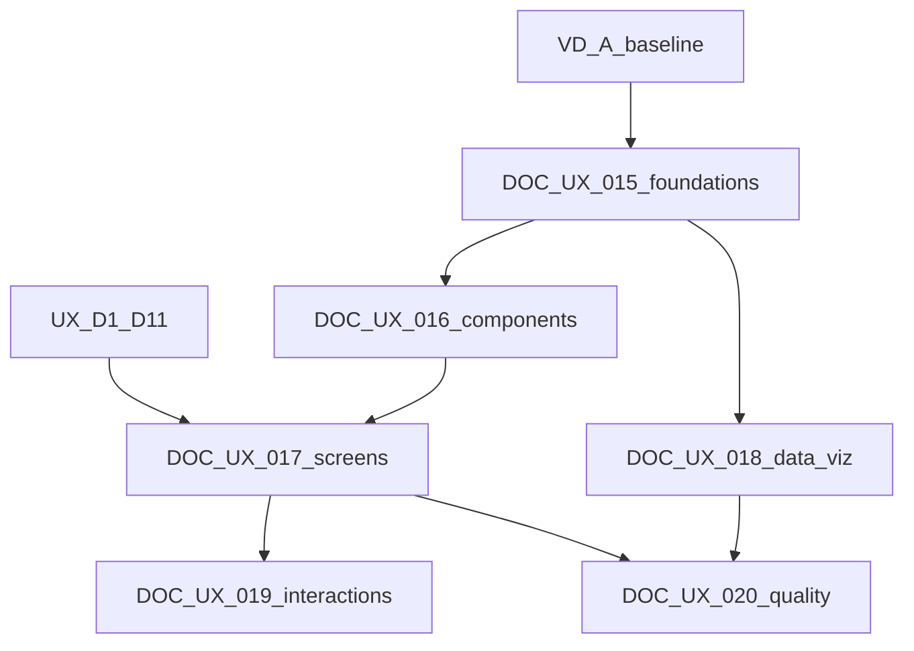

# UI Design / Design Specification — Demo v1

## Статус плана

**APPROVED** для выполнения. **Iterations 0–2 COMPLETED** (DOC-UX-014, DOC-UX-015, DOC-UX-016). Iterations 3–5 **not started**.

**Confirmed:** BA-OQ-006 working assumption = **V1 single table + Type**; BA-OQ-006 remains **open**; D12 **deferred**; VD-A / D1–D11 not reopened.

**Iteration 1 delivered:** concrete Light/Dark HEX; semantic status aliases; WCAG contrast calculations; type/spacing/radius; shadcn map; a11y checklist (`proposal`).

**Iteration 2 delivered:** `demo-v1-component-specification.md` (DOC-UX-016) — screen-driven components; StatusIndicator four models; Links≠Impact; DecisionPanel BR-006; viz boundaries only (`proposal`).

**Clarifications for later iterations:** (1) browser contrast check at impl; (2) StatusIndicator shared shell, distinct semantic models per entity status family; (3) V1 Issues & Risks table = shared columns only.

---

## 1. Результат исследования

**Готовность к UI Design:** Visual Direction завершён; **VD-A** = `approved Visual Direction baseline`; D1–D11 = `approved UX decision`; shell/stack (shadcn, TanStack Table, Recharts) зафиксированы. UI Design wave started (Iter 0).

**Фактические пути (не `03-product-definition`):** product живёт в [`docs/03-product/`](docs/03-product/). UX/VD — [`docs/05-ux-ui/`](docs/05-ux-ui/) (DOC-UX-001…013). Living OpenSpec — [`openspec/specs/`](openspec/specs/) (6 specs). Apps **нет**.

**Уже решено — не переоткрывать:** VD-A; D1–D11; Links = DOC-BA-015 only; Schedule = MS + EQ delivery; BR-006 honesty; KPI ≥4 or omit; Light/Dark + Snapshot A/B/C in App Bar; AcceptDateSlip не Must journey.

**Пробелы, которые закрывает UI Design (не VD):** конкретные Light/Dark HEX и token→shadcn mapping; component anatomy/sizes/states; screen layout grids и density numbers; measurable a11y checklist; interaction details; cross-screen consistency; UI acceptance criteria.

**Открытое, что UI Design не закрывает:** D12 (Gantt lib — только visual semantics); BA-OQ-006 (layout Issue/Risk — рабочая assumption для спецификации экрана, без закрытия OQ); BA-OQ-004/005/002 + HIP-*; Closed/Amber; mock volume `hypothesis` (DOC-PROD-012 не трогать).

**Риск противоречий:** narrative spine ≠ Domain edges (уже исправлено в VD); UI Design обязан повторять это в data-viz/screens. Не смешивать `approved Visual Direction baseline` с frontmatter `status: approved` на docs.

---

## 2. Источники (обязательная сверка при выполнении)

| Область | Пути |
|---------|------|
| VD baseline | [`demo-v1-visual-direction.md`](docs/05-ux-ui/demo-v1-visual-direction.md), [`demo-v1-design-tokens.md`](docs/05-ux-ui/demo-v1-design-tokens.md), [`demo-v1-screen-compositions.md`](docs/05-ux-ui/demo-v1-screen-compositions.md) |
| UX | DOC-UX-001…009 (concept → traceability), esp. shell, dashboard, schedule, entity-detail |
| Domain / BR | [`domain-model-demo-v1.md`](docs/02-business-analysis/domain-model-demo-v1.md), [`business-rules-demo-v1.md`](docs/02-business-analysis/business-rules-demo-v1.md), [`ba-registers.md`](docs/02-business-analysis/ba-registers.md) |
| Product / mock | [`docs/03-product/`](docs/03-product/) (capabilities, functional-scope, mock-narrative-data, walkthrough) |
| REQ | [`docs/04-requirements/`](docs/04-requirements/) REQ-PROJ/MILE/EQPT/RISK/IMPCT/NFR |
| OpenSpec | 6 living specs under [`openspec/specs/`](openspec/specs/) |
| Handoffs | [`2026-10-31-visual-direction.md`](docs/07-delivery/handoffs/2026-10-31-visual-direction.md), [`2026-10-31-ux-ui.md`](docs/07-delivery/handoffs/2026-10-31-ux-ui.md) |
| Docs rules | [`documentation-standard.md`](docs/standards/documentation-standard.md), AGENTS.md |

---

## 3. Ограничения и зависимости

**Hard constraints:** не менять Domain/BR/REQ/OpenSpec/DOC-PROD-012; не apps/npm/Gantt spike/ADR; не закрывать BA-OQ/HIP/D12; не Activity/WBS/CPM/deps/drag-reschedule; BR-006 honesty; FE later only via API (REQ-NFR-001).

**Decision status vocabulary (новые UI Design утверждения):**
- `approved Visual Direction baseline` / `approved UX decision` — только ссылки на уже принятое;
- новые UI Design решения в тексте — **`proposal`** до отдельного human APPROVE UI Design pack;
- BA-OQ-006 working layout — **`assumption`**;
- mock volume — **`hypothesis`**;
- D12 — **`deferred decision`**.

**Working assumption для Issues & Risks Register (не закрытие BA-OQ-006):** специфицировать **V1 — single table + Type column** как временный layout для Demo v1 screens/components; варианты V2/V3 оставить в open note.

**Gantt:** специфицировать look (markers, baseline ghost, no arrows) без выбора lib (D12).

---

## 4. Структура UI Design Specification

Оставить в [`docs/05-ux-ui/`](docs/05-ux-ui/) (единый UX/UI раздел; не плодить второй SoT). Compact pack; ссылаться на UX/VD, не дублировать IA/REQ prose.

| Файл | ID | Назначение |
|------|-----|------------|
| `demo-v1-ui-design-overview.md` | DOC-UX-014 | Scope, status map, link map, boundary vs implementation |
| `demo-v1-ui-foundations.md` | DOC-UX-015 | Light/Dark concrete tokens, type/spacing/radius/elevation, shadcn CSS var map, a11y checklist (measurable; not claiming pass) |
| `demo-v1-component-specification.md` | DOC-UX-016 | Screen-driven component specs (anatomy, variants, states, a11y, do/don't) |
| `demo-v1-ui-screens.md` | DOC-UX-017 | 8 surfaces: Shell, Dashboard, Schedule, 3 registers, Detail, M-DEC |
| `demo-v1-ui-data-viz.md` | DOC-UX-018 | Status/RAG/Δ, causal links vs impact, Snapshot A/B/C, charts/Gantt rules |
| `demo-v1-ui-interactions.md` | DOC-UX-019 | Nav, Snapshot, theme, table, tabs, dialog, keyboard |
| `demo-v1-ui-quality.md` | DOC-UX-020 | Consistency matrix, UI AC, design↔REQ/UX/VD traceability, regression prep |
| `docs/07-delivery/handoffs/YYYY-MM-DD-ui-design.md` | DOC-HANDOFF-UID-001 | Handoff → implementation only after explicit start |

**Updates:** [`docs/05-ux-ui/README.md`](docs/05-ux-ui/README.md); rows in [`demo-v1-ux-traceability.md`](docs/05-ux-ui/demo-v1-ux-traceability.md); link from concept; handoffs README; workspace plan [`.cursor/plans/ui-design-spec-demo-v1.md`](.cursor/plans/ui-design-spec-demo-v1.md) after APPROVE.

**Не создавать:** Figma binary / React/CSS / Design System encyclopedia. ASCII + tables достаточны; Figma — out of this wave unless later requested.

**Component inventory (только экранами Demo v1):** AppShell, Sidebar, TopBar, Breadcrumbs, SnapshotControl, ThemeToggle, Button/IconButton, Input/Select/Segmented, Badge/StatusIndicator, KPI tiles, Table+Toolbar+Filter+Pagination, Tabs, Panel/Separator, Dialog, Empty/Loading/Error/Skeleton, Timeline markers (Gantt visual), Link chips, Impact callouts. Без orphan components.

---

## 5. Последовательность итераций (выполнение по APPROVED плану)

### Iteration 0 — Kickoff sync — DONE
- Sources synced; BA-OQ-006 V1 assumption; D12 deferred.
- DOC-UX-014 + README UI Design section + traceability rows + workspace plan.
- **Stop criterion met.**

### Iteration 1 — Foundations — DONE
- DOC-UX-015: Light/Dark HEX; calculated contrast (all required pairs PASS); type/spacing/radius/elevation; shadcn map; a11y checklist.
- Link from DOC-UX-011; sync README / overview / plan / traceability.
- **Stop criterion met:** foundations as `proposal`; no npm install; Iter 2+ not started.

### Iteration 2 — Components — DONE
- DOC-UX-016 (`demo-v1-component-specification.md`): screen-driven inventory; anatomy, variants, sizes, states, a11y, data constraints.
- StatusIndicator: shared shell; **distinct** models for Issue / Risk RAG / Milestone RAG / Equipment delivery.
- Table / DecisionPanel (BR-006 honesty) / GanttSurface boundaries (D12 deferred).
- **Stop criterion met:** every component maps to ≥1 screen; Iter 3+ not started.

### Iteration 3 — Data viz + interactions — NOT STARTED
- DOC-UX-018: Snapshot A (RISK links present, no Issue-driven delay) vs B/C; Links vs Impact; Δ delivery≠PS labels; chart allow/deny; Gantt semantics.
- DOC-UX-019: Snapshot/theme switch; table filter/sort/page; detail tabs; M-DEC flow; keyboard; empty/loading/error.
- **Stop:** no invented metrics; BR-006 honesty explicit.

### Iteration 4 — Screens — NOT STARTED
- DOC-UX-017 for all 8 surfaces: grid, hierarchy, regions, composition, density, states, L/D, responsive, source links (UX/REQ/VD).
- Priority order inside doc: Shell → Dashboard → Schedule → registers → Detail → M-DEC.
- Issues & Risks: V1 assumption + BA-OQ-006 open; **shared columns only** (no artificial unify of Issue-only / Risk-only fields).
- **Stop:** screen inventory ↔ 5 nav + details; KPI rule preserved.

### Iteration 5 — Quality, indexes, handoff, gates — NOT STARTED
- DOC-UX-020: consistency matrix, UI AC, traceability UI Design → UX/VD/REQ/OpenSpec.
- Update README, concept link, UX traceability rows, handoff + indexes; save plan to `.cursor/plans/`.
- Gates: `npm run test:docs`; `openspec validate --specs --strict`; `git diff --check`.
- Report; **stop without commit** unless asked; **do not start apps**.

---

## 6. Acceptance criteria / quality gates

- VD-A / D1–D11 not reopened or contradicted.
- New UI Design content marked `proposal` (except citations of approved UX/VD).
- BA-OQ-006 / D12 / HIP open preserved; V1 layout = assumption only.
- Domain cardinality + status allowlist respected; no EQ—MS direct; no Amber/Closed as Must.
- BR-006: no green recovery / improved RAG after PrioritizeRecovery.
- Schedule: no Activity/WBS/CPM/deps/engine; Gantt read-only secondary.
- KPI ≥4 or omit; no decorative charts without data source.
- Every component justified by a screen; screens cover Shell + 5 nav + details + M-DEC.
- Foundations include Light and Dark token tables + shadcn mapping + a11y checklist without false WCAG pass claim.
- `npm run test:docs` PASS; `openspec validate --specs --strict` PASS; no forbidden path edits.

---

## 7. Open questions and risks

| Item | Handling in UI Design |
|------|----------------------|
| BA-OQ-006 | Working assumption V1; do not close |
| D12 | Visual-only; no lib choose/spike |
| BA-OQ-004/005 | No AcceptDateSlip Must screens |
| BA-OQ-002 / HIP-* | No messaging invent |
| Mock volume | Density from hypothesis ranges; no DOC-PROD-012 edit |
| Filter persistence | MVP assumption (return without filters) unless decided |
| Docs drift | Traceability + gates |
| Pressure to implement | Explicit boundary §8 |

---

## 8. Граница UI Design vs Implementation

| UI Design (this wave) | Implementation (later, explicit start) |
|-----------------------|----------------------------------------|
| Markdown specs DOC-UX-014…020 + handoff | `apps/web`, `apps/api`, npm packages |
| Proposed HEX / token maps / component states | Actual CSS variables, shadcn theme, React |
| Calculated contrast targets + checklist | Browser-measured contrast / keyboard testing |
| Gantt visual semantics | Library choice (D12) + code |
| Design AC | E2E / visual regression against apps |

Implementation **не** следует автоматически из APPROVE этого плана или из APPROVE UI Design docs — только отдельное решение.

---

## 9. Решения — confirmed

1. План UI Design — **APPROVED**.
2. BA-OQ-006 working assumption — **V1 single table + Type**; OQ remains open.
3. Iterations 0–2 — **done**. Next = Iteration 3 only after explicit continue.

Commit — по отдельной просьбе; apps — не автостарт.
