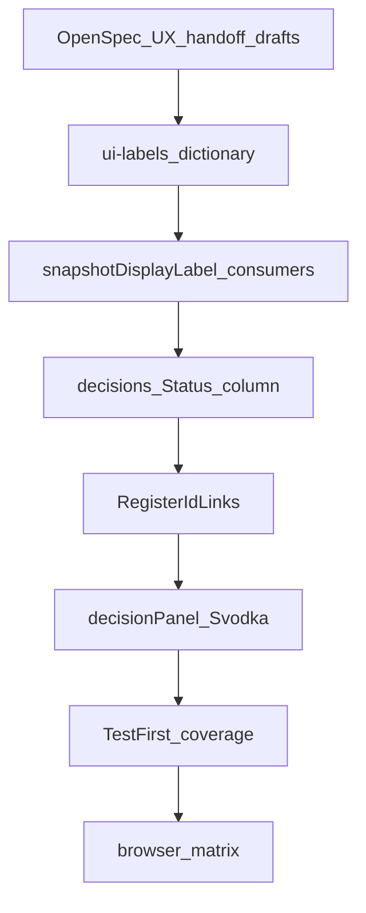

# UI semantics, links, snapshot ordinals

**Статус:** final close 2026-11-09. Type/Sut no glue; page coverage ≥80; build/tsc/lint 0.  
**Executor session:** `dbf0df0f-368e-4c1a-a9ff-1a2af77dc22b` (Auto only; no Task/Explore/Browser AI subagents).  
**Scope:** pharma-demo. **Artifacts:** `/tmp/pharma-ui-semantics-audit/`.  
**DX:** штатный `npm run dev` `:3080`; preserve auth + чужие dirty (schedule/progress). **No commit/push/deploy.**  
**Certainty:** assumption / `status: draft` — не `approved` / не `fact`.  
**Handoff:** `docs/07-delivery/handoffs/2026-11-08-ui-semantics-links-snapshots.md` v0.5.0.

### Codex remediation (обязательные поправки)

1. Unknown-safe `projectStatusLabel`/`ragLabel` + StatusPill neutral unknown (не false Critical/Green).
2. Canonical `hrefForUiRouteRef` — RegisterIdLinks без второго private switch; `data-ref-*`.
3. Browser: related cells (не primary ID); full inventory; **no** HydrationFailed suppress; toast 3500ms.
4. Decision Type compact + tooltip; Due date-only.
5. Fresh `tsc` exit 0; coverage register-table branches ≥80.

---

## 0. Constraints (из задания)

- Documentation First → OpenSpec draft → ADR только если нужно → код после Codex.
- Не выдумывать FR/GMP; fixtures / Nest mock narrative **immutable** ради UI-текста.
- Enums/CSS tokens в коде OK; user-facing слова-цвета запрещены.
- Snapshot digits = **display only**; API/localStorage/deeplink IDs остаются `A`–`S`.
- Test First на дефекты copy/layout/links; coverage ≥80 **changed** modules (без arbitrary exclude).
- Перед первой записью apps — перепроверить отсутствие чужих Cursor writers на тех же path.

---

## 1. Findings: слова-цвета (inventory)

### Канон смысла (документированный)

| Измерение | Meaning | Источники |
|---|---|---|
| Project/program `Green\|Yellow\|Red` | Управленческое здоровье портфеля/программы; не lifecycle, не overdue | `projectStatusMeaning` в [`ui-labels.ts`](apps/web/src/lib/ui-labels.ts); [`workstream-readiness.tsx`](apps/web/src/components/dashboard/workstream-readiness.tsx) уже «В норме/Внимание/Критично»; [`demo-v1-dashboard.md`](docs/05-ux-ui/demo-v1-dashboard.md) B06 (исключения без слов-цвета) |
| Risk RAG `Green\|Red` | Оценка риска в снимке (fixture); не Open/Closed | [`demo-v1-mock-narrative-data.md`](docs/03-product/demo-v1-mock-narrative-data.md) BR-002; [`demo-v1-ui-screens.md`](docs/05-ux-ui/demo-v1-ui-screens.md) Issues&Risks |
| Milestone RAG `Green\|Red` | Готовность/критичность вехи | UI screens C-02; ECharts tooltip уже «В норме/Критично» |
| Issue status | Lifecycle Open/Mitigating/Closed | уже смысловые в `issueStatusLabel` |
| Equipment / work | План/задержка; Waiting…Completed | уже смысловые |
| Decision dueState | Календарный срок **записи**, не исполнение | [`decision-due-labels.ts`](apps/web/src/lib/decisions/decision-due-labels.ts); honesty на `/decisions` |
| Unknown / empty | Не маскировать под Green | empty states + явный muted |

### Все UI-вхождения (prod + tests, audit 2026-11-08)

| Файл | Вхождение | Действие |
|---|---|---|
| [`apps/web/src/lib/ui-labels.ts`](apps/web/src/lib/ui-labels.ts) | `projectStatusLabel` Зелёный/Жёлтый/Красный; `ragLabel` Риск:/Веха: …цвет | **Канон словаря** — править здесь |
| [`status-pill.tsx`](apps/web/src/components/dashboard/status-pill.tsx) | consumer labels | без локальных строк |
| [`workstream-readiness.tsx`](apps/web/src/components/dashboard/workstream-readiness.tsx) | локальный `statusWord` В норме/Внимание/Критично | свести к `projectStatusLabel` (единый словарь) |
| [`executive-timeline-echarts.tsx`](apps/web/src/components/dashboard/executive-timeline-echarts.tsx) | `statusWord` Green→В норме / Red→Критично | выровнять с milestone RAG labels |
| [`executive-timeline.ts`](apps/web/src/lib/dashboard/executive-timeline.ts) | textSummary `зелёная`/`красная` | заменить на словарь |
| [`schedule-markers.tsx`](apps/web/src/components/schedule/schedule-markers.tsx) | a11y через `ragLabel` | автофикс через labels |
| [`portfolio-views.tsx`](apps/web/src/components/portfolio/portfolio-views.tsx) | filter options + «Красные риски» ×2 | filters via labels; copy → словарь |
| [`management-attention.tsx`](apps/web/src/components/dashboard/management-attention.tsx) | title «Управленческое внимание»; «Красные риски»; href «RAG Red» | §6 |
| [`milestones/page.tsx`](apps/web/src/app/milestones/page.tsx) | counters Красные/Зелёные | Критичные / В норме |
| [`workstream-detail-view.tsx`](apps/web/src/components/workstreams/workstream-detail-view.tsx) | «Красные риски» + StatusPill | copy + labels |
| [`impact-narrative.tsx`](apps/web/src/components/dashboard/impact-narrative.tsx) | «— красный/зелёный», «— красная/зелёная» | смысловые фразы |
| [`detail-impact.tsx`](apps/web/src/components/entity-detail/detail-impact.tsx) | то же | смысловые фразы |
| Tests | `ui-labels.test`, `dashboard-view.test`, `dashboard-u1.test`, `portfolio-views.test`, `registers-view.test`, `workstream-detail-view.test` | ожидания на новые строки |
| Notifications | `critical_risk: 'Критический риск'` | OK (не слово-цвет); не трогать без нужды |
| Gantt test titles | «красная — контур» в describe | можно оставить как tech comment в тесте; не user UI |

**Уже OK:** `issueStatusLabel`, `equipmentStatusLabel`, `workStatusLabel`, `decisionDueBadgeLabel`, attention filter «Требуют внимания».

**Запрет подхода:** regex `Red→Просрочено`, `risk→высокая вероятность`. RAG ≠ overdue ≠ probability.

---

## 2. Финальный словарь (proposed)

| Контекст | Enum | Было | Станет | Provenance |
|---|---|---|---|---|
| Project/program pill + filters | Green | Зелёный | **В норме** | workstream-readiness + dashboard B06 |
| | Yellow | Жёлтый | **Требует внимания** | user health set; screenshot «ВНИМАНИЕ» |
| | Red | Красный | **Критично** | workstream-readiness / screenshot «КРИТИЧНО» |
| Risk RAG | Green | Риск: зелёный | **Риск в норме** | оценка риска, не lifecycle/Closed |
| | Red | Риск: красный | **Риск критичен** | не = просрочен / вероятность |
| | null/unknown | — | **Нет оценки** | never «В норме» |
| Milestone RAG | Green | Веха: зелёная | **Веха в норме** | ECharts уже «В норме» |
| | Red | Веха: красная | **Веха критична** | ECharts «Критично» |
| | null/unknown | — | **Нет оценки** | never «В норме» |
| Project Yellow | Yellow | Жёлтый | **Требует внимания** | health; Amber N/A in Demo enums |
| Impact / narrative sentences | green/red adjectives | «— зелёный/красный» | «оценка в норме» / «оценка критична» (с id) | same meaning |
| Milestones counters | Red/Green counts | Красные / Зелёные | **Критичные** / **В норме** | §1 |
| Management attention title | — | Управленческое внимание | **Сводка** | user §6 |
| Attention risks item | — | Красные риски | **Риски с критической оценкой** | §1 |
| Attention risks hrefLabel | — | К красным рискам | **К рискам с критической оценкой** | a11y |
| Attention milestones hrefLabel | — | К вехам с RAG Red | **К вехам с критической оценкой** | a11y |
| Snapshot display | A…S | буква | **01…19** | Codex-accepted §4 |

CSS `--status-*`, StatusPill markers (●/▲/◆), API enums — **без изменений**.

---

## 3. `/decisions`: колонка «Статус» (Codex correction — перенос badges)

**User/Codex:** переместить **существующие** due-derived badges из колонки «Срок» в новую «Статус» слева. **Не** плодить искусственное «Записано» на каждой строке. «Записано» ≠ «Исполнено»; исполнение не отслеживается.

### Классификация badges

| Вид | Kind / copy | Класс | Куда |
|---|---|---|---|
| `passed` → «Срок прошёл» | derived due state | колонка **Статус** |
| `today` → «Сегодня» | derived due state | **Статус** |
| `upcoming` → «Срок впереди» | derived due state | **Статус** |
| `none` → «Срок не задан» | derived due state | **Статус** |
| Дата `formatDateRu` / «не задан» / «—» | calendar value | колонка **Срок** только |
| Summary KPI «Записано» | факт наличия записей в реестре | **один раз** в summary |
| Summary «Срок прошёл» | due aggregate | summary |
| «Исполнено» / fake progress | — | **запрещено** |

Caption/tooltip колонки Статус: **«Состояние указанного срока; исполнение решения не отслеживается»** (не «срок записи», не lifecycle workflow).

### Revised columns (8)

`ID | Тип | Суть | Статус | Срок | Владелец | Веха | Контекст`

- **Статус:** только due `StatusPill` (перенос из Due). `data-decision-due-state` / `data-decision-due-badge` на status cell.
- **Срок:** только дата (tabular) или «не задан»/«—»; **без** badges.
- Honesty paragraph сохранить.
- Owner / milestone / program / project links сохранить.
- Widths: 8 cols; readable 768/1440/1920; th=td=8.

Файл: [`apps/web/src/app/decisions/page.tsx`](apps/web/src/app/decisions/page.tsx).

---

## 4. Entity refs / route matrix

### Проблема

[`RegisterMutedIds`](apps/web/src/components/registers/register-table.tsx) — mono text без ссылок. Call sites:

- [`issues-risks/page.tsx`](apps/web/src/app/issues-risks/page.tsx) — Оборудование + Связи
- [`equipment/page.tsx`](apps/web/src/app/equipment/page.tsx) — Связи
- [`milestones/page.tsx`](apps/web/src/app/milestones/page.tsx) — Связи

Паттерн primary entity уже есть: [`RegisterEntityCell`](apps/web/src/components/registers/register-table.tsx) + [`entityDetailHref`](apps/web/src/lib/entity-routes.ts). Detail links: [`detail-links.tsx`](apps/web/src/components/entity-detail/detail-links.tsx).

### Route matrix (Demo v1)

| ID / type | Destination | Status |
|---|---|---|
| `EQ-*` equipment | `/equipment/:id` | **exists** |
| `ISS-*` issue | `/issues/:id` | **exists** |
| `RISK-*` risk | `/risks/:id` | **exists** |
| `MS-*` milestone | `/milestones/:id` | **exists** |
| `KT-*` imported checkpoint | detail только если карточка реально обслуживается API; иначе muted + title | **resolve honestly** — не выдумывать |
| `PER-*` / person | `/people/:id` | **exists** |
| `AN-*` analyst project | `/projects/:id` | **exists** |
| `PRG-*` program | `/programs/:id` | **exists** |
| `WS-*` workstream | `/workstreams/:id` | **exists** |
| `DEC-*` decision | **нет** detail (`hrefForEntityRef` → null) | muted text + explanation; **не** слепой `/decisions` root; `?q=DEC-001` только если search реально фильтрует ID |

### Реализация (после Codex)

1. Helper `hrefForRegisterId(id): string | null` (prefix map; расширить routes для program/project без ломки `EntityRefType` detail API).
2. `RegisterIdLinks` вместо `RegisterMutedIds`: inline `<Link>` или muted ``; **без** вложенных `<td>`.
3. Browser: click EQ/ISS/RISK → карточка → back; snapshot state жив.

---

## 5. Snapshot display map (полный A–S)

Canonical sequence = [`SNAPSHOT_IDS`](apps/web/src/lib/snapshot/snapshot-id.ts) (совпадает с возрастанием [`SNAPSHOT_AS_OF`](apps/web/src/lib/snapshot/snapshot-meta.ts)). Ordinal = `index + 1`, display = `padStart(2,'0')` → **01…19**, не `010`, не filtered index, не alphabet shuffle.

| ID | asOf | Display |
|---|---|---|
| A | 2027-02-15 | **01** |
| B | 2027-02-28 | **02** |
| C | 2027-03-01 | **03** |
| D | 2027-03-20 | **04** |
| E | 2027-04-10 | **05** |
| F | 2027-04-20 | **06** |
| G | 2027-05-15 | **07** |
| H | 2027-06-01 | **08** |
| I | 2027-06-20 | **09** |
| J | 2027-07-05 | **10** |
| K | 2027-07-20 | **11** |
| L | 2027-08-01 | **12** |
| M | 2027-08-12 | **13** |
| N | 2027-08-22 | **14** |
| O | 2027-09-01 | **15** |
| P | 2027-09-10 | **16** |
| Q | 2027-09-15 | **17** |
| R | 2027-09-18 | **18** |
| S | 2027-09-22 | **19** |

**Helper:** `snapshotDisplayLabel(id: SnapshotId): string` (+ использовать в `snapshotOptionLabel` / trigger aria / visible «Снимок NN»).

**Consumers display:**

- [`snapshot-selector.tsx`](apps/web/src/components/snapshot/snapshot-selector.tsx) trigger + options + aria
- [`trend-heading.ts`](apps/web/src/lib/dashboard/trend-heading.ts) «Изменения к снимку NN»
- Footers: portfolio-views, project-control-summary, project-status-panel, entity-detail, people, workstream-detail, notification-toast/popover, RegisterShell `snapshot=` prop
- [`select-snapshot.ts`](apps/web/src/lib/test/select-snapshot.ts) test helper aria

**Не менять:** `?snapshot=C`, persistence letter, previousScenarioSnapshot letter order, API errors mentioning id, `data-cost-for-snapshot`, scenario titles/dates in `SNAPSHOT_CONTEXT_RU`.

**Не:** regex замена букв внутри русских слов сценария.

---

## 6. Dashboard layouts

### «Требуется решение» — [`decision-panel.tsx`](apps/web/src/components/dashboard/decision-panel.tsx)

**Сейчас (`needed`):** один `
` = (a) отклонение поставки/запуска + (b) решение не зарегистрировано + (c) запись не чинит прогноз; толстая `border-2` danger frame.

**Целевая композиция (без 3 nested cards / без толстого red frame):**

1. Header row: краткий title «Требуется решение» + CTA «Все решения»
2. Context line (data-aware): отклонение поставки/запуска — из snapshot payload / top exception; **не** hardcode C-текста на A/I/S
3. Record state line: badge/text «Решение не зарегистрировано»
4. Muted note: запись не меняет прогноз автоматически (BR-006 honesty)

**`recorded`:** показать записанное решение (type/note) + owner link + due date из `data.decisions[]`; без fake progress.  
**`absent` + empty:** не показывать critical callout.  
Сохранить `DASHBOARD_PAIR_SURFACE_CLASS` / list scroll max-h.

### «Управленческое внимание» → «Сводка»

[`management-attention.tsx`](apps/web/src/components/dashboard/management-attention.tsx): title **Сводка**; items/hrefLabels из словаря §2; matrix 2×2 / empty message без изменений структуры.

---

## 7. Doc-first / OpenSpec / handoff (до кода)

| Артефакт | Действие |
|---|---|
| `openspec/changes/ui-semantics-links-snapshots/` | proposal + design + specs + tasks (presentation-only; snapshot IDs immutable) |
| [`docs/05-ux-ui/demo-v1-dashboard.md`](docs/05-ux-ui/demo-v1-dashboard.md) | расширить правило B06 на pills/реестры/display ordinals; callout composition; Сводка |
| [`docs/05-ux-ui/demo-v1-ui-screens.md`](docs/05-ux-ui/demo-v1-ui-screens.md) | decisions column Status; registers links; snapshot display note |
| `docs/07-delivery/handoffs/2026-11-08-ui-semantics-links-snapshots.md` | draft handoff + link this plan |
| Fixtures / Nest narrative | **immutable** |
| ADR | не требуется, если только presentation; иначе MADR draft |

---

## 8. Tests / gates / browser criteria

### TestFirst (meaningful, не letter-only)

1. `ui-labels`: dictionary table Green/Yellow/Red + risk/milestone RAG; unknown path не green.
2. Decisions: 8 columns; record status cell; due badge **not** in status cell; honesty intact.
3. `RegisterIdLinks`: EQ/ISS/RISK → correct href; DEC → null/muted.
4. `snapshotDisplayLabel`: полный map 19 ids; `C→03`, `I→09`, `J→10`, `S→19`.
5. Decision panel: needed = 3 structural parts; recorded shows real decision fields; A/absent no critical paste.
6. Management attention title «Сводка» + new risk label.
7. Update existing tests that assert старые color-words.

### Coverage / quality

- ≥80 statements/branches/functions/lines на **changed** modules (`ui-labels`, snapshot display helper, register id links, decision-panel, management-attention, decisions page helpers).
- `eslint` changed FE; `tsc` web (+ api если не трогали — skip broad).
- `npm run check:architecture` (FE ↛ api/mock).
- Build/typecheck as repo scripts for touched packages.
- Не «чинить» architecture fixture-import.

### Browser (`/tmp/pharma-ui-semantics-audit/`)

Playwright из package репо; secrets без stdout dump.

| Check | Criterion |
|---|---|
| AppBar I/C/S | Visible **03 / 09 / 19** (не C/I/S); dates/context preserved |
| Persist | Select → navigate → back / reload: data correct; storage still letter id |
| Dashboard C | Callout structure (context / record / muted); Сводка without «Красные» |
| Dashboard I or A | No C-only critical paste when absent/needed differs |
| `/decisions` | Status left of Due; due badges in Due only |
| Registers | Real click ISS/EQ/RISK → detail URL → back |
| Tooltips/charts | Sample milestone RAG without «зелёная/красная» |
| Viewports | 1440 + 768 screenshots projects/decisions/dashboard as needed |
| Console | pageerror 0; post-login no blanket ignore; known prelogin 401 only |

---

## 9. Implementation order (после Codex OK)

Preserve schedule/progress dirty. Re-check no parallel writers before apps edits.

---

## 10. Out of scope

- Миграция snapshot ID contract / rename API letters.
- Decision detail route / execution tracking / fake progress.
- Изменение fixture RAG/status ради текста.
- Толстый red redesign / 3 nested cards.
- Commit/push/deploy; новые deps; DS migration.

---

## Acceptance (plan complete when)

- [x] Этот файл существует: `.cursor/plans/ui-semantics-links-snapshots.md`
- [x] Findings table + dictionary + routes + full snapshot map + criteria
- [ ] Codex review OK
- [ ] Затем Agent implementation per §9
