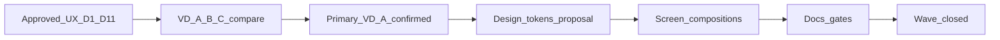

# Visual Direction Demo v1 — план docs-волны

## Статус этого плана

**Docs-волна Visual Direction — COMPLETED** (2026-10-31).

| Решение | Статус |
|---------|--------|
| APPROVE плана на запись VD docs | done |
| Primary **VD-A Industrial Control Lattice** | confirmed |
| VD-B / VD-C | сравнение only |
| Отдельный handoff | `docs/07-delivery/handoffs/2026-10-31-visual-direction.md` |
| Pack DOC-UX-010…013 + indexes | written |
| Corrective pass (Snapshot A causal; Gantt secondary read-only; `status-open`; a11y principle ≠ verified WCAG) | done |
| Quality gates `test:docs` + `openspec validate --specs --strict` | PASS |
| Apps / install / Gantt spike / ADR / Domain / BR / REQ / OpenSpec / DOC-PROD-012 | **не** менялись (constraint upheld) |

Новые визуальные утверждения остаются **`proposal`** до отдельного human APPROVE Visual Direction as design baseline. D1–D11 = `approved UX decision`. D12 = `deferred decision`. BA-OQ-006 и прочие OQ **не** закрыты.

**Следующее (не эта волна):** human review DOC-UX-010…013 → опционально APPROVE VD baseline → отдельно UI Design / apps. Commit рабочей копии — по отдельной просьбе.

Workspace-копия плана: [`.cursor/plans/visual-direction-demo-v1.md`](.cursor/plans/visual-direction-demo-v1.md).

---

## 1. Источники (изучены / сверить при написании)

**UX pack (обязательно):** [`docs/05-ux-ui/README.md`](docs/05-ux-ui/README.md), [`demo-v1-ux-concept.md`](docs/05-ux-ui/demo-v1-ux-concept.md), [`demo-v1-shell-navigation.md`](docs/05-ux-ui/demo-v1-shell-navigation.md), [`demo-v1-screens-and-flows.md`](docs/05-ux-ui/demo-v1-screens-and-flows.md), [`demo-v1-dashboard.md`](docs/05-ux-ui/demo-v1-dashboard.md), [`demo-v1-schedule-workspace.md`](docs/05-ux-ui/demo-v1-schedule-workspace.md), [`demo-v1-entity-detail.md`](docs/05-ux-ui/demo-v1-entity-detail.md), [`demo-v1-data-viz-and-components.md`](docs/05-ux-ui/demo-v1-data-viz-and-components.md), [`demo-v1-mock-ux-requirements.md`](docs/05-ux-ui/demo-v1-mock-ux-requirements.md), [`demo-v1-ux-traceability.md`](docs/05-ux-ui/demo-v1-ux-traceability.md), handoff [`2026-10-31-ux-ui.md`](docs/07-delivery/handoffs/2026-10-31-ux-ui.md).

**Ограничения (точечно):** DOC-BA-015 (Links); BR-006 / REQ-IMPCT (PrioritizeRecovery honesty); status allowlist (OnTrack/Delayed; Open/Mitigating; Green/Red — без Closed/Amber без решения); BA-OQ-006 open для layout Issues & Risks Register.

**Не дублировать:** поля/REQ prose, mock volumes (остаются `hypothesis`), OpenSpec UI SHALL.

Примечание: этап H proposal ранее запрещал отдельный Visual Direction file — **эта волна явно вводит Visual Direction** как следующий docs-артефакт; не смешивать с «encyclopedia Design System».

---

## 2. Три существенно разных направления (`proposal`)

Референсы — только для приёмов; **не** копировать бренд/layout чужого продукта. Правила учёта референсов — §2.6 и `demo-v1-visual-references.md`.

| ID | Название | Характер | Отличие от «типового admin» |
|----|----------|----------|------------------------------|
| **VD-A** | Industrial Control Lattice | Современный enterprise project controls: плотность + иерархия + выразительная композиция; slate/steel нейтрали; Page Surface с умеренной глубиной; tabular figures для дат/Δ; RAG без neon/glow | Не Excel-сетка, не SCADA, не mono-таблицы, не карточечный admin dashboard |
| **VD-B** | Precision Workbench | Светлые поверхности + сдержанный синий accent (не purple); shadcn-совместимый token map; умеренные elevation; спокойный enterprise SaaS | Ближе к зрелому B2B tool; зазор от purple-gradient admin template |
| **VD-C** | Narrative Ops Desk | Более выраженная типографическая иерархия на Dashboard; shell спокойный; Page Surface «editorial plate»; таблицы dense | Dashboard как briefing, реестры как ops tools; избегать broadsheet/cream-terracotta клише |

**Primary (confirmed):** **VD-A Industrial Control Lattice**. Tokens и screen compositions пишутся под VD-A. VD-B / VD-C — краткое сравнение в visual-direction (+ references при реальных источниках).

Избегать в recommendations: purple-on-white / purple-indigo gradients; warm cream + terracotta + serif cliché; dense broadsheet newspaper look; glow, emoji, multi-layer shadow stacks.

### 2.1. Характер VD-A (уточнение)

Целевой характер — **современный enterprise project controls product**, не «холодный Excel», не SCADA-панель, не монотонные таблицы/прямоугольники, не типовой admin с одинаковыми KPI-карточками.

Сочетать (`proposal`):

- высокую информационную плотность;
- строгую типографическую иерархию;
- выразительную композицию зон (особенно Dashboard);
- быструю считываемость отклонений;
- понятную управленческую историю на Dashboard;
- сдержанную, но заметную визуальную идентичность.

### 2.2. Поверхности и глубина

Не сводить систему только к hairline borders и абсолютно плоским поверхностям.

Осмысленное разделение уровней (`proposal`): application background → Page Surface → рабочие панели → KPI/metric tiles → таблицы → вложенные info areas.

Умеренная elevation; **ограниченное** число уровней глубины (ориентир elevation 0–2 в tokens).

Избегать: многослойных теней; чрезмерных обводок; одинакового визуального веса всех поверхностей; декоративных эффектов без функции.

### 2.3. Цветовая система (первый проход)

В `design-tokens.md` на первом проходе определить прежде всего:

- цветовые роли;
- принципы Light/Dark;
- нейтральную основу;
- accent roles;
- semantic status roles (только allowlisted статусы);
- правила контраста и читаемости.

**Не** фиксировать окончательную палитру преждевременно одним списком HEX. Конкретные значения — обоснованный `proposal` до human review. Status allowlist **не** расширять.

### 2.4. Статусы (визуальная передача)

Статус **не** передаётся только цветом. Сочетать (`proposal`): текстовая метка + цвет + форма/маркер + положение в иерархии.

Не вводить новые бизнес-статусы; не менять интерпретацию существующих (Domain / BR / mock allowlist).

### 2.5. Dashboard (композиция)

Dashboard в первую очередь рассказывает **управленческую историю**:

- состояние проекта;
- отклонения;
- влияние на Production Start;
- causal картина **только** в пределах подтверждённых Domain links;
- Decision PrioritizeRecovery (без execution / без ложного улучшения forecast/RAG — BR-006).

Не превращать Dashboard в коллекцию KPI-карточек и декоративных графиков. KPI-группа: ≥4 обоснованных показателя либо группа отсутствует (`approved UX decision`).

### 2.6. Внешние референсы

Использовать только если реально помогают обосновать решения. В `demo-v1-visual-references.md` явно разделять:

- фактически изученные источники;
- наблюдения;
- собственные рекомендации;
- источники, ещё не изученные (если упомянуты).

Не заявлять «изучен», если не проверялся. Не копировать визуальную идентичность продуктов/брендов. Если внешних источников нет — файл references не создавать или оставить краткий stub с честным «внешние референсы не использовались».

---

## 3. Что можно зафиксировать сейчас vs отдельно

### Уже `approved UX decision` (не трогать как proposal)

Shell (Sidebar + App Bar + breadcrumbs + Page Surface); D1–D11; Light/Dark toggle; Snapshot A/B/C; shadcn / TanStack / Recharts; KPI ≥4 or omit; Links vs Impact; Schedule = MS + EQ delivery only; BR-006 honesty; один shell Director+PM.

### Можно предложить сейчас (`proposal`)

- Primary visual direction **VD-A** (confirmed для этой волны).
- Базовая token system: **роли и принципы first**; примерные значения как proposal; semantic status только allowlisted; type/spacing/radius/elevation; multi-channel status encoding; surface depth levels.
- Component visual language поверх shadcn (не новая component library).
- Screen compositions для 8 поверхностей; Dashboard = narrative-first (§2.5).
- Desktop-first responsive rules (таблицы не ломать ради «адаптивности»).

### Требуют отдельной оценки / остаются open

| Тема | Статус |
|------|--------|
| D12 Gantt library | `deferred decision` — look read-only timeline/Gantt **без** выбора lib |
| BA-OQ-006 Issues/Risks layout | `open_question` — варианты визуализации без закрытия OQ |
| Closed / Amber ambient | `open_question` — не в semantic palette как Must |
| Mock volume | `hypothesis` — density rules без правки DOC-PROD-012 |
| Filter persistence / Phase grouping | `assumption` / `open_question` |
| Figma high-fidelity / component library impl | out of scope |
| Human APPROVE Visual Direction как design baseline | после review docs (AI не ставит frontmatter `approved`) |
| Финальная HEX-палитра | `proposal` до human review (§2.3) |

---

## 4. Документы к созданию

Компактный pack (без encyclopedia; объём работ не расширять):

| Файл | ID (план) | Содержание |
|------|-----------|------------|
| [`docs/05-ux-ui/demo-v1-visual-direction.md`](docs/05-ux-ui/demo-v1-visual-direction.md) | DOC-UX-010 | Identity VD-A (§2.1); сравнение VD-A/B/C; primary; принципы; anti-patterns; mapping к D1–D11 |
| [`docs/05-ux-ui/demo-v1-design-tokens.md`](docs/05-ux-ui/demo-v1-design-tokens.md) | DOC-UX-011 | Роли/принципы Light/Dark; neutrals/accent/semantic; surface depth (§2.2–2.4); type/spacing/radius/elevation; shadcn CSS var mapping intent; HEX только как proposal |
| [`docs/05-ux-ui/demo-v1-screen-compositions.md`](docs/05-ux-ui/demo-v1-screen-compositions.md) | DOC-UX-012 | Shell, Dashboard (§2.5), Schedule, 3 registers, Entity Detail, M-DEC; иерархия/зоны/плотность/состояния; BA-OQ-006 open |
| [`docs/05-ux-ui/demo-v1-visual-references.md`](docs/05-ux-ui/demo-v1-visual-references.md) | DOC-UX-013 | Только при реальных внешних источниках (§2.6); иначе не создавать / честный stub |

**Обновления:** [`docs/05-ux-ui/README.md`](docs/05-ux-ui/README.md); ссылка в [`demo-v1-ux-concept.md`](docs/05-ux-ui/demo-v1-ux-concept.md); строки в [`demo-v1-ux-traceability.md`](docs/05-ux-ui/demo-v1-ux-traceability.md); **отдельный** handoff `docs/07-delivery/handoffs/YYYY-MM-DD-visual-direction.md` + индекс handoffs; план в [`.cursor/plans/visual-direction-demo-v1.md`](.cursor/plans/visual-direction-demo-v1.md).

Frontmatter новых docs: `status: draft`; certainty блоки; Decision Status: `proposal` для VD.

ASCII/wireframe-level layouts допустимы; **не** генерировать React/CSS/Figma binary.

---

## 5. Последовательность выполнения — выполнено

1. ~~Сверка UX pack + constraints~~ done  
2. ~~`visual-direction.md`~~ done (DOC-UX-010)  
3. ~~`design-tokens.md`~~ done (DOC-UX-011)  
4. ~~`screen-compositions.md`~~ done (DOC-UX-012)  
5. ~~`visual-references.md`~~ done (DOC-UX-013; honest stub)  
6. ~~README + concept + traceability + handoff~~ done  
7. ~~Gates~~ PASS  
8. ~~Corrective pass~~ done (Snapshot A / Gantt-only / `status-open` / a11y wording)  
9. **Docs-wave closed** — план синхронизирован; UI Design / apps не стартуют автоматически.

---

## 6. Quality / consistency checks — результат волны

Критерии §6 плана соблюдены в docs-волне и corrective pass. Повторный gate после corrective: `test:docs` PASS; `openspec validate --specs --strict` PASS.

---

## 7. Решения (confirmed) — волна закрыта

1. APPROVE плана на запись Visual Direction docs — **да**; выполнение — **done**.  
2. Primary — **VD-A**; VD-B/C — сравнение.  
3. Отдельный handoff — **да**.  
4. Новые VD = `proposal` до отдельного human APPROVE baseline (вне этой волны).  
5. Docs-волна Visual Direction — **CLOSED**.  

Вне волны (не блокировали закрытие docs): финальные HEX; Figma; D12 lib; закрытие BA-OQ-006; commit по отдельной просьбе; UI Design / apps.
