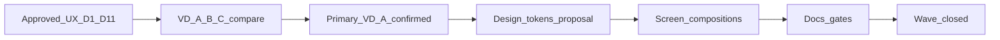

# Visual Direction Demo v1 — план docs-волны

## Статус этого плана

**Visual Direction — COMPLETED**; **VD-A APPROVED** as Demo v1 Visual Direction baseline (2026-10-31).

| Решение | Статус |
|---------|--------|
| Docs-волна (pack + handoff + gates + corrective) | done |
| **VD-A Industrial Control Lattice** | **`approved Visual Direction baseline`** |
| VD-B / VD-C | рассмотрены; **не** выбраны |
| Отдельный handoff | `docs/07-delivery/handoffs/2026-10-31-visual-direction.md` |
| Principles + compositions under VD-A | approved within baseline |
| Exact HEX / final token values / measured a11y | **UI Design** (not done in this wave) |
| D12 / BA-OQ / HIP / mock volume | open / deferred / hypothesis as before |
| Apps / install / Gantt spike / ADR / Domain / BR / REQ / OpenSpec / DOC-PROD-012 | **не** менялись (`vd-no-impl`) |

Отдельный APPROVE VD-A **больше не требуется**. D1–D11 = `approved UX decision` (не пересматривались).

**Standing constraint (`vd-no-impl`):** apps, npm install, Gantt spike, ADR и реализация **не** входят в выполненную волну.

**Следующее (вне этой задачи):** **UI Design / Design Specification** — только по явному разрешению; затем отдельно apps.

Workspace: [`.cursor/plans/visual-direction-demo-v1.md`](.cursor/plans/visual-direction-demo-v1.md).

---

## 1. Источники (сверены при написании)

**UX pack (обязательно):** [`docs/05-ux-ui/README.md`](docs/05-ux-ui/README.md), [`demo-v1-ux-concept.md`](docs/05-ux-ui/demo-v1-ux-concept.md), [`demo-v1-shell-navigation.md`](docs/05-ux-ui/demo-v1-shell-navigation.md), [`demo-v1-screens-and-flows.md`](docs/05-ux-ui/demo-v1-screens-and-flows.md), [`demo-v1-dashboard.md`](docs/05-ux-ui/demo-v1-dashboard.md), [`demo-v1-schedule-workspace.md`](docs/05-ux-ui/demo-v1-schedule-workspace.md), [`demo-v1-entity-detail.md`](docs/05-ux-ui/demo-v1-entity-detail.md), [`demo-v1-data-viz-and-components.md`](docs/05-ux-ui/demo-v1-data-viz-and-components.md), [`demo-v1-mock-ux-requirements.md`](docs/05-ux-ui/demo-v1-mock-ux-requirements.md), [`demo-v1-ux-traceability.md`](docs/05-ux-ui/demo-v1-ux-traceability.md), handoff [`2026-10-31-ux-ui.md`](docs/07-delivery/handoffs/2026-10-31-ux-ui.md).

**Ограничения (точечно):** DOC-BA-015 (Links); BR-006 / REQ-IMPCT (PrioritizeRecovery honesty); status allowlist (OnTrack/Delayed; Open/Mitigating; Green/Red — без Closed/Amber без решения); BA-OQ-006 open для layout Issues & Risks Register.

**Не дублировать:** поля/REQ prose, mock volumes (остаются `hypothesis`), OpenSpec UI SHALL.

Примечание: этап H proposal ранее запрещал отдельный Visual Direction file — эта docs-волна **создала** Visual Direction pack; не смешивать с «encyclopedia Design System».

---

## 2. Направления — выбор зафиксирован

Референсы — только для приёмов; **не** копировать бренд. См. `demo-v1-visual-references.md`.

| ID | Название | Итог для Demo v1 |
|----|----------|------------------|
| **VD-A** | Industrial Control Lattice | **`approved Visual Direction baseline`** |
| **VD-B** | Precision Workbench | Рассмотрена; **не** выбрана |
| **VD-C** | Narrative Ops Desk | Рассмотрена; **не** выбрана |

Tokens и compositions — под VD-A. Принципы VD-A утверждены; illustrative HEX — UI Design.

Избегать в recommendations: purple-on-white / purple-indigo gradients; warm cream + terracotta + serif cliché; dense broadsheet newspaper look; glow, emoji, multi-layer shadow stacks.

### 2.1. Характер VD-A (уточнение)

Целевой характер — **современный enterprise project controls product**, не «холодный Excel», не SCADA-панель, не монотонные таблицы/прямоугольники, не типовой admin с одинаковыми KPI-карточками.

Сочетать (утверждено в VD-A):

- высокую информационную плотность;
- строгую типографическую иерархию;
- выразительную композицию зон (особенно Dashboard);
- быструю считываемость отклонений;
- понятную управленческую историю на Dashboard;
- сдержанную, но заметную визуальную идентичность.

### 2.2. Поверхности и глубина

Не сводить систему только к hairline borders и абсолютно плоским поверхностям.

Осмысленное разделение уровней (VD-A): application background → Page Surface → рабочие панели → KPI/metric tiles → таблицы → вложенные info areas.

Умеренная elevation; **ограниченное** число уровней глубины (ориентир elevation 0–2 в tokens).

Избегать: многослойных теней; чрезмерных обводок; одинакового визуального веса всех поверхностей; декоративных эффектов без функции.

### 2.3. Цветовая система (первый проход)

В `design-tokens.md` на первом проходе определить прежде всего:

- цветовые роли;
- принципы Light/Dark;
- нейтральную основу;
- accent roles;
- semantic status roles (только allowlisted статусы);
- правила контраста и читаемости.

Окончательные HEX — **UI Design**. Status allowlist **не** расширять.

### 2.4. Статусы (визуальная передача)

Статус **не** передаётся только цветом. Сочетать (VD-A): текстовая метка + цвет + форма/маркер + положение в иерархии.

Не вводить новые бизнес-статусы; не менять интерпретацию существующих (Domain / BR / mock allowlist).

### 2.5. Dashboard (композиция)

Dashboard в первую очередь рассказывает **управленческую историю**:

- состояние проекта;
- отклонения;
- влияние на Production Start;
- causal картина **только** в пределах подтверждённых Domain links;
- Decision PrioritizeRecovery (без execution / без ложного улучшения forecast/RAG — BR-006).

Не превращать Dashboard в коллекцию KPI-карточек и декоративных графиков. KPI-группа: ≥4 обоснованных показателя либо группа отсутствует (`approved UX decision`).

### 2.6. Внешние референсы

Использовать только если реально помогают обосновать решения. В `demo-v1-visual-references.md` явно разделять:

- фактически изученные источники;
- наблюдения;
- собственные рекомендации;
- источники, ещё не изученные (если упомянуты).

Не заявлять «изучен», если не проверялся. Не копировать визуальную идентичность продуктов/брендов. Если внешних источников нет — файл references не создавать или оставить краткий stub с честным «внешние референсы не использовались».

---

## 3. Что зафиксировано в волне vs остаётся open

### Уже `approved UX decision` (не пересматривались)

Shell (Sidebar + App Bar + breadcrumbs + Page Surface); D1–D11; Light/Dark toggle; Snapshot A/B/C; shadcn / TanStack / Recharts; KPI ≥4 or omit; Links vs Impact; Schedule = MS + EQ delivery only; BR-006 honesty; один shell Director+PM.

### Утверждено как Visual Direction baseline

- **VD-A** — единственное выбранное направление.
- Роли/принципы токенов, multi-channel status, surface depth, screen compositions, desktop-first responsive — в рамках VD-A.

### Требуют отдельной оценки / остаются open

| Тема | Статус |
|------|--------|
| D12 Gantt library | `deferred decision` |
| BA-OQ-006 Issues/Risks layout | `open_question` |
| Closed / Amber ambient | `open_question` |
| Mock volume | `hypothesis` |
| Filter persistence / Phase grouping | `assumption` / `open_question` |
| Figma / apps / implementation | **out of scope** (`vd-no-impl`); UI Design — следующий этап по явному старту |
| Финальная HEX-палитра / measured a11y | UI Design / implementation |

---

## 4. Документы — созданы

| Файл | ID | Содержание |
|------|-----|------------|
| [`docs/05-ux-ui/demo-v1-visual-direction.md`](docs/05-ux-ui/demo-v1-visual-direction.md) | DOC-UX-010 | Identity VD-A; сравнение VD-A/B/C; принципы |
| [`docs/05-ux-ui/demo-v1-design-tokens.md`](docs/05-ux-ui/demo-v1-design-tokens.md) | DOC-UX-011 | Roles / Light-Dark / semantic / depth / a11y principle |
| [`docs/05-ux-ui/demo-v1-screen-compositions.md`](docs/05-ux-ui/demo-v1-screen-compositions.md) | DOC-UX-012 | Shell + key screens; BA-OQ-006 variants open |
| [`docs/05-ux-ui/demo-v1-visual-references.md`](docs/05-ux-ui/demo-v1-visual-references.md) | DOC-UX-013 | Honest stub (внешние product UI не аудировались) |

**Также обновлены:** [`docs/05-ux-ui/README.md`](docs/05-ux-ui/README.md); [`demo-v1-ux-concept.md`](docs/05-ux-ui/demo-v1-ux-concept.md); [`demo-v1-ux-traceability.md`](docs/05-ux-ui/demo-v1-ux-traceability.md); handoff [`2026-10-31-visual-direction.md`](docs/07-delivery/handoffs/2026-10-31-visual-direction.md) + индекс handoffs.

Frontmatter docs: `status: draft` (lifecycle). VD-A в тексте: `approved Visual Direction baseline`. React/CSS/Figma binary **не** создавались.

---

## 5. Последовательность выполнения — выполнено

1. ~~Сверка UX pack + constraints~~ done  
2. ~~`visual-direction.md`~~ done (DOC-UX-010)  
3. ~~`design-tokens.md`~~ done (DOC-UX-011)  
4. ~~`screen-compositions.md`~~ done (DOC-UX-012)  
5. ~~`visual-references.md`~~ done (DOC-UX-013; honest stub)  
6. ~~README + concept + traceability + handoff~~ done  
7. ~~Gates~~ PASS  
8. ~~Corrective pass~~ done (Snapshot A / Gantt-only / `status-open` / a11y wording)  
9. **Visual Direction closed** — VD-A baseline approved; UI Design / apps **не** стартуют без явного разрешения на следующий этап.

---

## 6. Quality / consistency checks — результат волны

Критерии §6 плана соблюдены в docs-волне и corrective pass. Повторный gate после corrective: `test:docs` PASS; `openspec validate --specs --strict` PASS.

---

## 7. Решения (confirmed) — Visual Direction закрыт

1. Docs-волна Visual Direction — **выполнена и CLOSED**.
2. **VD-A** = **`approved Visual Direction baseline`** для Demo v1; VD-B/C не выбраны. Отдельный APPROVE VD-A **не** требуется.
3. Отдельный handoff — **да**.
4. Следующий допустимый этап — **UI Design / Design Specification** (явный старт); не начинать в рамках закрытой VD-волны.
5. **No-implementation (`vd-no-impl`):** apps, npm install, Gantt spike, ADR, Domain/BR/REQ/OpenSpec/mock — **не** часть этой волны.

Остаётся: финальные HEX; measured a11y; D12; BA-OQ/HIP; mock volume hypothesis; apps после отдельного старта.
