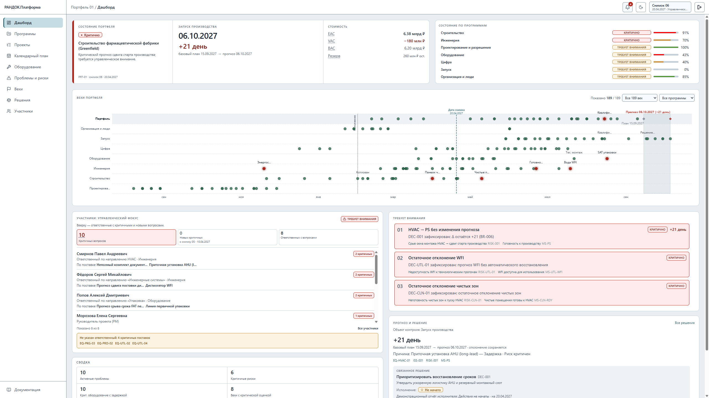
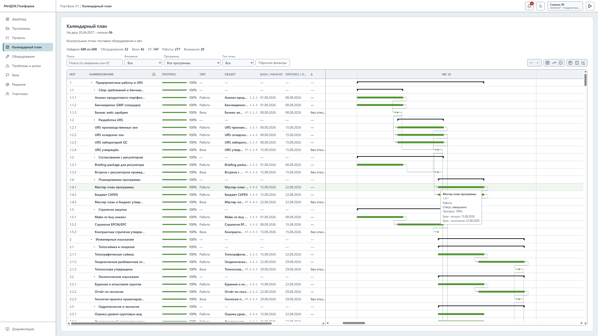
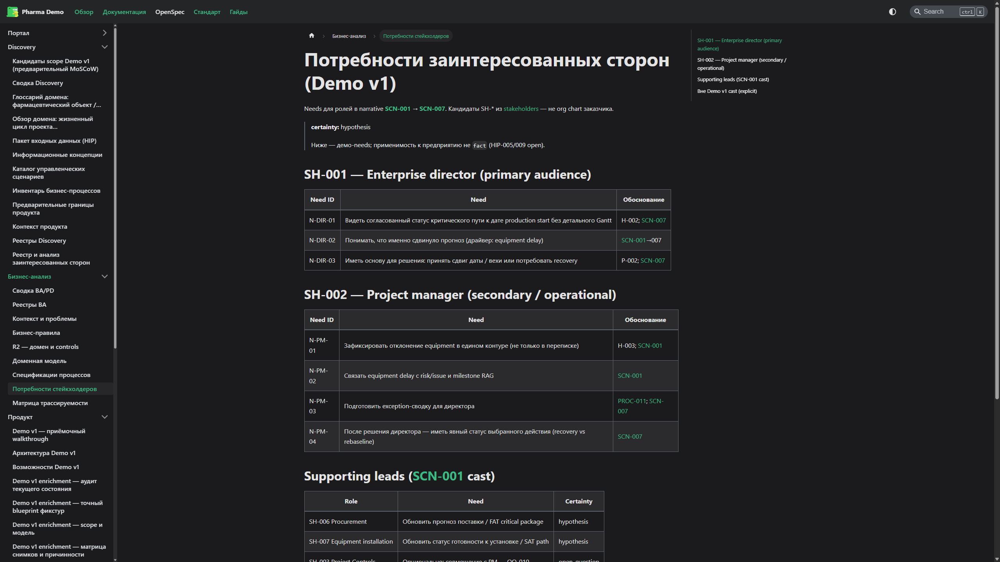

# Pharma Demo

Демонстрационный продукт для управления портфелем фармацевтического строительства (greenfield): от директорского дашборда и календарного плана до связанной инженерной документации.

Цель репозитория — показать полный цикл работы над сложным UI/API demo: продуктовая модель, Living Specs (OpenSpec), Next.js + NestJS, mock-данные без PostgreSQL, single-origin Docker Compose и портал документации на Docusaurus.

---

## Скриншоты

### Дашборд портфеля



*Снимок портфеля для директора: критичность старта производства, стоимость (BAC/EAC/VAC), статусы программ, timeline вех, фокус по участникам, исключения «требует внимания» и панель прогноза/решения.*

### Календарный план



*Рабочее место планировщика: иерархия ИСР, прогресс, база/прогноз/Δ, фильтры и интерактивный Gantt с зависимостями, тултипами и режимами сравнения на большом объёме работ (сотни строк на снимке).*

### Портал документации



*Встроенный docs-портал (Docusaurus): discovery, бизнес-анализ, продукт, OpenSpec и гайды. Документация — Source of Truth рядом с кодом, а не отдельный «забытый» wiki.*

---

## Что сделано

| Область | Результат |
|---|---|
| **Продукт** | Сценарий портфеля фармазавода: программы, проекты, оборудование, проблемы/риски, вехи, решения, участники |
| **Дашборд** | Director-first композиция: KPI старта производства, статусы программ, executive timeline, people focus, exceptions, decision panel |
| **Календарный план** | Таблица + Gantt (DHTMLX), ИСР, база/прогноз/факт, связи, внимание, виртуализация и согласованная геометрия панелей |
| **API** | NestJS с mock-фикстурами и контрактами; фронт ходит только через HTTP API |
| **Документация** | Markdown SoT + OpenSpec living specs + Docusaurus portal на том же origin (`/docs`) |
| **DX / запуск** | Один origin через Caddy: UI `/`, API `/backend`, docs `/docs` — и для local dev, и для server Compose |

Это **mock demo**: данные живут в NestJS, без PostgreSQL. Контракты API рассчитаны так, чтобы позже подключить persistence без ломки UI.

---

## Стек

- **Web:** Next.js (App Router), TypeScript, Tailwind
- **API:** NestJS, mock fixtures, session form-login для demo
- **Docs:** Docusaurus 3 + OpenSpec
- **Runtime:** Docker Compose + Caddy (single-origin)

---

## Быстрый старт

| Сценарий | Команда | Назначение |
|---|---|---|
| **Development** | `npm run dev` | Hot reload Web + API + Docs на **:3080** |
| **Local production-like** | `docker compose --profile app up --build -d` | Собранные образы, host-routing `*.localhost` |
| **Server / IP:port** | `npm run server:up` | Один origin `/` · `/backend` · `/docs` (default **8080**) |

```bash
cp .env.local.example .env.local   # HOST_PORT=3080 по умолчанию
npm run dev
# → http://localhost:3080/
# → http://localhost:3080/backend/health
# → http://localhost:3080/docs/
npm run dev:down
```

Смена порта: `HOST_PORT`, `WEB_ORIGIN`, `PUBLIC_ORIGIN`, `DOCUSAURUS_URL` в корневом `.env.local`.  
На сервере: `cp .env.example .env`, затем `npm run server:auth:ensure` и `npm run server:up`.

Подробнее: [local-dev-and-demo](docs/10-operations/local-dev-and-demo.md), [server-compose-demo](docs/10-operations/server-compose-demo.md), [live presentation](docs/guides/how-to/demo-v1-live-presentation.md).

---

## Структура репозитория

```text
/
├── apps/web/                 # Next.js UI
├── apps/api/                 # NestJS mock API
├── docs/                     # Markdown Source of Truth
│   └── assets/screenshots/   # кадры UI для README
├── website/                  # Docusaurus (читает docs/, без копий контента)
├── openspec/                 # living specs + changes
├── docker-compose*.yml       # dev / prod-like / server
└── scripts/                  # проверки документации
```

---

## Документация и процесс

- Портал после `npm run dev`: http://localhost:3080/docs/
- SoT: [`docs/`](docs/) · living specs: [`openspec/specs/`](openspec/specs/)
- Documentation First / Test First: [`docs/11-ai-engineering/`](docs/11-ai-engineering/)
- Вклад в docs/OpenSpec: [`CONTRIBUTING.md`](CONTRIBUTING.md)

---

## Лицензии стека docs

OpenSpec (MIT), Docusaurus 3.x (MIT), локальный search без Algolia Ask AI.
