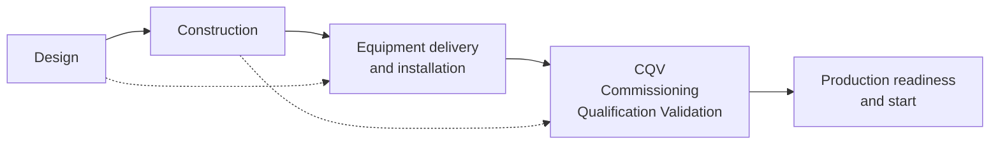

# Domain overview: pharma facility project lifecycle

Отраслевой desk research для Discovery. Документ описывает **типовую** модель проекта создания / реконструкции фармацевтического производственного объекта (facility), а не требования конкретного заказчика или продукта Pharma Demo.

Термины — в [domain-glossary.md](./domain-glossary.md). Инженерный глоссарий репозитория — отдельно: [`terminology.md`](../standards/terminology.md). Evidence — в [registers.md](./registers.md).

## Назначение и границы

> **certainty:** assumption
>
> Для Discovery достаточно отраслевой модели lifecycle (design → construction → equipment → CQV → готовность к старту производства), чтобы позже обсуждать project controls и сценарии демо. Применимость к конкретному предприятию / Demo v1 **не** утверждена.

> **certainty:** open_question
>
> Какой горизонт объекта у целевого заказчика: greenfield завод, линия, utility, реконструкция корпуса? (см. OQ-004 в registers / HIP)

## Source facts (парафраз внешних источников)

> **certainty:** fact
>
> **ISPE Baseline® Guide: Volume 5 – Commissioning and Qualification (Second Edition)** описывает science- and risk-based подход к Commissioning and Qualification (C&Q) фармацевтических manufacturing facilities, systems, utilities и equipment, чтобы показать пригодность к intended purpose; среди ключевых тем — Quality Risk Management, URS, Design Review / Design Qualification, acceptance and release, change management и GEP-документация. (EV-001)

> **certainty:** fact
>
> В публичном addendum к этому Baseline Guide **commissioning** определено как planned, managed and documented подход к setting to work, start-up, regulation and adjustment и verification установки/работы, необходимый, чтобы привести equipment, automation и systems в полностью работоспособное состояние, отвечающее safety и end-user requirements; в pharma-контексте QRM C&Q commissioning включает qualification testing и подтверждающую документацию. (EV-002)

> **certainty:** fact
>
> **PIC/S GMP Guide, Annex 15 (Qualification and Validation)** описывает стадии квалификации equipment / facilities / utilities / systems: URS → Design Qualification (DQ) → при применимости Factory Acceptance Testing (FAT) / Site Acceptance Testing (SAT) → Installation Qualification (IQ) → Operational Qualification (OQ) → Performance Qualification (PQ); FAT может дополняться SAT после получения оборудования на площадке. (EV-003)

> **certainty:** fact
>
> **WHO TRS 986, Annex 2** (WHO GMP for pharmaceutical products: main principles) требует, чтобы qualification and validation документально подтвердили: соответствие design (DQ); built and installed as designed (IQ); работу в соответствии с design specifications (OQ); и что process consistently производит продукт с заданными атрибутами (process validation / performance qualification). (EV-004)

> **certainty:** fact
>
> **ISPE Good Practice Guide: Good Engineering Practice (Second Edition)** охватывает полный lifecycle engineering projects и engineered systems от conceptual design до retirement и позиционирует GEP как enabler для QRM-based integrated C&Q. (EV-005)

> **certainty:** fact
>
> По **AACE TCM Framework**, project control — рекурсивный PDCA-цикл (planning → implementation → performance measurement → performance assessment) для управления инвестированием ресурсов в создание / изменение / поддержание / вывод из эксплуатации актива на уровне проекта. (EV-006)

> **certainty:** fact
>
> В **PMI Lexicon of Project Management Terms** milestone — significant point or event в portfolio, program или project; milestone schedule — тип schedule с milestones и planned dates. (EV-007)

> **certainty:** fact
>
> Статья в *Pharmaceutical Engineering* (ISPE) описывает **Turn Over Package (TOP)** как организованный пакет документации (спецификации, manuals, drawings и др.), характеризующий установленные systems/equipment; TOP критичен для C&Q и может служить основой для IQ / leverage commissioning → qualification. (EV-008)

> **certainty:** fact
>
> **PIC/S GMP Guide Part I** связывает достижение quality objective с Pharmaceutical Quality System, включающим GMP и Quality Risk Management; система должна быть documented, её effectiveness — monitored; требуются competent personnel и suitable premises, equipment и facilities. (EV-009)

> **certainty:** fact
>
> **WHO TRS 986 Annex 2** указывает, что licensed pharmaceutical products должны производиться только licensed manufacturers, чья деятельность регулярно инспектируется competent national authorities; WHO GMP используется как стандарт для assessment manufacturing authorizations и как basis for inspection of manufacturing facilities. (EV-010)

## Типовая модель lifecycle (синтез)

> **certainty:** hypothesis
>
> Ниже — **отраслево-типичная** схема капитального / facility-проекта в pharma (не единственная и не нормативная для заказчика). Стадии часто **перекрываются** (например, поставка оборудования параллельно строительству; FAT до поставки; qualification после mechanical completion).

### 1. Design

> **certainty:** hypothesis
>
> Обычно: определение требований пользователя (URS / process needs), концептуальный и детальный design, design review, при необходимости Design Qualification; GEP-практики покрывают путь от conceptual design (EV-005). Параллельно закладываются границы systems для последующего TOP / C&Q.

### 2. Construction

> **certainty:** hypothesis
>
> Строительство / монтаж корпуса, utilities, clean utilities, HVAC и связанных систем; полевые испытания (pressure / loop / flushing и т.п. — состав зависит от объекта); накопление as-built и construction records для handover. Mechanical completion часто выступает контрольной точкой перед commissioning (EV-008 описывает TOP на этапе mechanical completion или позже).

### 3. Equipment (поставка, FAT/SAT, установка)

> **certainty:** fact
>
> По PIC/S Annex 15 оборудование, особенно с novel / complex technology, может оцениваться у vendor до поставки (FAT); до установки подтверждается соответствие URS/functional specification у vendor при применимости; FAT может дополняться SAT на manufacturing site. (EV-003)

> **certainty:** hypothesis
>
> На практике поставка long-lead equipment и интеграция с site utilities / automation часто на критическом пути даты запуска; задержки FAT/SAT и punch-list закрытия — типичные драйверы сдвига milestone «ready for qualification / production».

### 4. Commissioning, Qualification, Validation (CQV / C&Q)

> **certainty:** fact
>
> ISPE позиционирует integrated C&Q facilities/systems/utilities/equipment; commissioning (в смысле EV-002) и стадии URS→DQ→FAT/SAT→IQ→OQ→PQ (EV-003) / DQ–IQ–OQ–PV/PQ (EV-004) образуют отраслевой каркас «пригодности к intended purpose» перед коммерческим использованием.

> **certainty:** assumption
>
> В управленческом контуре project controls «CQV complete» / «system released» часто трактуются как gate к operational readiness; точные критерии release — site-specific PQS / Validation Master Plan.

### 5. Готовность к старту производства (production readiness)

> **certainty:** hypothesis
>
> Типичный смысл для facility-проекта: системы приняты (acceptance and release / qualified), документация handover завершена или достаточна, персонал обучен, процедуры и materials/supply готовы, регуляторный / inspection контекст учтён. Это **не** утверждение даты MAA / GMP certificate конкретного сайта.

> **certainty:** fact
>
> WHO и PIC/S связывают производство licensed products с инспектируемыми manufacturers и documented Pharmaceutical Quality System (suitable premises/equipment) — как отраслевой контекст «готовности к регулируемой эксплуатации», не как FR продукта. (EV-009, EV-010)

## Контрольные точки (milestones) — кандидаты

> **certainty:** hypothesis
>
> Для project controls на facility-проекте часто отслеживают (названия и набор — site/project-specific):

| Кандидат milestone | Смысл (рабочий) | Связь с источниками |
|--------------------|-----------------|---------------------|
| Design freeze / DQ complete | Design зафиксирован / DQ documented | EV-001, EV-003 |
| Mechanical completion | Стройка/монтаж доведены до согласованного объёма | EV-008 (handover at MC) |
| FAT complete (per package) | Приёмка у vendor | EV-003 |
| SAT / installation complete | Приёмка на сайте / установка | EV-003 |
| Commissioning complete | Systems set to work per plan | EV-002 |
| IQ / OQ / PQ complete | Стадии квалификации | EV-003, EV-004 |
| TOP / turnover accepted | Документационный handover | EV-008 |
| Ready for production / PPQ start | Операционная готовность | hypothesis |
| Inspection / regulatory readiness pack | Пакет к инспекции / licensing | EV-009, EV-010 + hypothesis |

> **certainty:** fact
>
> PMI: milestone = significant point or event; может отражаться в milestone schedule с planned dates. (EV-007)

## Документация и inspection readiness

> **certainty:** fact
>
> TOP (Turn Over Package) в отраслевой литературе ISPE — организованный комплект документации по systems/equipment, критичный для C&Q и leverage в IQ; планирование документации должно начинаться рано в проекте. (EV-008)

> **certainty:** fact
>
> PIC/S Part I: PQS должен быть comprehensively designed, correctly implemented, fully documented, effectiveness monitored; premises/equipment — suitable and sufficient. (EV-009)

> **certainty:** hypothesis
>
> «Inspection readiness» для **проекта строительства** часто означает: прослеживаемость design→as-built→commissioning→qualification, закрытые deviations/punch items с impact assessment, актуальные drawings/SOP/training, статус квалификации systems — в форме, пригодной для internal audit и последующей regulatory inspection сайта. Конкретный checklist заказчика неизвестен (OQ-005).

> **certainty:** open_question
>
> Нужно ли в Demo v1 явно моделировать inspection-ready document status, или достаточно readiness/milestone статусов без регуляторного narrative? (см. OQ-003)

## Связь с project controls

> **certainty:** fact
>
> AACE: project control измеряет progress/performance против планов и оценивает отклонения для corrective action (PDCA). (EV-006)

> **certainty:** hypothesis
>
> На pharma facility-проектах ценность project controls для директора / PM — ранняя видимость сдвига даты запуска из-за пересечения construction, equipment supply, CQV и documentation/TOP, а не «отчёт ради отчёта». Применимость к Pharma Demo — см. product-context (другой агент) и последующие волны D2–D4.

## Что этот документ намеренно не фиксирует

- FR / GMP-требования конкретного предприятия как факты.
- Org chart заказчика и обязательный набор ролей (D2).
- Conceptual model сущностей продукта (D3: `information-concepts.md`).
- Scope Demo v1 (D4).

## Следующие шаги Discovery

1. Эксперт / заказчик: подтвердить или скорректировать стадии и milestone-кандидаты (HIP).
2. D2: связать процессы (schedule, equipment, docs, readiness) с ролями без искусственной полноты.
3. Оркестратор: сверка с product-context после параллельного D1-Context.
