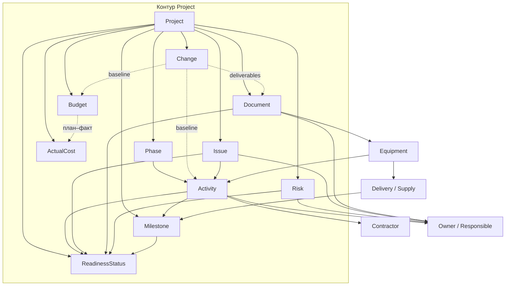

# Information concepts (conceptual)

Концептуальная модель **информационных объектов** project controls для Discovery Pharma Demo. Это **не** ER-диаграмма, **не** схема БД, **не** OpenAPI и **не** утверждённая модель данных продукта.

Отраслевой lifecycle: [domain-overview.md](./domain-overview.md). Термины: [domain-glossary.md](./domain-glossary.md). Процессы: [process-inventory.md](./process-inventory.md). Роли: [stakeholders.md](./stakeholders.md). Evidence / OQ: [registers.md](./registers.md).

## 1. Назначение и границы

> **certainty:** assumption
>
> Для Discovery достаточно именованного набора концептов и связей «кто чем оперирует», чтобы позже строить management scenarios и границы Demo v1. Нормализация, ключи, таблицы и persistence — вне scope этого документа.

> **certainty:** hypothesis
>
> Применимость перечисленных концептов к конкретному заказчику и к Demo v1 **не** подтверждена; набор — отраслево-типичный кандидат для единого управленческого контура (P-001 / P-002). Подтверждение — expert/customer (см. OQ-005; также OQ-012 бюджет, OQ-013 contractors).

> **certainty:** fact
>
> Документ **не** является database schema и не фиксирует физическую модель данных.

---

## 2. Правила certainty

| Утверждение | Certainty |
|-------------|-----------|
| Парафраз EV-* (milestone, schedule/activities, baseline/change control, project control PDCA, TOP, FAT/SAT…) | `fact` относительно источника |
| Концепт как объект учёта в Pharma Demo / демо | `hypothesis` |
| Связь концепт ↔ PROC-\* / SH-\* | `hypothesis`, если обоснована DOC-DISC-015/016; иначе `open_question` |
| Customer data dictionary / org master data | **не** фиксируется как `fact` |

---

## 3. Каталог концептов

> **certainty:** hypothesis
>
> Имена концептов — рабочие ярлыки Discovery (EN). Локальные названия у заказчика могут отличаться; синонимы не запрещены до expert confirm.

### Project

> **certainty:** hypothesis
>
> **Project** — управляемый объект капитального / facility-проекта (или сопоставимого пакета работ), вокруг которого собираются фазы, активности, вехи, затраты, риски, issues и статус готовности. Горизонт «один завод / один проект / multi-project» — OQ-004.

**Процессы:** сквозной контур PROC-001…011. **Роли:** SH-001 (обзор), SH-002 (интеграция), SH-003 (контур controls — OQ-010).

### Phase

> **certainty:** hypothesis
>
> **Phase** — укрупнённый отрезок lifecycle проекта (типовой синтез DOC-DISC-013: Design → Construction → Equipment → CQV → production readiness). Фазы часто перекрываются; не обязаны совпадать с stage-gate заказчика один-в-один.

**Процессы:** контекст для PROC-001, PROC-010; стадии упоминаются в PROC-002…009. **Роли:** SH-004…SH-007 (по стадии), SH-002.

### Activity

> **certainty:** fact *(относительно PMI Lexicon / EV-007 — смысл schedule)*
>
> В отраслевом определении **project schedule** — linked activities с planned dates, durations, milestones и resources. (EV-007)

> **certainty:** hypothesis
>
> **Activity** как концепт продукта — единица плановой/фактической работы в schedule (пакет, задача, work package), привязанная к Phase и/или Milestone, с Owner/Responsible и опционально Contractor.

**Процессы:** PROC-001. **Роли:** SH-002; functional leads SH-004…SH-007; SH-011 как исполнитель пакета.

### Milestone

> **certainty:** fact *(относительно EV-007)*
>
> **Milestone** — significant point or event в portfolio, program или project; milestone schedule представляет milestones с planned dates. (EV-007)

> **certainty:** hypothesis
>
> В контуре продукта Milestone — значимая контрольная точка / gate (например MC, FAT/SAT, IQ/OQ/PQ, TOP accepted, ready for production — **кандидатный** набор, OQ-006), к которой сходятся Activities, Documents, Issues и ReadinessStatus.

**Процессы:** PROC-010; вход/выход для PROC-001, PROC-009, PROC-011. **Роли:** SH-001, SH-002.

### Contractor

> **certainty:** hypothesis
>
> **Contractor** — внешняя организация / исполнитель пакетов работ (строительство, монтаж, specialty). Может быть first-class объектом или атрибутом Activity/Issue — OQ-013.

**Процессы:** PROC-006. **Роли:** SH-011; координация SH-002 / SH-004 / SH-007.

### Owner / Responsible

> **certainty:** hypothesis
>
> **Owner / Responsible** — лицо или роль, отвечающая за Activity, Risk, Issue, Change, Document или ReadinessStatus (не обязательно юридический «владелец актива»). В Discovery может отображаться на SH-* без жёсткого RACI заказчика (OQ-010, OQ-011).

**Процессы:** все PROC с назначением владельца; особенно PROC-001, PROC-004, PROC-005, PROC-003, PROC-008. **Роли:** SH-001…SH-010 по контуру ответственности.

### Equipment

> **certainty:** fact *(относительно EV-003 — контекст квалификации)*
>
> Для equipment / facilities / utilities / systems стадии квалификации включают URS → DQ → при применимости FAT/SAT → IQ → OQ → PQ. (EV-003)

> **certainty:** hypothesis
>
> **Equipment** как концепт project controls — единица оборудования / системы в контуре поставки и монтажа (long-lead, установка, стык с CQV), а не полный asset register завода.

**Процессы:** PROC-007; стык PROC-001 / PROC-008 / PROC-009. **Роли:** SH-006, SH-007; обзор SH-002.

### Delivery / Supply

> **certainty:** hypothesis
>
> **Delivery / Supply** — событие или статус поставки (заказ → отгрузка → получение на сайте → готовность к установке / SAT), связанное с Equipment и влияющее на критический путь к вехам запуска (HYP-002 в registers / domain-overview).

**Процессы:** PROC-007; влияние на PROC-001 / PROC-010. **Роли:** SH-006; SH-007 на приёмке/монтаже.

### Budget

> **certainty:** fact *(относительно EV-007 — cost baseline)*
>
> **Cost baseline** — approved version бюджета, изменяемая через formal change control и служащая основой сравнения с actual results. (EV-007; см. также project control PDCA — EV-006)

> **certainty:** hypothesis
>
> **Budget** в продукте — плановый / approved стоимостной контур проекта или пакета. Входит ли в первичный demo narrative — OQ-012.

**Процессы:** PROC-002; изменение через PROC-003. **Роли:** SH-002, SH-003, SH-008; обзор SH-001.

### ActualCost

> **certainty:** hypothesis
>
> **ActualCost** — зафиксированные фактические затраты (на уровне Project / Phase / пакета), сопоставляемые с Budget для план–факт и прогноза. Детализация (EVA и т.п.) — вне Discovery-модели.

**Процессы:** PROC-002; входы в PROC-011. **Роли:** SH-008, SH-003; обзор SH-001 / SH-002.

### Risk

> **certainty:** hypothesis
>
> **Risk** — project risk (угроза/возможность для сроков, стоимости, готовности), ведущийся в risk register с Owner и статусом мониторинга. **Не** отождествлять автоматически с полным QRM C&Q / product quality (OQ-003; разделение в PROC-004).

**Процессы:** PROC-004; вход в PROC-011. **Роли:** SH-002, SH-001 (топ-риски); leads по предметной области.

### Issue

> **certainty:** hypothesis
>
> **Issue** — открытое отклонение / препятствие / пункт punch list, требующее учёта и закрытия; влияет на Activities, Milestones и ReadinessStatus (контекст punch / handover — glossary + EV-008).

**Процессы:** PROC-005. **Роли:** SH-002; SH-004…SH-007; опционально SH-011.

### Change

> **certainty:** fact *(относительно EV-007)*
>
> **Change control** — process, whereby modifications to documents, deliverables или baselines identified, documented, approved или rejected. (EV-007)

> **certainty:** hypothesis
>
> **Change** как концепт — зафиксированное предложение / решение об изменении baseline (schedule, cost, scope/deliverables) на уровне **project** controls. Не подменяет site PQS/GMP change SOP (OQ-014).

**Процессы:** PROC-003; затрагивает PROC-001, PROC-002, PROC-008. **Роли:** SH-002; leads; impact-обзор SH-001.

### Document

> **certainty:** fact *(относительно EV-008 — TOP)*
>
> **Turn Over Package (TOP)** — организованный пакет документации, характеризующий установленные systems/equipment; критичен для C&Q и может поддерживать / leverage IQ. (EV-008)

> **certainty:** hypothesis
>
> **Document** в project controls — управленческий статус артефакта / пакета (спецификация, as-built, TOP, protocol…) относительно handover и вех, а не полный EDMS/QMS content store. Термин TOP vs нейтральный «handover package» — OQ-009; inspection-ready — OQ-008.

**Процессы:** PROC-008; вход в PROC-009 / PROC-010. **Роли:** SH-010; SH-002; обзор SH-001 / SH-009 (контекст).

### ReadinessStatus

> **certainty:** hypothesis
>
> **ReadinessStatus** — агрегируемый или явный статус готовности к Milestone / production start (RAG или эквивалент), собираемый из Activities, Issues, Documents, Equipment/Delivery и Risks. Ценность для директора — H-002 / P-001.

**Процессы:** PROC-009; выход в PROC-011. **Роли:** SH-001 (потребитель), SH-002 (сборка), leads по контурам.

---

## 4. Ключевые связи (проза)

> **certainty:** hypothesis
>
> Связи ниже — концептуальные («что связано с чем» для narrative и будущего моделирования), не cardinality для БД.

1. **Project** содержит **Phase**-ы и набор **Milestone**-ов; **Activity** принадлежит Project и обычно отнесена к Phase и/или влияет на Milestone.
2. **Owner / Responsible** назначается на Activity, Risk, Issue, Change, Document и (опционально) на контур ReadinessStatus.
3. **Contractor** исполняет или участвует в Activity (и может фигурировать в Issue); first-class vs атрибут — OQ-013.
4. **Equipment** связан с **Delivery / Supply** и с Activities монтажа / квалификации; статус поставки влияет на критический путь к Milestone.
5. **Budget** и **ActualCost** относятся к Project (и при необходимости к Phase / пакету); изменение Budget — через **Change** (cost baseline — EV-007).
6. **Risk** и **Issue** привязаны к Project и могут ссылаться на Activity, Milestone, Equipment или Document; эскалации видны SH-001 / SH-002 (PROC-004, PROC-005, PROC-011).
7. **Change** может затрагивать schedule (Activity/Milestone), Budget, Document/deliverable — PROC-003; messaging vs GMP change — OQ-014.
8. **Document** (в т.ч. элементы TOP) поддерживает Equipment / systems и вход в **ReadinessStatus** / Milestone acceptance — PROC-008, PROC-009.
9. **ReadinessStatus** агрегирует готовность к значимым Milestone (и к production readiness) для management reporting — PROC-009, PROC-010, PROC-011.

---

## 5. Концептуальная диаграмма

> **certainty:** hypothesis
>
> ER-подобная схема **только** для визуализации связей Discovery. Не таблицы, не FK, не нормализация.

---

## 6. Трассировка к процессам и ролям

> **certainty:** hypothesis
>
> Матрица — ориентир Discovery; «✓» означает обоснованную связь через DOC-DISC-015/016, не обязательность в Demo v1.

| Концепт | PROC-* | SH-* (если обосновано) | Примечание |
|---------|--------|------------------------|------------|
| Project | PROC-001…011 | SH-001, SH-002, SH-003 | Горизонт — OQ-004 |
| Phase | PROC-001, PROC-010 | SH-002; SH-004…007 по стадии | Синтез DOC-DISC-013 |
| Activity | PROC-001 | SH-002, SH-004…007, SH-011 | Schedule — EV-007 |
| Milestone | PROC-010, PROC-009, PROC-011 | SH-001, SH-002 | Набор вех — OQ-006 |
| Contractor | PROC-006 | SH-011 | First-class? OQ-013 |
| Owner / Responsible | PROC-001, 003…005, 008 | SH-001…010 | RACI — OQ-010/011 |
| Equipment | PROC-007 | SH-006, SH-007 | FAT/SAT контекст EV-003 |
| Delivery / Supply | PROC-007 | SH-006, SH-007 | Критический путь — HYP-002 |
| Budget | PROC-002, PROC-003 | SH-002, SH-003, SH-008, SH-001 | Demo scope — OQ-012 |
| ActualCost | PROC-002, PROC-011 | SH-008, SH-003 | Пара к Budget |
| Risk | PROC-004, PROC-011 | SH-002, SH-001 | ≠ полный QRM |
| Issue | PROC-005 | SH-002, leads, SH-011 | Punch / handover |
| Change | PROC-003 | SH-002, leads, SH-001 | vs GMP — OQ-014 |
| Document | PROC-008, PROC-009 | SH-010, SH-002 | TOP — EV-008; OQ-008/009 |
| ReadinessStatus | PROC-009, PROC-010, PROC-011 | SH-001, SH-002 | H-002 / P-001 |

---

## 7. Открытые вопросы

> **certainty:** open_question
>
> Достаточен ли кандидатный набор концептов для demo narrative, или нужны отдельные объекты (WBS, package, purchase order, protocol instance…)? (expert/customer + product owner; стык с OQ-005)

> **certainty:** open_question
>
> Нужен ли ReadinessStatus как отдельный хранимый объект или достаточно вычисляемого представления по Milestone / Issues / Documents? (product owner; связано с OQ-008)

> **certainty:** open_question
>
> Budget / ActualCost и Contractor — first-class в Demo v1 или за скоупом / атрибутами? (OQ-012, OQ-013)

---

## 8. Связанные документы

| Тема | Документ |
|------|----------|
| Lifecycle стадий | [domain-overview.md](./domain-overview.md) (DOC-DISC-013) |
| Термины | [domain-glossary.md](./domain-glossary.md) (DOC-DISC-014) |
| Процессы PROC-* | [process-inventory.md](./process-inventory.md) (DOC-DISC-016) |
| Роли SH-* | [stakeholders.md](./stakeholders.md) (DOC-DISC-015) |
| P-*/HYP/OQ/EV | [registers.md](./registers.md) |
