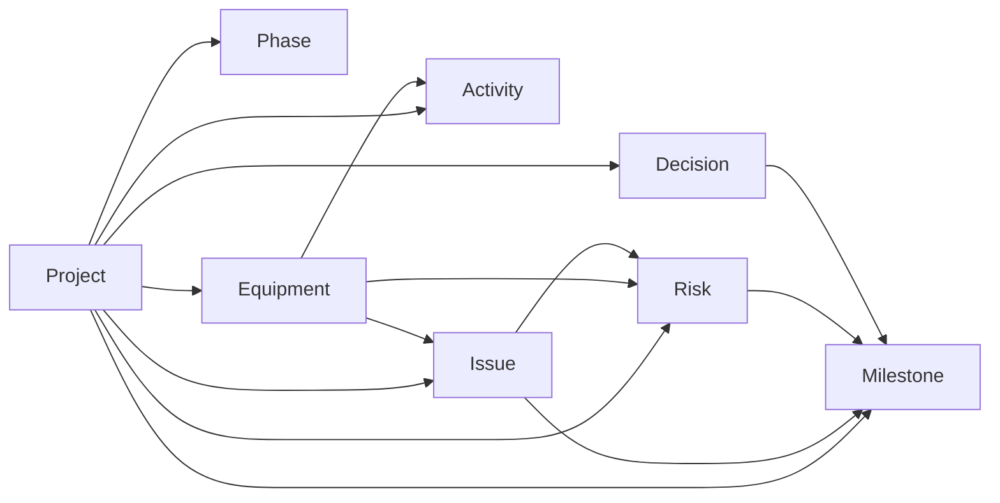

# Domain model (Demo v1)

Концептуальная модель для mock narrative SCN-001→SCN-007. **Не** ER, **не** схема PostgreSQL. База: [information-concepts](../01-discovery/information-concepts.md) — суженная до Must.

> **certainty:** hypothesis

## Сущности в scope

| Сущность | Ключевые атрибуты (демо) | Состояния / заметки |
|----------|--------------------------|---------------------|
| Project | id, name, baselineProductionStart, forecastProductionStart | Один проект (BA-A-001) |
| Phase | id, name, projectId | Остаётся для C-01 overview; в mock SCN-001→007 экземпляры **не обязательны** |
| Activity | id, projectId, name, plannedStart/Finish, forecastFinish, equipmentId? | Critical path activity for EQ |
| Milestone | id, projectId, name, baselineDate, forecastDate, rag | MS-PS = production start |
| Equipment | id, name, isCritical, baselineDelivery, forecastDelivery, status | OnTrack / Delayed |
| Risk | id, projectId, title, rag, milestoneId, issueId?, equipmentId? | rag fixture; согласованность с BR-002 |
| Issue | id, projectId, title, status, ownerRole, equipmentId, milestoneId | Open / Mitigating / AcceptedSlip? / Closed |
| Decision | id, projectId, milestoneId?, type, ownerRole?, dueDate?, note | AcceptDateSlip / PrioritizeRecovery; **не** execution recovery |
| OwnerRef | roleId (SH-*) | Не полный User/auth |

## Phase в Demo v1

> **certainty:** assumption
>
> **Phase остаётся** в модели и C-01 как опциональный контейнер overview. Для primary narrative SCN-001→007 mock **не требует** экземпляров Phase; отсутствие Phase в Snapshots A/B/C не ломает causal chain. Нужны ли Phase в runtime mock — open до реализации (не Must для story).

## Вне scope Demo v1 domain

Budget, ActualCost, Contractor-as-aggregate, Document/TOP package, ReadinessStatus-by-area (SCN-006), Change (PQS-grade).

## Кардинальности (концептуальные, Demo v1)

> **certainty:** assumption
>
> Только отношения, нужные narrative. Не ER constraints.

| Связь | Кардинальность (Demo v1) | Примечание |
|-------|--------------------------|------------|
| Project — Phase | 1 — 0..\* | Phase опциональны в mock |
| Project — Milestone | 1 — 1..\* | Минимум MS-PS |
| Project — Equipment | 1 — 1..\* | Минимум один critical package |
| Project — Activity | 1 — 0..\* | |
| Project — Risk | 1 — 0..\* | |
| Project — Issue | 1 — 0..\* | |
| Project — Decision | 1 — 0..\* | |
| Equipment — Activity | 1 — 0..\* | Narrative: EQ-HVAC-01 ↔ ACT-EQ-01 (**assumption** 1 активность) |
| Equipment — Issue | 1 — 0..\* | |
| Equipment — Risk | 1 — 0..\* | |
| Issue — Risk | 0..1 — 0..1 | Narrative: ISS-001 ↔ RISK-001 (**assumption** пара) |
| Issue — Milestone | \* — 1 | N Issues → один MS-PS |
| Risk — Milestone | \* — 1 | N Risks → один MS-PS |
| Decision — Project | \* — 1 | |
| Decision — Milestone | \* — 0..1 | Обычно MS-PS в SCN-007 |

> **certainty:** open_question
>
> Нужны ли в Demo v1 несколько Milestone/Equipment одновременно — вне текущего single-driver narrative (не расширяем).

## Decision (управленческий выбор)

> **certainty:** hypothesis
>
> **Decision** фиксирует выбор директора относительно **текущего** состояния Project/Milestone (и связанного отклонения). Demo v1 **не** моделирует выполнение recovery actions и **не** автоматически пересчитывает forecast (BR-006).

## Связи (проза)

1. Project содержит Milestones, Activities, Risks, Issues, Equipment; опционально Phases; Decisions.
2. Equipment (critical) связан с Activity и может порождать Issue/Risk.
3. Issue и Risk ссылаются на Milestone MS-PS.
4. Milestone.forecastDate и Project.forecastProductionStart согласованы по BR-004.
5. Decision ссылается на Project и (обычно) Milestone; не является workflow исполнения.

## Диаграмма

## Mapping to capabilities

| Entity | Capabilities |
|--------|----------------|
| Project, Phase | C-01 |
| Milestone | C-02, C-05 |
| Equipment, Activity | C-03 |
| Risk, Issue | C-04 |
| Decision + forecast aggregate | C-05 |
