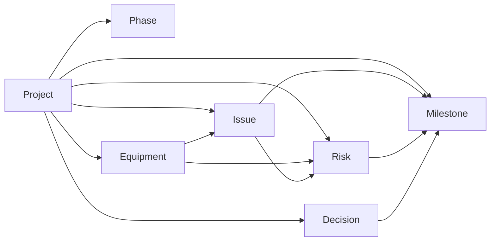

# Доменная модель (Demo v1)

Концептуальная модель для mock narrative SCN-001→SCN-007. **Не** ER, **не** схема PostgreSQL. База: [information-concepts](../01-discovery/information-concepts.md) — суженная до Must.

> **certainty:** hypothesis

## Сущности в scope

| Сущность | Ключевые атрибуты (демо) | Состояния / заметки |
|----------|--------------------------|---------------------|
| Project | id, name, baselineProductionStart, forecastProductionStart | Один проект (BA-A-001) |
| Phase | id, name, projectId | Для C-01 overview; в mock SCN-001→007 экземпляры **не обязательны** |
| Milestone | id, projectId, name, baselineDate, forecastDate, rag | MS-PS = production start |
| Equipment | id, **projectId**, name, isCritical, baselineDelivery, forecastDelivery, status | OnTrack / Delayed; projectId = логический reference ownership |
| Risk | id, projectId, title, rag, milestoneId, issueId?, equipmentId? | rag fixture; integrity vs BR-002 на B/C |
| Issue | id, projectId, title, status, ownerRole, equipmentId, milestoneId | Open / Mitigating / Closed |
| Decision | id, projectId, milestoneId?, type, ownerRole?, dueDate?, note | AcceptDateSlip / PrioritizeRecovery; **не** execution |
| OwnerRef | roleId (SH-*) | Не полный User/auth |

**Вне Demo v1 domain (явно):** Activity как самостоятельная сущность; Budget; Contractor aggregate; Document/TOP; Readiness-by-area; Change PQS-grade.

> **certainty:** assumption
>
> **R2 extensions** (Workstream read-model, Person `PER-*`, Cost measures, Notifications) — см. [DOC-BA-018](./demo-v1-r2-domain-and-controls.md). Историческая таблица выше описывает enrichment baseline; R2 не удаляет BA-015 edges.

## Phase в Demo v1

> **certainty:** assumption
>
> **Phase остаётся** в модели и C-01 как опциональный контейнер overview. Mock primary narrative **не требует** экземпляров Phase.

## Обозначение кардинальности

В таблице ниже запись `A — B` читается как связь между сущностями A и B.

| Символ | Смысл |
|--------|--------|
| `1` | Ровно один экземпляр на стороне связи |
| `0..*` | Ноль или много |
| `1..*` | Один или много |
| `\*` | Ноль или много (краткая запись) |
| `0..1` | Ноль или один |

Число **слева** от «—» относится к стороне **первой** сущности в имени связи (как правило «родитель» / владелец в формулировке строки); число **справа** — ко второй. Пример: `Project — Milestone | 1 — 1..*` = у одного Project есть один или много Milestone; каждый Milestone принадлежит одному Project.

> **certainty:** assumption
>
> Это концептуальные кардинальности Demo v1, не DDL.

## Кардинальности (Demo v1)

| Связь | Кардинальность | Примечание |
|-------|----------------|------------|
| Project — Phase | 1 — 0..\* | Phase опциональны в mock |
| Project — Milestone | 1 — 1..\* | Минимум MS-PS |
| Project — Equipment | 1 — 1..\* | Ownership: Equipment.projectId → Project |
| Project — Risk | 1 — 0..\* | |
| Project — Issue | 1 — 0..\* | |
| Project — Decision | 1 — 0..\* | |
| Equipment — Issue | 1 — 0..\* | |
| Equipment — Risk | 1 — 0..\* | |
| Issue — Risk | 0..1 — 0..1 | См. блок ниже (Demo v1 assumption) |
| Issue — Milestone | \* — 1 | |
| Risk — Milestone | \* — 1 | |
| Decision — Project | \* — 1 | |
| Decision — Milestone | \* — 0..1 | Обычно MS-PS |

> **certainty:** assumption
>
> **Issue — Risk `0..1 — 0..1`:** в концептуальной модели Demo v1 для primary narrative (ISS-001 ↔ RISK-001) допускается не более одной связи Issue↔Risk на пару в этом пути. Это **ограничение модели Demo v1**, а не универсальное бизнес-правило предприятия и не DDL. Risk.issueId? / narrative pair согласованы с этим допущением.

> **certainty:** open_question
>
> Нужны ли несколько Milestone/Equipment одновременно — вне single-driver narrative (не расширяем).

## Decision vs Issue.status

> **certainty:** hypothesis
>
> **Decision** фиксирует выбор директора (AcceptDateSlip / PrioritizeRecovery) относительно текущего Project/Milestone. Не моделирует выполнение recovery и не auto-reforecast (BR-006).  
> **Issue.status** Open / Mitigating / Closed — не путать с типом Decision. AcceptDateSlip ≠ Issue.status.

## Связи (проза)

1. Project владеет Milestones, Equipment, Risks, Issues, Decisions; опционально Phases.
2. Equipment (critical) может быть связан с Issue/Risk.
3. Issue и Risk ссылаются на Milestone MS-PS (отдельные сущности, linked).
4. Milestone.forecastDate и Project.forecastProductionStart согласованы по BR-004.
5. Decision ссылается на Project и (обычно) Milestone.

## Диаграмма

## Mapping to capabilities

| Entity | Capabilities |
|--------|----------------|
| Project, Phase | C-01 |
| Milestone | C-02, C-05 |
| Equipment | C-03 |
| Risk, Issue | C-04 |
| Decision + forecast aggregate | C-05 |
