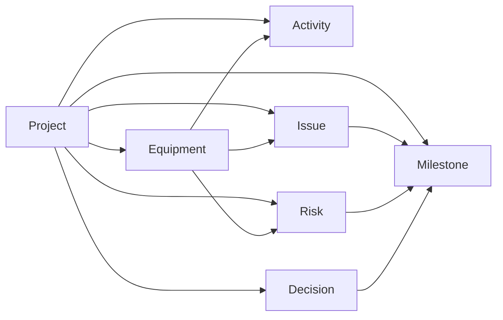

# Domain model (Demo v1)

Концептуальная модель для mock narrative SCN-001→SCN-007. **Не** ER, **не** схема PostgreSQL. База: [information-concepts](../01-discovery/information-concepts.md) — суженная до Must.

> **certainty:** hypothesis

## Сущности в scope

| Сущность | Ключевые атрибуты (демо) | Состояния / заметки |
|----------|--------------------------|---------------------|
| Project | id, name, baselineProductionStart, forecastProductionStart | Один проект (BA-A-001) |
| Phase | id, name, projectId | Опционально для overview; Equipment phase context |
| Activity | id, projectId, name, plannedStart/Finish, forecastFinish, equipmentId? | Critical path activity for EQ |
| Milestone | id, projectId, name, baselineDate, forecastDate, rag | MS-PS = production start |
| Equipment | id, name, isCritical, baselineDelivery, forecastDelivery, status | status: OnTrack / Delayed / … |
| Risk | id, projectId, title, rag, milestoneId, issueId?, equipmentId? | rag: Green/Amber/Red |
| Issue | id, projectId, title, status, ownerRole, equipmentId, milestoneId | Open / Mitigating / AcceptedSlip / Closed |
| Decision | id, projectId, type, ownerRole?, dueDate?, note | AcceptDateSlip / PrioritizeRecovery |
| OwnerRef | roleId (SH-*) | Не полный User/auth |

## Вне scope Demo v1 domain

Budget, ActualCost, Contractor-as-aggregate, Document/TOP package, ReadinessStatus-by-area (SCN-006), Change (PQS-grade).

## Связи (проза)

1. Project has Milestones, Activities, Risks, Issues, Equipment packages, Decisions.
2. Equipment (critical) links to Activity and drives Issue/Risk.
3. Issue and Risk link to Milestone MS-PS.
4. Milestone forecastDate и Project.forecastProductionStart согласованы по BR-004.
5. Decision ссылается на Project / Milestone в момент SCN-007.

## Диаграмма

## Mapping to capabilities

| Entity | Capabilities |
|--------|----------------|
| Project, Phase | C-01 |
| Milestone | C-02, C-05 |
| Equipment | C-03 |
| Risk, Issue | C-04 |
| Decision + forecast | C-05 |
