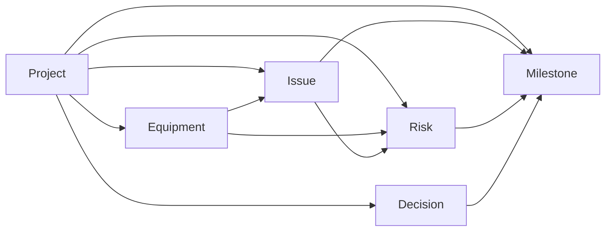

# Demo v1 enrichment — scope and model

> **certainty:** hypothesis
>
> Расширенная **та же** Demo v1 (не Demo v2). R1 applied. Не GMP/CSV claim. Не модель конкретного предприятия.

## 1. Why current Demo feels thin

Singular fixtures (1 EQ / 1 MS / 1 Issue / 1 Risk / 1 Decision / A–C) prove the causal spine but feel empty as a plant project. Enrichment = `small but believable` multi-workstream model.

**Preserve:** Live Presentation HVAC spine; BR-006 honesty; BA-015 edges; read-only Schedule; FE via API; Nest mock only.

## 2. Target scale (R1)

| Entity | Count | Rationale |
|--------|------:|-----------|
| Workstreams | **8** | Parallel readiness without WBS |
| Equipment | **23** | After MOVE OUT shell construction item |
| Milestones | **14** | Intermediate gates + MS-PS |
| Issues | **11** | Open / Mitigating / **Closed** |
| Risks | **12** | Mix Green + Red |
| Decisions | **6** | Across F/G/H; Decision ≠ recovery |
| Snapshots | **8** (A…H) | Discrete fixtures |

**Calendar:** DOC-PROD-012 (**2027**); PS baseline **2027-09-15**.  
**Spine IDs:** `PRJ-01`, `EQ-HVAC-01`, `MS-PS`, `ISS-001`, `RISK-001`, `DEC-001`.

## 3. Workstreams

| Code | RU label | Role |
|------|----------|------|
| `WS-BLD` | Здание и оболочка | Early gates (milestone-led; procured package only) |
| `WS-CLN` | Чистые помещения | Before HVAC IQ |
| `WS-HVAC` | HVAC | **Sole PS driver** |
| `WS-UTL` | Инженерные системы | PW/WFI / power |
| `WS-PRD` | Технологическое оборудование | Production train |
| `WS-PKG` | Упаковка | Recoverable story |
| `WS-QC` | Лаборатория / QC | Release readiness |
| `WS-AUT` | Автоматизация / BMS·EMS | Integration |

> **certainty:** assumption
>
> `workstream` — string enum on EQ / MS / Issue / Risk; **not** a Domain entity.

## 4. Causal stories (5)

| # | Story | Objects | Note |
|---|-------|---------|------|
| S1 | HVAC → PS | EQ-HVAC-01, ISS-001, RISK-001, MS-PS, DEC-001 | Spine; DEC only via Project/MS-PS |
| S2 | Clean-room | EQ-CLN-*, MS-CLN-RDY, RISK-CLN-01 | |
| S3 | WFI / utilities | EQ-UTL-02, ISS-UTL-01, RISK-UTL-01, MS-UTL-WFI | Own MS only |
| S4 | Packaging | EQ-PKG-01, ISS-PKG-01, RISK-PKG-01, MS-PKG-SAT | Recoverable |
| S5 | QC | EQ-QC-01, RISK-QC-01, MS-QC-RDY | |

Narrative EQ→ISS→RISK→MS→PS ≠ graph edges.

## 5. Domain / relationships (R1)

### Keep entities

Project, Equipment, Milestone, Issue, Risk, Decision.

**Owner / SH-*:** reference metadata on `ownerRole` / `owner` — **not** Owner Domain/API entity (ADAPT).

### Relationship matrix (direct)

| Edge | Allowed |
|------|---------|
| Issue → Milestone | **YES** |
| Decision → Project | **YES** |
| Decision → Milestone | **YES** (optional) |
| Decision → EQ / Issue / Risk | **NO** |
| Equipment → Milestone | **NO** |

### Read-model extensions (not Domain entities)

| Change | Why |
|--------|-----|
| Arrays in fixtures | Multi-record |
| RU `name` / `title` | Director copy |
| `workstream` field | Filters / rollup |
| Dashboard `projectStatus`, workstream rollups, `topExceptions[]`, `trend` | Director overview |
| `TopException.priority` | **Dashboard/read-model only** — curated Demo order; **not** Issue/Risk/EQ/MS Domain field |
| Issue status **Closed** | Must lifecycle |

### Explicitly NOT adding

Activity, Task, WBS, WorkPackage, Contractor, Dependency, Cost, Document, Qualification Protocol, Owner entity, `Issue.critical`, Domain `managementPriority`.

## 6. Product decisions (closed — R1)

### BR-004 — single PS driver

> **certainty:** assumption
>
> Sole Production Start driver = **EQ-HVAC-01 / RISK-001**. No `max(Δ)`, CPM, float, or dependency engine. Other workstreams may shift **their** milestones only.

### Issue lifecycle

Must statuses: **Open | Mitigating | Closed**.  
Closed effects are **fixture-authored**. Closed ≠ auto Risk Green ≠ auto MS recovery ≠ auto reforecast.

### AcceptDateSlip

Post-state = **fixture-authored**. Decision alone changes nothing. BA-OQ-004/005 closed for Demo enrichment path.

### BR-007 — state-based

If RISK-001 is Red on HVAC→PS path, MS-PS SHALL NOT be Green (any snapshot). Letters C–H are examples/tests only.

## 7. Derived status rules (backend-owned)

### Workstream rollup

- **RED:** any Risk in WS with `rag=Red`
- **YELLOW:** no Red Risk AND (Delayed critical Equipment in WS OR Issue Open|Mitigating in WS)
- **GREEN:** otherwise  
Closed Issue does not create attention. FE display-only.

### Overall project status

- **RED:** MS-PS Red OR RISK-001 Red
- **YELLOW:** not Red AND (any WS ≠ Green OR any Open|Mitigating Issue OR any Delayed critical EQ)
- **GREEN:** otherwise  
No scoring system.

## 8. Snapshot drama

| ID | Sense |
|----|--------|
| A | Baseline |
| B | Local attention |
| C | HVAC +21 (≈ current B) |
| D | Cascade CLN / HVAC IQ |
| E | Parallel pressure |
| F | Decisions recorded (≈ current C+) |
| G | Partial recovery; HVAC residual +14 |
| H | Residual honesty |

## 9. Architecture constraints

Next + Nest; mock Nest only; FE via HTTP; no PostgreSQL; discrete snapshots; atomic switch; stale rejection; Decision ≠ recovery; Schedule = EQ delivery + Milestone; no CPM/deps/drag; no Activity.

## 10. Related

DOC-PROD-021 · DOC-PROD-022 · DOC-UX-021 · `.cursor/plans/demo-v1-enrichment.md` (E1…E8)
